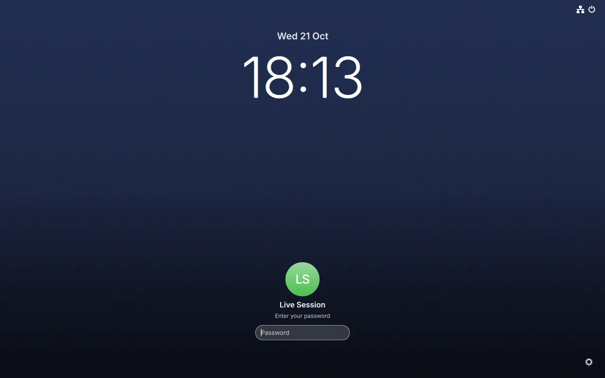
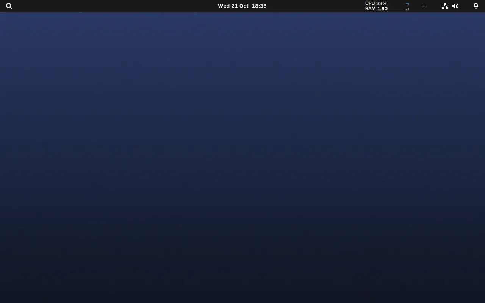
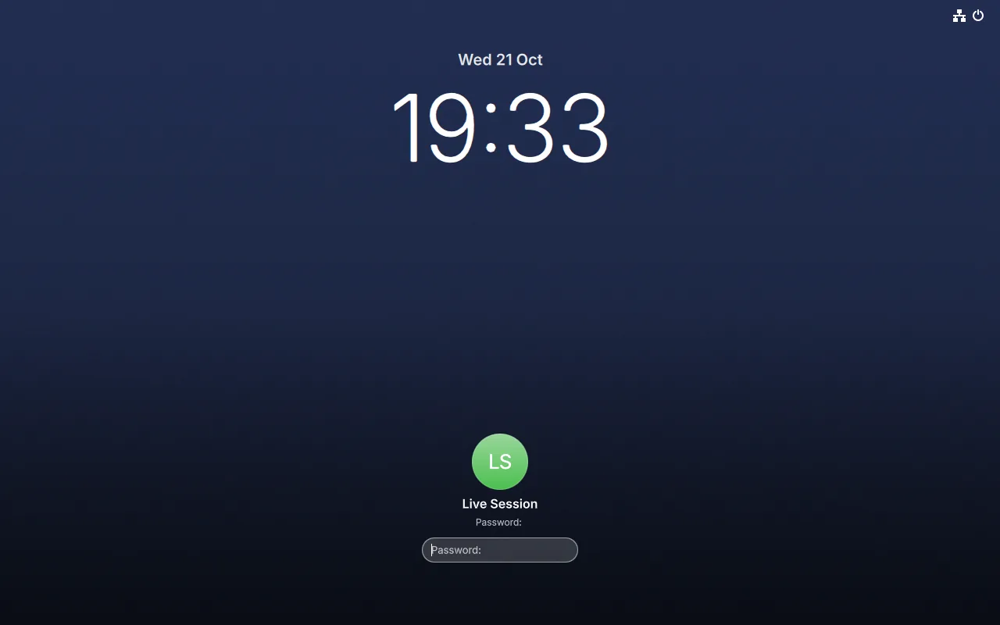

# Bingux OS

An Arch Linux based live image whose desktop is Gnoblin (compositor) and
Bingux (shell, lock screen and login screen). Everything here builds inside a
stock `archlinux` container, so the host only needs podman or docker.

```text
distro/
  build.sh              host entry point: sources, then the container build
  container-build.sh    package builds and mkarchiso inside the container
  publish-repo.sh       uploads the pacman repository to a GitHub release
  packages/             PKGBUILDs for the packages Arch does not ship
    gnoblin/            placeholder; the PKGBUILD comes from the Gnoblin release tooling
    bingux/             this repository, including bingux-shell (vendored Quickshell)
    bingux-os/          image defaults: login screen, wallpaper, skel, repository
  profile/              archiso overlay on top of the releng profile
  sources/              generated inputs (ignored)
  out/                  packages, repository and the ISO (ignored)
```

## Build

```sh
distro/build.sh --gnoblin ~/dev/gnoblin
```

- The Gnoblin checkout must contain greeter mode (`gnoblin --greeter`), which
  is on the `feat/greeter-mode` branch until it reaches Gnoblin's `main`, and
  the session-lock fixes (`a05f29ae`, `2317ff42`, `4f33ee52`): without them the
  lock screen stays black and unlocking crashes the compositor.
- Both checkouts must be committed: the Bingux archive comes from
  `scripts/make-source-archive.sh` and the Gnoblin bundle from Gnoblin's
  `scripts/build-release-assets.sh --source-only`, which archive `HEAD`.
- The container runs privileged so that `pacstrap` and `mkarchiso` can mount
  the chroot's `/proc`, `/sys` and `/dev`. Rootless podman works: the build
  script makes `arch-chroot` bind the container's `/dev` because a user
  namespace cannot mount devtmpfs.
- `--step packages` stops after the pacman repository in `distro/out/repo`;
  `--step iso` reuses it. `--step package:NAME` rebuilds one package against
  that repository, which is the quick loop for PKGBUILD changes. A step
  regenerates only the sources it uses, so `package:bingux-os` needs neither
  a clean tree nor Gnoblin.
- Do not edit `container-build.sh` while a build runs: bash reads it as it
  goes.
- Expect an hour or more the first time: Mutter and bingux-shell (Quickshell
  built into the Bingux binary) compile from source. `JOBS` limits parallelism.
- Gnoblin's source bundle applies its Mutter patch series with `git am` in
  the Gnoblin checkout, so commit signing applies to it. If the signing key
  is not unlocked, run with signing disabled for that process only:
  `GIT_CONFIG_COUNT=1 GIT_CONFIG_KEY_0=commit.gpgsign GIT_CONFIG_VALUE_0=false distro/build.sh ...`.
  A failed `git am` leaves `subprojects/mutter` in the Gnoblin checkout on
  the release tag with a staged patch; restore the pinned revision with
  `git -C subprojects/mutter reset --hard && git -C subprojects/mutter checkout <pin>`
  before the next run.
- The build stages the live root and the compile trees in the container's
  `/tmp`, several GB, which `build.sh` mounts as a 20 GB tmpfs
  (`BINGUX_BUILD_TMPFS` sets the size; `0` uses the container's disk instead,
  which needs about 10 GB free). A full disk shows as `could not extract ...
(Write failed)` from pacstrap or `Image size exceeds free space` from
  xorriso.

The image lands in `distro/out/bingux-os-<date>-x86_64.iso`.

## What the image does

The login screen, the desktop after signing in and the lock screen (from the headless
QEMU runs of the tests below):





- `greetd` is the display manager; it starts `bingux-greeter-session`, so the
  first thing on screen is the Bingux login screen on a Gnoblin greeter
  compositor. The account is `live` with password `live`, created by
  `bingux-os-firstboot.service` before greetd starts, together with its
  greeter wallpaper snapshot.
- Signing in starts a Gnoblin session with the Bingux shell and the default
  wallpaper. `gnoblinctl session lock` shows the lock screen (the password
  unlocks it) and `gnoblinctl session logout` returns to the login screen.
- The `bingux-os` package holds everything that makes this Bingux OS rather
  than Arch with two extra packages, and it is the same package the installer
  puts on disk, so the live image and an installed system do not drift apart:
  the greetd configuration, the `init.lua` in `/etc/skel` that loads
  `/usr/share/gnoblin/conf.d/*.lua` and the user's own `conf.d/`, the
  default wallpaper (generated at build time, so no picture is checked in)
  with a gsettings override that selects it, the repository configuration, and
  an install hook that enables greetd, NetworkManager and the global
  `bingux.target`.
- The Bingux OS pacman repository travels on the image in
  `/opt/bingux-os/repo`, so installing needs no network for those packages.

## Install to disk

Boot the image in UEFI mode, then:

```sh
bingux-os-install --disk /dev/nvme0n1 --user kieran
```

This erases the whole disk (it asks you to type the disk name first; `--yes`
skips that), creates a 512 MiB EFI partition and an ext4 root, installs the
base system and `bingux-os` with archinstall and systemd-boot, creates the
account with administrator rights and asks for its password (or reads
`--password-file`). The base system comes from the Arch mirrors, so the
machine needs a network connection. Other options: `--hostname`, `--timezone`,
`--locale`, `--keyboard`.

It supports UEFI only. For another layout, encryption or extra packages, run
`archinstall` yourself and add `bingux-os` to the additional packages; its
install hook does the rest.

`tests/distro-install.py` runs this end to end in QEMU: it installs onto a
blank virtual disk, inspects the result, boots the disk alone and signs in.

## Package repository

pacman reads `[bingux-os]` from `/etc/pacman.conf`, which the `bingux-os`
package adds, and the servers from `/etc/pacman.d/bingux-os-mirrorlist`. On
the live image the first server is the copy on the image; an installed system
lists the published repository only:

```text
https://github.com/kierandrewett/bingux/releases/download/pacman-x86_64
```

`distro/publish-repo.sh` creates or updates that release from
`distro/out/repo` (`--dry-run` lists what it would upload). It needs `gh`
signed in with write access, and replaces the assets on every run so the
database always matches its packages. The packages are unsigned
(`SigLevel = Optional TrustAll`): anyone who can change the release can change
what installed systems update to. Sign the packages and the database before
pointing real machines at a public repository.

To host it elsewhere, serve `distro/out/repo` over HTTPS and change the
`Server` line in `/etc/pacman.d/bingux-os-mirrorlist` (and the default in
`distro/packages/bingux-os/bingux-os-mirrorlist`).

## Tests

```sh
tests/distro-boot.py      # the live image: sign in, lock, unlock, log out
tests/distro-install.py   # install to a virtual disk, boot it, sign in
```

Both start QEMU headless (KVM when `/dev/kvm` is writable), press keys and
take screenshots through the QEMU monitor, and write their results to
`distro/out/boot-test/` and `distro/out/install-test/` (`checks.json`,
`report.txt`, PNGs). The install test needs UEFI firmware for QEMU (OVMF;
`BINGUX_DISTRO_OVMF_CODE` and `BINGUX_DISTRO_OVMF_VARS` override the paths),
the internet and about 6 GiB of temporary space. To look at the image by hand:

```sh
qemu-system-x86_64 -enable-kvm -m 4G -smp 4 \
    -device virtio-vga-gl -display gtk,gl=on \
    -cdrom distro/out/bingux-os-*.iso
```
