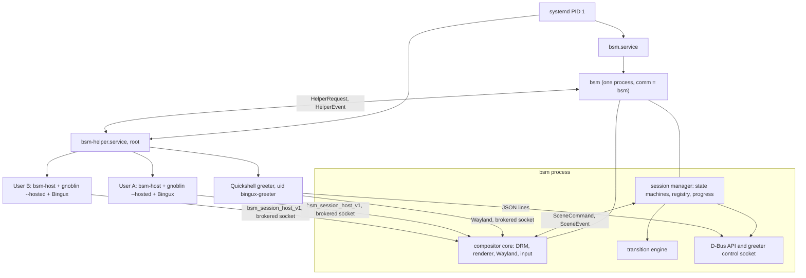
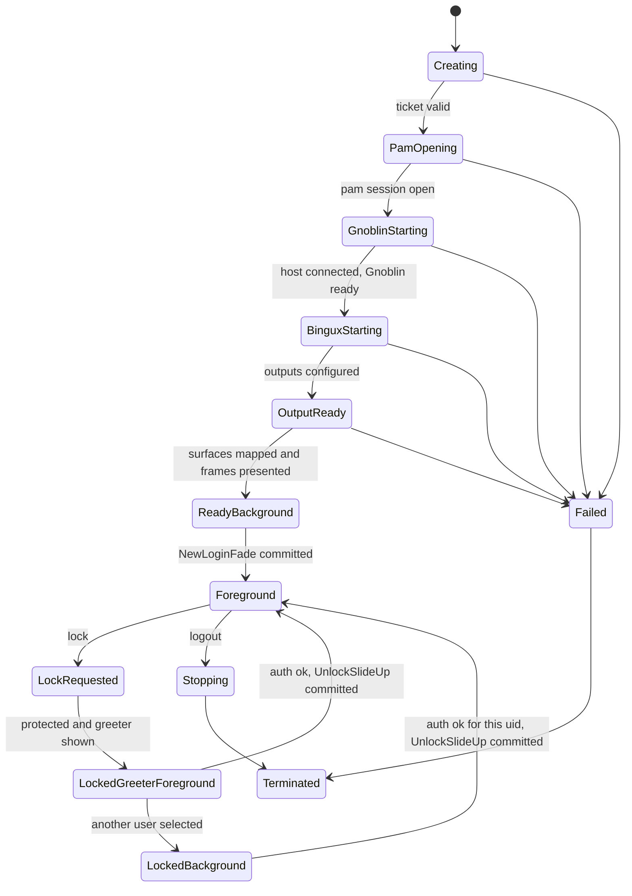

# bsm: the Bingux Session Manager

`bsm` is one persistent system process. It is the system Wayland compositor
and the session manager. It owns the display and the seat for the whole
graphical life of the machine, shows a restricted Quickshell greeter, and hosts
one nested Gnoblin per signed-in user. Gnoblin stays the window manager and
compositor inside each user's session. bsm decides which session is visible,
which one gets input, and runs every full-screen transition.

This page is the architecture decision record and the contract between the
parts. The wire types live in `packages/bsm-proto`; the private Wayland
protocol is `packages/bsm/protocol/bsm-session-host-v1.xml`. Status of each
part is in [Implementation status](#implementation-status).

## Decisions

| #   | Decision                                                                                                                                                                                       | Why, and the alternative that was rejected                                                                                                                                                                                                                  |
| --- | ---------------------------------------------------------------------------------------------------------------------------------------------------------------------------------------------- | ----------------------------------------------------------------------------------------------------------------------------------------------------------------------------------------------------------------------------------------------------------- |
| D1  | Rust and Smithay 0.7 for the compositor core.                                                                                                                                                  | Smithay gives DRM/KMS, GBM, libinput, libseat, buffer import and Wayland protocol plumbing. Writing those from scratch, or embedding Mutter as a second compositor, adds risk without benefit. Bingux already ships Rust packages.                           |
| D2  | A hosted Gnoblin is headless Mutter plus a bridge (`bsm-host`). The bridge consumes Mutter's ScreenCast virtual monitors and forwards input through RemoteDesktop/EIS. It is not a new Mutter backend. | Uses stable public Mutter D-Bus APIs (the same ones the devkit viewer uses), so no Mutter patch series growth. A custom backend inside Mutter would be more direct but is a large fork surface. Revisit only if the bridge's copy cost measures badly.       |
| D3  | `bsm` runs as the unprivileged `bsm` account with seatd access. PAM and uid changes happen in `bsm-helper`, a root service that talks to bsm over a `SOCK_SEQPACKET` socket.                    | PAM and `setuid` must not run inside a multithreaded render process. A root `bsm` would hold more power than a compositor needs. The helper is not a second session manager: it keeps no session registry and makes no policy decisions.                      |
| D4  | Hosted sessions are logind sessions without a seat (`XDG_SESSION_TYPE=wayland`, class `user`, no `XDG_SEAT`).                                                                                  | bsm owns seat0 and its devices, so no user session may call `TakeControl`. A seatless session is `Active` in logind, which keeps user managers, D-Bus and `systemd --user` working. Polkit treats it as non-local; see [logind and polkit](#logind-and-polkit). |
| D5  | The greeter control channel is a Unix socket with JSON lines, not D-Bus.                                                                                                                       | Quickshell has no generic D-Bus client but has `Quickshell.Io.Socket`. Secrets travel only on this socket. D-Bus (`org.bingux.Session1`) serves `bsmctl` and the desktop shell.                                                                               |
| D6  | Integrated mode is opt-in. Standalone Gnoblin and Bingux with `ext-session-lock-v1` and greetd stay unchanged.                                                                                 | The distro image enables bsm only with `bingux.bsm` on the kernel command line, or when the unit is enabled explicitly.                                                                                                                                       |

## Process model

* `/proc/<pid>/comm` of the compositor is `bsm`: the binary is named `bsm`
  and is exec'd directly by `bsm.service`.
* The manager and the compositor share one address space and talk through
  bounded channels. The compositor thread never waits on PAM, D-Bus or the
  helper.
* `bsm-helper` exists because PAM and uid transitions need root. It is
  socket-activated by `bsm-helper.socket` and is not started by users.
* A hosted session's processes live in a systemd scope under the user
  manager, so a Gnoblin crash ends only that session.

## Connection and role model

bsm never exposes one shared Wayland socket. It has three kinds of connection,
each created by a different path:

| Role          | How it connects                                                                                                                                                                           | Globals it sees                                                                                                                                                          |
| ------------- | ----------------------------------------------------------------------------------------------------------------------------------------------------------------------------------------- | ------------------------------------------------------------------------------------------------------------------------------------------------------------------------ |
| `GREETER`     | `/run/bsm/greeter-wayland.sock`, mode 0660, group `bingux-greeter`. On accept bsm checks uid is the greeter account and pid equals the process `bsm-helper` launched for this generation. | `wl_compositor`, `wl_shm`, `wl_seat`, `wl_output`, `xdg_output`, `zwlr_layer_shell_v1`, `wp_viewporter`, `wp_fractional_scale`, `linux-dmabuf`, `wp_presentation`.        |
| `HOSTED_USER` | A per-generation socket `/run/bsm/sessions/<id>-<generation>.sock` (random name, mode 0666). On accept bsm checks uid, the pid reported by the helper (`SO_PEERPIDFD` where available) and the systemd scope in `/proc/<pid>/cgroup`; `/proc/<pid>/exe` is checked only when readable. Single use. | `wl_compositor`, `wl_shm`, `linux-dmabuf`, `wl_seat`, `wl_output`, `bsm_session_host_v1`.                                                                                |
| none          | Any other peer is closed before the Wayland handshake. Clients cannot name their own role or uid.                                                                                          | none                                                                                                                                                                     |

No role sees `ext-session-lock`, screencopy, output management,
`wlr-data-control`, virtual keyboard or foreign-toplevel globals. Role-specific
globals use Smithay's global filtering. A test connects as each role and
compares the registry with the table above.

A same-uid process can read the bridge's `/proc/<pid>/environ`. It still fails
the pid check and the socket is single use. bsm holds no capabilities, so it cannot
read another uid's `/proc/<pid>/exe`; that check is best effort. The remaining trust
boundary is "this uid's processes affect this uid's own session surface", which
is no wider than what that user can already do.

Apps inside a hosted session connect only to the Gnoblin socket of their own
session. Clipboard, portals, PipeWire and input methods stay session-local.

## Security invariants

1. At most one principal owns physical input per seat (`InputOwner`).
2. An unauthenticated account chooser can reveal nothing: selecting a user changes
   the greeter's appearance only.
3. A session is protected (`Protect`, acknowledged by a rendered frame) before any
   other principal gets input or pixels.
4. Authentication success is single use and bound to uid, intent, session and
   generation. It never reveals a desktop by itself: bsm runs a gated transition.
5. Stale or out-of-order readiness, progress and PAM callbacks (wrong generation or
   not the next stage) change nothing.
6. A greeter crash cannot unlock anything: sessions stay protected and the compositor
   shows an opaque cover until a greeter reconnects.
7. A hosted Gnoblin crash ends that session only; bsm returns to the greeter.
8. On failure the compositor shows the opaque cover and the greeter, never the last
   desktop buffer.
9. bsm restart does not reopen user sessions as foreground. Recovery reconciles
   running sessions with logind and brings them back protected; the user
   authenticates to resume.

## Session state machine

The manager is the only writer. States are `SessionState`, `SeatState` and
`TransitionState` in `bsm-proto::state`.

Rules the implementation enforces:

* Selected account, last-used account, foreground session, protected sessions and
  authentication target are separate fields. A mid-flight change of the selected
  account cancels the challenge and never retargets it.
* An existing running session for the account is resumed, not relaunched. If an
  account has several, the most recently foreground one is chosen (deterministic;
  multiple sessions per uid are not supported yet).
* Only one transition runs at a time. Lock, power, suspend and logout may interrupt
  a transition before `Committed`; the compositor rolls back to the authorised
  scene or the cover.

## Startup protocol and the reveal gate

A new login has a unique `generation`. Milestones are `bsm_proto::progress::Stage`
and each has one owner and one kind of evidence:

| Stage               | Owner                   | Evidence                                                                                                                                    |
| ------------------- | ----------------------- | ------------------------------------------------------------------------------------------------------------------------------------------- |
| `AuthAccepted`      | `bsm-helper`            | `AuthDone{ok}` with a ticket that `OpenSession` redeemed.                                                                                   |
| `PamSession`        | `bsm-helper`            | `SessionOpened` after `pam_open_session`, scope exists, `XDG_RUNTIME_DIR` exists.                                                           |
| `HostConnected`     | compositor              | The bridge connected to the brokered socket and passed uid, scope, exe and pid checks (`SessionConnected`).                                 |
| `GnoblinReady`      | bridge, then validated  | `report(gnoblin_ready)`. The bridge sends it only after Gnoblin's runtime handshake (guardian `READY` and the session bus name) completed.   |
| `OutputsConfigured` | bridge, bsm validates   | One `report(output_configured)` per bsm output and an acked `configure` for the same outputs. Counted: n of m.                              |
| `BinguxLaunched`    | bridge                  | `report(bingux_launched)`, sent when the wallpaper and shell units report started.                                                          |
| `SurfacesMapped`    | bridge, from Gnoblin    | `report(surfaces_mapped, output, mapped, required)` per output, computed from Gnoblin's layer-surface list for the required namespaces.      |
| `DesktopReady`      | bsm                     | `SurfaceEvidence.presented_frames >= 1` on every required output after the ack **and** the bridge's `report(desktop_ready)` that arrived before that frame. |
| `ReadyToReveal`     | manager                 | All above, generation current, outputs unchanged since `OutputsConfigured`, then `SessionState::ReadyBackground`.                           |

`Startup.settled` in Bingux is not used as evidence: it can become true on a timer.
The Bingux side reports readiness through a socket the bridge owns
(`$XDG_RUNTIME_DIR/bsm/ready.sock`, JSON lines
`{"generation":"…","event":"launched|surface|ready", …}`). The bridge accepts
it only from the session's uid, ignores a generation it did not start with, and
cross-checks `surface` events against Gnoblin's layer-surface list. A
required surface is the wallpaper and the top bar and dock named in the current
Bingux configuration. Popouts and other helpers are optional and never
block the reveal.

Progress shown by the greeter is `ProgressModel::fraction()`: reached stages
count fully, counted stages count `done/total`, unknown-duration stages leave
the bar still and show an activity treatment and the stage label. A failed stage
stops the bar and the greeter offers Retry, Back to accounts and a power menu.
A failure timeout per stage (default 60 s, `GnoblinReady` 90 s) is policy in the
manager and ends in `Failed`, not an endless wait.

## Transitions

bsm renders every full-screen transition from a monotonic frame clock. QML
never animates the outer scene. The engine is `bsm::transitions`; its timeline
math (`trajectory(kind, t)`) is pure, so tests assert exact opacity and offset
curves and a headless renderer dumps frames.

| Operation       | Scene during the animation                                                                                         | Animated value                                                 | Default           |
| --------------- | ------------------------------------------------------------------------------------------------------------------ | -------------------------------------------------------------- | ----------------- |
| New login       | Greeter composed full opacity underneath; ready desktop above it.                                                  | Desktop opacity 0 to 1, ease-out cubic.                        | 420 ms            |
| Unlock / switch back | Existing desktop composed underneath, fully opaque; the whole greeter scene above it.                         | Greeter scene translation `y` 0 to `-output height`, on every output together, ease `cubic-bezier(0.22, 1, 0.36, 1)`. | 520 ms |
| Lock            | Protect first (desktop leaves outputs and capture, input revoked, frame acknowledged), then greeter above cover.   | Greeter opacity 0 to 1 over the opaque cover.                  | 240 ms            |
| Log out         | Greeter already ready underneath; leaving session above it.                                                        | Session opacity 1 to 0, ease-in-out.                           | 320 ms            |
| Reboot/power off | Fullscreen cover on every output.                                                                                 | Cover opacity 0 to 1, then held; kept until the system stops.  | 360 ms            |
| Suspend         | Protect all, ready the lock scene, then sleep.                                                                     | As Lock.                                                       | 200 ms            |

Common rules: reduced motion collapses the duration to one frame but runs the
same checks; the source and target are validated before the first frame and on
each frame; if either disappears the compositor restores the cover plus
greeter; input moves at `Committed` and the keystrokes that authenticated are not
delivered to the revealed desktop because the greeter keeps keyboard focus until
the first valid desktop frame has been presented.

## Appearance publishing

bsm is the source of truth for what the greeter shows before login.

* Accounts come from AccountsService, with an NSS passwd fallback; system and hidden
  accounts are excluded by policy (`/etc/bsm/bsm.toml`, defaults documented in the
  packaging).
* The user's Bingux shell publishes a whitelisted appearance record
  (`color_scheme`, `accent`, `clock_format`, `reduce_motion`) with the avatar and
  wallpaper as source image file descriptors over the `PublishAppearance` D-Bus
  method; the caller's uid is taken from the bus, never from the message. bsm never
  opens a path a user supplies, and it needs no capability to read a user's home.
* bsm runs the sandboxed `bsm-imgconv` child as its own uid (no network, seccomp,
  rlimits, size and decode caps) on those descriptors to produce resized copies under
  `/var/lib/bingux/greeter/<uid>/` through write-to-temp and `rename`. The greeter
  receives paths to these copies only.
* Existing wallpaper snapshots from `bingux-session export` remain valid; bsm adopts
  and revisions them instead of creating a second wallpaper source.
* Opt-out is `show_personal_images = false` per account. The cache copies are readable
  by the greeter account, which is a privacy trade-off and is documented for users.

## Power and session actions

`SessionPower.qml` in integrated mode calls `bsmctl` (D-Bus
`org.bingux.Session1`) and renders confirmation dialogs only. bsm returns an operation
id and emits `Requested`, `Authorising`, `Preparing`, `Animating`, `Committed` and a
final `Failed`, `Cancelled` or `Completed`, with an error code on failure.
Reboot and power off call `org.freedesktop.login1.Manager` from bsm after the cover is
committed and after inhibitor and polkit checks. Denial or failure removes the cover
and returns to the authorised scene. Suspend protects all sessions first and resumes on
the greeter.

Authorisation: a session user may lock, log out and switch from their own session;
reboot and power off follow polkit (`org.freedesktop.login1.reboot*`); the
greeter account without a session may reboot and power off only when policy allows;
nobody can act on another uid's session. The caller's session is found from the D-Bus
peer pid and its cgroup, never from an argument.

## logind and polkit

This section records what the target system does. Results are filled in from the QEMU
runs; claims marked "unverified" have not been measured yet.

* bsm owns seat0 through seatd and holds all DRM and input devices. No hosted
  Gnoblin requests device control.
* A hosted session is a logind session with no seat, class `user`, type `wayland`.
  `Active=yes` for such sessions (`session_is_active` is true without a seat).
  Unverified in QEMU: `loginctl show-session` output for both users.
* Polkit sees these sessions as not local. Rules for the actions that need
  "active local" (storage mounting, NetworkManager, colord and similar) are shipped in
  `bsm.rules`; which actions are covered is verified per action, and the rest stays
  denied and documented.
* `LockedHint` is set by bsm on the matching logind session through the helper, so
  the logind view and bsm's view agree.
* Audio and USB device ACLs normally follow the active seat session through
  `uaccess`. Seatless sessions do not get seat ACLs. The image gives hosted users the
  `audio`, `video` groups explicitly (unverified: PipeWire, cameras).
* Idle inhibitors and `systemd-inhibit` locks taken inside a hosted session count
  towards the power-action check in bsm.

## Runtime modes

| Mode                   | Backend                                                          | Use                                                              |
| ---------------------- | ---------------------------------------------------------------- | ---------------------------------------------------------------- |
| `bsm --backend drm`    | seatd, DRM/KMS, GBM, libinput.                                   | The installed system, started by `bsm.service`.                  |
| `bsm --backend winit`  | A window in an existing Wayland desktop.                         | Development under a running desktop.                             |
| `bsm --backend headless` | Pixman renderer into memory, a fake output set, PNG frame dump. | Automated tests and the deterministic frame harness.             |

Production builds contain no mock login. The test-only authentication backend is
compiled only with the `test-auth` cargo feature and the packages never enable it.

## Migration map

| Existing                                                    | Fate          | Notes                                                                                                                                |
| ----------------------------------------------------------- | ------------- | ------------------------------------------------------------------------------------------------------------------------------------ |
| `shell/bingux/LockScreen.qml`, `LockTheme.qml`              | Refactored    | Visuals move to `shell/bingux/auth/` (`AuthScreen`, `AuthCard`, ...); the standalone lock window is a thin wrapper over them.        |
| `LockShell.qml`, `LockAuthentication.qml`, `WlSessionLock`  | Retained      | Standalone fallback without bsm, unchanged contract (`docs/locking.md`).                                                             |
| `SessionScreen`, `bingux-greeter` for greetd                | Retained      | Standalone greetd path stays; the bsm greeter is a new entry point `shell/bingux/greeter/GreeterShell.qml`.                          |
| `SessionPower.qml`                                          | Refactored    | In integrated mode: no `gnoblinctl`, no `bingux-session-fade` overlay; calls `bsmctl`. Standalone path unchanged.                    |
| `Startup.qml` `settled`                                     | Retained, not reused | Keeps scheduling background helpers. Never used as readiness evidence.                                                        |
| `bingux-session` (accounts, wallpaper export)               | Reused        | Account listing and wallpaper snapshot code are shared with bsm's appearance publisher.                                              |
| `packaging/gnoblin/bingux.lua`                              | Extended      | Emits the Bingux readiness events; `Super+L` runs `bsmctl lock` when `BSM_SESSION_ID` is set.                                        |
| Gnoblin `--devkit` viewer path                              | Retained      | Unchanged. Hosted mode is `gnoblin --hosted`, a separate flag.                                                                       |
| Gnoblin guardian `READY`                                    | Extended      | Reported to the bridge; means "serves session-local clients", not "Bingux painted".                                                  |
| Gnoblin `ext-session-lock-v1`                               | Retained      | Standalone lock path. In hosted mode the in-session lock request is forwarded to bsm instead.                                        |
| greetd                                                      | Retained      | Remains the default display manager. bsm replaces it only when enabled.                                                              |
| (none)                                                      | New           | `packages/bsm` (`bsm`, `bsmctl`), `packages/bsm-helper`, `packages/bsm-host`, `packages/bsm-proto`.                                  |

## Rollback and recovery

* Package install does not enable bsm. The image enables it with `bingux.bsm` on the
  kernel command line; removing the option boots greetd again.
* `systemctl disable --now bsm.service && systemctl enable greetd.service` restores
  greetd. A root TTY (`Ctrl+Alt+F3`) stays available because bsm releases no VT
  policy: the DRM backend honours seatd VT switching.
* If bsm fails to start, `OnFailure=` starts greetd (`bsm-fallback.service`).
  Logs: `journalctl -u bsm -u bsm-helper`.

## Implementation status

The table is updated with each milestone. Values: implemented and tested,
implemented but unverified, blocked, not yet implemented.

| Milestone                           | Status                  | Evidence |
| ----------------------------------- | ----------------------- | -------- |
| Contract crate `bsm-proto`          | implemented and tested  | `cargo test` in `packages/bsm-proto` |
| Private protocol XML                | implemented but unverified | parses with `xmllint`; server and client code pending |
| Everything else                     | not yet implemented     |          |
