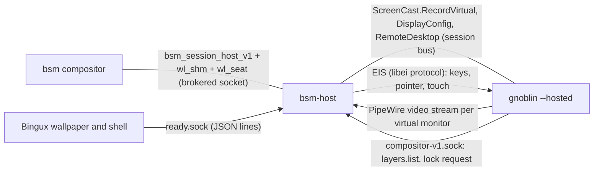

# bsm-host: the hosted-session bridge

`bsm-host` (installed at `/usr/libexec/bsm/bsm-host`) is decision D2 of
[architecture.md](architecture.md). It runs as the user, inside the session
scope, next to `gnoblin --hosted`. It connects Gnoblin to bsm:



It is a bridge, not a Mutter backend: it uses the same public Mutter D-Bus APIs
as any screen-sharing client, so the Mutter patch series does not grow.

## Launch contract

The helper starts, as the session user inside the scope, with a session D-Bus:

1. `pipewire` and `wireplumber` come from the user manager (`systemd --user`
   socket activation), not from the helper. PipeWire cannot link a capture stream
   to Mutter's virtual-monitor node without a session manager; without
   WirePlumber the stream stays `Paused` forever. The bridge retries the
   PipeWire connection for up to 60 s; Gnoblin's Mutter itself needs PipeWire
   when the first virtual monitor is recorded.
2. `gnoblin --hosted --wayland-display NAME` (leader).
3. `bsm-host`. The session ends when either the leader or the bridge exits.

`bsm-host` may start before Gnoblin: it waits up to 120 s for Gnoblin's
services. Environment:

| Variable                   | Required | Meaning                                                                                                      |
| -------------------------- | -------- | ------------------------------------------------------------------------------------------------------------ |
| `BSM_HOST_SOCKET`          | yes      | Path of the brokered bsm socket. Given only to the bridge, never to Gnoblin or apps.                         |
| `XDG_RUNTIME_DIR`          | yes      | The session's runtime directory. `bsm/ready.sock` is created in it, PipeWire and Gnoblin sockets are found there. |
| `DBUS_SESSION_BUS_ADDRESS` | yes      | The session bus of the hosted Gnoblin.                                                                        |
| `BSM_SESSION_ID`           | no       | Checked against bsm's `identity` event; a mismatch is logged and bsm's value wins.                           |
| `BSM_GENERATION`           | no       | Same. The generation used in every report is the one from `identity`.                                        |
| `BSM_OUTPUT_HINTS`         | no       | `"WxH,WxH"` from `OpenSession.output_hints`. Accepted and ignored: outputs come from bsm's `output_added` events. |
| `GNOBLIN_COMPOSITOR_SOCKET`| no       | Override of `$XDG_RUNTIME_DIR/gnoblin/compositor-v1.sock`.                                                   |
| `BSMCTL`                   | no       | Path of `bsmctl` (default: `bsmctl` from `PATH`).                                                            |
| `BSM_HOST_RECOVERY_SECS`   | no       | How long to keep reconnecting after bsm went away (default 120; `--recovery-window SECS` overrides). |
| `BSM_HOST_READY_PEERS`     | no       | Comma list of executable names allowed on `ready.sock` (default `quickshell,qs,bingux,bingux-wallpaper`; `*` allows all, used by the tests). |
| `BSM_HOST_READY_IDLE_SECS` | no       | A `ready.sock` connection that sends no valid line in this time is closed (default 10). |
| `BSM_HOST_HANDSHAKE_SECS`  | no       | How long the registry roundtrip of a reconnect may take before the attempt is abandoned (default 10). |
| `RUST_LOG`                 | no       | `info` by default. `debug` logs reports, ready lines and frame statistics every 5 s.                         |

Option: `--background-fps N` (default 10): frame rate while the session is not
receiving input.

The bridge talks to a user-level Gnoblin only; it needs no privilege. Run it
with `Restart=no` semantics: any exit means the session is over or unusable and
bsm cleans up.

### Exit status

| Status | Meaning                                                                                          |
| ------ | ------------------------------------------------------------------------------------------------ |
| 0      | bsm sent `closed`, or the bridge received SIGTERM/SIGINT. `ready.sock` is removed.               |
| 1      | Internal error (for example buffers could not be allocated).                                     |
| 2      | Usage error: missing `BSM_HOST_SOCKET`, `XDG_RUNTIME_DIR` or the bus address, bad argument.      |
| 3      | The connection to bsm was lost and bsm did not come back within the recovery window (default 120 s). |
| 4      | Gnoblin is lost: Mutter or `org.gnoblin.Hosted1` vanished, a stream ended or failed, the EIS connection closed, Gnoblin closed the RemoteDesktop session, a virtual monitor could not be created or laid out, or Gnoblin did not appear in 120 s. |
| 5      | After a reconnect bsm announced another session id or generation than before.                    |

## What the bridge does

### Towards bsm (Wayland)

* Binds `wl_compositor`, `wl_shm`, `wl_seat`, every `wl_output` and
  `bsm_session_host_v1`. The protocol bindings are generated at build time from
  `bsm/core/protocol/bsm-session-host-v1.xml` (the single source of truth).
* For each `output_added` it creates a `wl_surface`, calls `get_session_surface`
  and creates a matching Gnoblin virtual monitor (below). It acknowledges every
  `configure` as soon as it arrives, then commits a state-only commit
  (opaque region, no buffer). **No buffer is ever attached before the ack.**
  The buffer size is the configure size; `output_added`'s width and height are
  not used for buffers.
* `output_changed` with a new position, scale or transform re-applies the layout
  in place. A configure with a new size rebuilds the virtual monitors (see
  [limitations](#limitations)). `output_removed` destroys the surface and
  rebuilds the remaining monitors.
* Frames are `wl_shm` XRGB8888, 4 slots per output. A slot is written only after
  the compositor released it. The newest committed slot is pinned so the frame
  can be presented again (see `desktop_ready`). Damage comes from PipeWire's
  `VideoDamage` metadata; the damage of frames that were dropped (throttling, no
  free slot) is accumulated into the next forwarded frame, so a dropped frame
  never leaves a stale region on screen.
* The bridge never asks for `wl_surface.frame` callbacks and does not depend on
  `presented` events for flow control: the compositor may not send either to a
  background session. Backpressure is slot availability.
* `input_state`: while inactive, no keyboard, pointer or touch event is
  forwarded and the frame rate drops to `--background-fps` (see
  [Background](#background-throttling)). On the transition to inactive every held key,
  button and touch point is released inside Gnoblin.
* `closed` ends the bridge with status 0.
* **bsm restart (review F9).** When the connection to bsm fails (EOF, reset, a
  protocol error) the bridge does not exit. Gnoblin and the apps keep running
  (the capture streams keep draining, their frames are dropped), input is
  released and revoked, the Wayland objects of the dead connection are
  forgotten, and the bridge reconnects to the **same** `BSM_HOST_SOCKET` path with
  exponential backoff (100 ms doubling to 2 s) for the recovery window. On
  reconnect it binds the globals again and the normal handshake runs: `identity`
  must carry the same session id and generation (otherwise exit 5), every
  announced output gets a new surface and configure/ack, and the last frame of
  each output is presented again on the new surface (acked first), so bsm sees
  a frame without Gnoblin repainting. Virtual monitors are **not** rebuilt when
  the outputs are unchanged: an output with the same size keeps its monitor; a
  changed position or scale is re-applied in place; a changed size or a
  vanished output rebuilds the monitors as usual, and an output that bsm does
  not announce again after its first burst of events (a Wayland sync marks the
  end) is treated as removed. The whole readiness state for the generation is
  reported again (`gnoblin_ready`, `bingux_launched`, then per output
  `output_configured` and `surfaces_mapped` as each output is acknowledged, and
  `desktop_ready` when everything is back). `closed` after a reconnect still ends
  the bridge with status 0. If Gnoblin is gone while bsm is away the bridge
  exits 4 as usual.
* The cursor: Mutter delivers the pointer image as stream metadata
  (`cursor-mode` 2). On `wl_pointer.enter` and whenever the image changes, the
  bridge calls `wl_pointer.set_cursor` with an ARGB8888 buffer built from it
  (or no surface when Gnoblin hides the cursor). Exactly one cursor is on
  screen: bsm's.

### Towards Gnoblin (session bus)

* `org.gnome.Mutter.RemoteDesktop.CreateSession`, then
  `org.gnome.Mutter.ScreenCast.CreateSession` linked to it
  (`remote-desktop-session-id`), so EIS absolute devices get one region per
  virtual monitor. `ConnectToEIS` is called before the session starts.
* One `RecordVirtual` (cursor mode: metadata) per bsm output. The stream's
  PipeWire node id arrives in `PipeWireStreamAdded`. The first monitor starts
  the session (`RemoteDesktop.Start`); monitors added later need
  `ScreenCast.Stream.Start`. Monitors are created one at a time because the
  bridge assigns each newly appeared `Meta-N` connector to the monitor it just
  created.
* **The virtual monitor's mode is set by PipeWire negotiation.** The bridge offers
  exactly one size (the configure size) and caps `maxFramerate` at the bsm
  output's refresh rate; Mutter uses both for the monitor's mode.
* `org.gnome.Mutter.DisplayConfig.ApplyMonitorsConfig` (temporary method) after
  the stream is streaming: scale (the closest scale Mutter supports for the
  mode; a different value is logged), position and transform. Mutter accepts
  only layouts that start at the origin, do not overlap and where every
  monitor touches another by an edge. The bridge shifts bsm's layout to the
  origin and, if it is still not valid (a gap, an overlap, a diagonal
  neighbour), packs the monitors left to right in bsm's x order. Gnoblin's
  layout is therefore not guaranteed to equal bsm's global layout; bsm routes
  input to a surface per output, so pointer mapping stays exact.
* `org.gnoblin.Hosted1.Ready` (property, with `PropertiesChanged`) is the
  runtime handshake: it becomes `gnoblin_ready`. Loss of the name after it was
  seen ends the bridge with status 4. `ActionRequested(s)` is matched on
  interface and path with any sender (it comes from Gnoblin's Lua worker).
* `$XDG_RUNTIME_DIR/gnoblin/compositor-v1.sock` (JSON lines, API 1.81): the
  bridge subscribes to `gnoblin.layer.*`, `gnoblin.monitor.*` and
  `gnoblin.session.lock-requested`, and polls `layers.list` (a plain list of
  records with `namespace`, `monitor_id` = connector, `mapped`) on every
  change and every 2 s. The socket may appear after the bridge; it reconnects
  every 250 ms.
* Session actions from inside the session are forwarded to bsm through
  `bsmctl <action>`, which identifies the caller by its cgroup:
  `ActionRequested` with `logout`, `reboot`, `poweroff`, `suspend`, and
  `gnoblin.session.lock-requested` as `lock`. `hibernate` has no bsm
  equivalent and is ignored (logged).

### PipeWire

The bridge consumes each stream in one PipeWire thread. Negotiation is
deliberate:

* Formats offered: `BGRx` and `BGRA` (both are bytes B, G, R, X/A in memory,
  which is `wl_shm` XRGB8888; alpha is ignored because the surface is declared
  opaque). Size fixed to the configure size. Nothing else is accepted.
* Buffer types: `MemFd` and `MemPtr`. **DMA-BUF is not offered**, so Mutter
  never negotiates it; the copy path below is the only path. A DMA-BUF path
  (linux-dmabuf import, no CPU copy) is future work and needs bsm's compositor
  to offer `zwp_linux_dmabuf_v1` to hosted sessions, which it does.
* Metadata requested: header, `VideoDamage` (16 rectangles), cursor (up to
  384x384).
* The stream is created with `node.dont-fallback` and `node.dont-reconnect`:
  it links to the node Mutter named, waiting for it if necessary, and never to
  another video source (without this WirePlumber attached a new monitor's
  stream to a stale monitor of a stopped session).
* Each frame is copied row by row from the PipeWire buffer into a free slot
  (one `memcpy` of the frame when strides match) and a message goes to the main
  thread, which attaches, damages and commits. A buffer with a zero-size chunk
  (Mutter's cursor-only update) carries no picture: it is neither forwarded nor
  allowed to replace a withheld picture. If no slot is free the frame is kept
  and retried on the next 20 ms tick; a withheld frame is forwarded just before
  PipeWire frees its buffer (renegotiation).

### Input (EIS)

Input arrives from bsm as ordinary `wl_seat` events on the bridge's connection
and is forwarded to Gnoblin through an EIS connection obtained from
`RemoteDesktop.ConnectToEIS` (`reis` client, sender context).

* Keyboard: `wl_keyboard.key` evdev codes become `ei_keyboard.key`. **bsm's
  keymap is not applied**: Gnoblin interprets the codes with its own keymap, so
  both must use the same layout (configured in the user's Gnoblin settings).
  Key repeat is done by Mutter inside the session (a held key repeats; tested).
* Pointer: `enter`/`motion` give surface-local coordinates in the output's
  logical space; the bridge adds the origin of the EIS region that matches the
  monitor's rectangle in Gnoblin's layout (matched by geometry, within 1.5 px;
  with a single region that region is used) and sends `motion_absolute`.
  Buttons, smooth scroll (`axis`), 120ths scroll (`axis_value120`, preferred
  over smooth when both arrive in a frame) and `axis_stop` are forwarded.
* Touch: `down`/`motion`/`up` map to `ei_touchscreen` the same way.
* Events are batched with `ei_device.frame` and flushed immediately. Devices
  that appear after the session started (Mutter creates the absolute pointer and
  touch devices when the first monitor streams) are bound and resumed as they
  arrive.
* Nothing is forwarded while `input_state` is 0. On the active-to-inactive
  transition, on keyboard `leave` and on touch `cancel`, everything still held
  is released.

### Readiness reports

Reports use the generation string from bsm's `identity` event. Stale lines are
ignored. The rules are implemented in `readiness.rs`, a pure state machine
with unit tests.

Reports go through a small queue (review F6): a report identical to the last one
sent for the same kind and output is dropped, and at most 20 reports per second
(burst 20) are sent; when the budget is exhausted only the newest report of
each kind and output is kept and sent as soon as budget returns (100 ms timer).
Nothing is sent while bsm is away.

| Report              | Sent when                                                                                                                                                                  |
| ------------------- | -------------------------------------------------------------------------------------------------------------------------------------------------------------------------- |
| `gnoblin_ready`     | Once, when `org.gnoblin.Hosted1.Ready` is true.                                                                                                                            |
| `output_configured` | Once per output, after `gnoblin_ready`, the virtual monitor exists and streams, DisplayConfig was applied and the configure is acknowledged. `a` = outputs configured, `b` = outputs known. |
| `bingux_launched`   | Once, when every required component has sent `launched`.                                                                                                                  |
| `surfaces_mapped`   | Per output whenever (mapped, required) changes, from `bingux_launched` on. A role counts as mapped only when Bingux says so **and** Gnoblin's `layers.list` shows a mapped layer surface with the role's namespace on that output's monitor. |
| `desktop_ready`     | Once, when every required component sent `ready`, every required surface is confirmed on every output and every output is configured. A frame is presented again right after the report, so bsm sees a frame that follows it. |

Required roles (review F13): they do **not** come from the reporter. The
baseline is the wallpaper, the bar and, unless the user's configuration has
`[desktop] dock = false` (`~/.config/bingux/bingux.toml`, read at start), the
dock; each must exist on at least one output. Per output the wallpaper is
always required, and the bar or dock is required there when Bingux declared it
with a `surface` line **or** Gnoblin's layer list shows a surface with its
namespace on that output (mapped or not). A reporter can therefore only add
requirements, never remove one: it cannot hide a surface Gnoblin already holds.
Bingux draws the bar and dock on one monitor only, so a second monitor with
just a wallpaper reports `surfaces_mapped` 1 of 1. The `required` field and a
`component` other than `wallpaper` or `desktop` (including none) are ignored, and a
component cannot claim another's role (the wallpaper reporter cannot send a
`bar` surface). Declared surfaces are still confirmed in Gnoblin's layer list.
Unit-tested; the two-output VM run is the real check.

Roles and namespaces: `wallpaper` = `bingux-wallpaper`, `bar` =
`bingux-top-bar`, `dock` = `bingux-dock`.

### `ready.sock`

`$XDG_RUNTIME_DIR/bsm/ready.sock`, `SOCK_STREAM`. The directory is mode 0700, the
socket 0600, and a connection is accepted only when `SO_PEERCRED` shows the
session's own uid **and**, best effort, a process that looks like the Bingux
shell: the peer's executable name or `comm` (read from `/proc/<pid>`, pid from
`SO_PEERCRED`) must be one of `quickshell`, `qs`, `bingux`, `bingux-wallpaper`
(unreadable `/proc` is accepted). That keeps stray same-uid helpers from
weakening the reveal gate by accident; it is **not** a security boundary, since
any process of the uid can run a binary with such a name (the compositor still
requires acknowledged, presented frames). At most 16 connections; one that sends
no valid line within 10 s is closed so idle connections cannot starve the real
reporters. One JSON object per line, at most
4096 bytes; a longer line or invalid JSON closes that connection and nothing
else. The bridge creates it at startup, before Gnoblin starts Bingux.

```json
{"generation":"7","component":"wallpaper","event":"launched"}
{"generation":"7","component":"desktop","event":"launched","required":["bar","dock"]}
{"generation":"7","component":"desktop","event":"surface","output":"Meta-0","role":"bar","mapped":true}
{"generation":"7","component":"wallpaper","event":"ready"}
```

* `generation`: `BSM_GENERATION`. Any other value is counted and ignored.
* `component`: `wallpaper` or `desktop`. Both must send `launched` and `ready`.
  Anything else is rejected. Roles: wallpaper component = `wallpaper`; desktop
  component = `bar`, `dock`. `required` on `launched` is parsed and ignored.
* `output` is the `wl_output` name Bingux sees, which is the Gnoblin connector
  (`Meta-N`). The bridge also accepts the bsm output name.
* `surface` with `mapped:false` after a `ready` withdraws that component's
  `ready`. Duplicate lines are idempotent; a restarted process re-sends them.
  Popouts never report and never block anything.

## Background throttling

When `input_state` is 0 the session keeps running and keeps serving its
applications; only the frame forwarding is reduced. The frame gate lets one
frame through per `1 / --background-fps` seconds and withholds the newest
frame in between. The withheld frame is forwarded when the interval expires
(trailing edge, 20 ms timer), so the last state is never lost to throttling. The
PipeWire stream itself is not paused: pausing it would stop Mutter's frame
clock and therefore every client's frame callbacks. Becoming active passes the
next frame immediately.

## Fixed race: `gnoblin_ready` before `identity`

A 30-run loop of the rebuild test against the staged Gnoblin caught one failure
with the stand-in's text `stale generation  in report ... kind: 1, generation: ""`:
when Gnoblin was ready before bsm's `identity` event was dispatched, the bridge
sent `gnoblin_ready` with an empty generation, and the identity handler then
replaced the readiness state, losing what it had learned. Now nothing is sent
before the identity; the identity handler keeps the known facts (Gnoblin ready,
outputs) and reports them with the real generation. Regression test:
`gnoblin_ready_before_bsms_identity_is_reported_once_with_the_real_generation`
(a stand-in that delays `identity` by 1.5 s; it fails without the fix).

## Failure modes

| Situation                                           | Behaviour                                                                                                |
| --------------------------------------------------- | -------------------------------------------------------------------------------------------------------- |
| bsm closes or crashes                               | The session is kept and the bridge reconnects for up to 120 s (see above), then status 3. `closed`: status 0. |
| Gnoblin or Mutter exits                             | D-Bus name loss, EIS EOF or PipeWire stream end: status 4 within about a second.                         |
| Stream negotiates another size than configured      | Status 4 (the buffer would not match what bsm expects).                                                  |
| Monitor creation or layout fails                    | Status 4, reason in the log.                                                                             |
| Frames stop while Gnoblin is alive                  | Not detected by the bridge (an idle desktop sends no frames). bsm judges readiness by frames it receives. |
| `ready.sock` junk, wrong uid, wrong generation      | That connection or line is dropped; other readiness traffic is unaffected.                               |
| A compositor that releases buffers slowly           | Frames are dropped when all slots are busy (`no_slot` in the stats); their damage carries to the next frame. |
| No layer list (Gnoblin's socket missing)            | `surfaces_mapped` stays at `0 of n`: the bridge never confirms a surface on Bingux's word alone.         |

## Test mode

`--test-pattern` exists only when built with `--features test-pattern` (the
packages never enable it). It skips Gnoblin, D-Bus, PipeWire and EIS, presents
a generated pattern (`bridge/testing.rs`), pretends every role is mapped in
Gnoblin's list and takes the Bingux lines from `ready.sock` or, with
`--test-auto-ready-ms N`, generates them. `--test-input-log PATH` appends every
forwarded input event as a JSON line. This lets BsmCompositor and BsmManager
exercise the protocol without Gnoblin.

## Tests and evidence

```
cd bsm/host
export CARGO_TARGET_DIR=/tmp/bsm-target/bsm-host LIBCLANG_PATH=/usr/lib64
cargo test --features test-pattern
```

* Unit tests: readiness rules, `ready.sock` framing, frame gate, damage
  accumulation, layout planning, layer-list parsing.
* `tests/protocol.rs` (feature `test-pattern`): the bridge against
  `tests/support/standin.rs`, a small `wayland-server` stand-in for bsm. It
  checks no buffer before the ack, report order and counts, stale generations,
  socket mode, oversized lines, input gating and release-on-revoke, background
  rate, resize, clean close, the lost-connection exit status, surviving a bsm
  restart (same generation, state reported again, input revoked until `input_state`),
  outputs that changed during the outage, a changed generation, the `ready.sock`
  peer policy and idle close.
* `tests/hosted.rs`: the real bridge against a private hosted session (own
  runtime dir, own session bus, PipeWire, WirePlumber, no system bus, private
  `HOME`): either stock headless Mutter plus a `org.gnoblin.Hosted1` stub, or the
  real hosted Gnoblin. It proves: real frames arrive as `wl_shm` buffers, a
  click lands on the exact pixel in a client, typed keys reach a terminal only
  while active, a held key repeats, two outputs with different scales become two
  monitors at the requested positions, resize and removal rebuild the monitors,
  a compositor crash gives status 4, Gnoblin actions are forwarded to `bsmctl`,
  the cursor image arrives, a bsm restart keeps the session, client and monitor (the
  monitor is created once), and `desktop_ready` waits for Gnoblin's own layer
  list (layer clients are built from Gnoblin's `tests/hosted-layer-client.c`).
  Tests skip with a message when a tool is missing.

Run against the staged hosted Gnoblin (the script runs everything in a private
user and mount namespace, nothing on the host changes):

```
/home/kieran/dev/gnoblin-bsm-wt/scripts/run-staged.sh /usr/local/lib/gnoblin /tmp/gnoblin-bsm/stage \
  env BSM_TEST_GNOBLIN=/usr/local/lib/gnoblin/bin/gnoblin \
      BSM_TEST_GNOBLIN_SRC=/home/kieran/dev/gnoblin-bsm-wt \
      BSM_HOST_EVIDENCE_DIR=/tmp/bsm-host-evidence \
  <path of the built hosted test binary> --test-threads=1
```

`BSM_HOST_EVIDENCE_DIR` makes the tests write the frames the stand-in received
as PNGs. Two from the real Gnoblin run are kept in `docs/bsm/images/`:
`bridge-real-gnoblin-click.png` (a `weston-clickdot` window in the hosted
session; the crosshair is where the stand-in clicked, delivered through EIS)
and `bridge-real-gnoblin-layers.png` (Gnoblin's wallpaper, top bar and dock
layer surfaces).

### Measured cost of the shared-memory path

`cargo test --release --test hosted measure_costs -- --ignored --nocapture`
(optional `BSM_BENCH_SIZE=3840x2160`) runs `weston-simple-shm` (a client that
redraws every frame) in a hosted session and measures the bridge's CPU time over
10 s with and without input. The numbers below were taken on the development
machine with stock Mutter 49.7, 1920x1080 at 60 Hz, **while the machine was
under a load average of about 38** (other builds were running), so they
overstate the cost; the in-test baseline (the same 8 MB copy between two plain
memory blocks) took 5.75 ms there, and 1 to 2 ms on an idle machine of this
class:

| Phase                  | Frames forwarded | Bridge CPU (one core) | CPU per forwarded frame | Compositor CPU |
| ---------------------- | ---------------- | --------------------- | ----------------------- | -------------- |
| background (10 fps)    | 9.4 /s           | 2.3 %                 | 2.5 ms                  | 18.8 %         |
| foreground (input on)  | 20.7 /s          | 4.3 %                 | 2.1 ms                  | 15.1 %         |

Bridge RSS: 112 MiB (4 slots of 8 MiB plus PipeWire's own buffers). The
foreground rate is limited by the loaded machine and by the stand-in's polling
release (2 ms), not by the bridge; `no_slot` drops showed up for that reason. The cost
per forwarded frame is one `memcpy` of the frame plus the message hop; at 4K it
scales with the pixel count (about 4x). The remaining per-frame cost is in
Mutter (readback into the PipeWire buffer), which is the price of D2; a
DMA-BUF path would remove both copies and is the first optimisation to make if
`measure_costs` shows the copy mattering on real hardware.

## Building

`cargo build --release` in `bsm/host` (edition 2024, standalone
`Cargo.lock`). The `pipewire` crate generates bindings with `bindgen`, so it
needs `libclang` and the PipeWire and SPA headers (`pipewire-devel`,
`clang`). On a machine where `LIBCLANG_PATH` points at an embedded toolchain,
set `LIBCLANG_PATH=/usr/lib64` (Fedora) or the distribution's libclang
directory. Runtime libraries: `libpipewire-0.3`. EIS uses the pure-Rust `reis`
crate, so `libei` is not linked.

## Limitations

Stated plainly so nobody assumes more than was verified:

* **No DMA-BUF path.** Every frame is copied once on the CPU.
* Mutter sends a frame when the picture changes. The first frame normally
  arrives when the stream starts. A session that never produces a frame
  never gets one presented, so it never reaches the reveal gate; bsm's stage
  timeout reports it. (Once, under a load average above 50, a test saw no first
  frame within 30 s; it did not repeat in 8 further runs.)
* **Mutter cannot remove one virtual monitor.** An output removal or a size
  change of any output recreates every virtual monitor (new RemoteDesktop and
  ScreenCast sessions, new EIS connection); windows move to the remaining
  monitors while that happens. Position, scale and transform changes apply in
  place.
* Applying a layout after Bingux's surfaces exist can migrate them
  (Gnoblin observed one bar move between monitors). The layout is applied as
  soon as each monitor streams, before `output_configured`, which is the
  earliest the bridge can.
* `transform` is passed to DisplayConfig only; rotated outputs were not tested.
* Fractional scales are snapped to what Mutter supports for the mode; the
  monitor logical size follows. Scale 2 was tested; 1.25 and 1.5 were not.
* Scroll, touch and `axis_stop` forwarding are implemented and covered by the
  protocol-level input log, but were not exercised against a real client in the
  hosted session (pointer buttons, motion and keys were).
* The keymap of bsm is ignored (see Input).
* One bridge serves one session. After a reconnect the same socket path is used again; bsm must re-arm the registration (BsmManager and BsmCompositor do).
* bsm-restart recovery is verified against the stand-in compositor and a real hosted Mutter session (frames, the same client, input and no monitor rebuild); it is not verified with the real bsm in a VM. A bsm that accepts the connection but never answers is abandoned after 10 s (`BSM_HOST_HANDSHAKE_SECS`) and retried (tested with a peer that never answers).
* Not verified in a QEMU image or with the real bsm compositor: the bridge was
  tested against its own stand-in and the real hosted Gnoblin. The stand-in
  follows the protocol text, not bsm's implementation.
