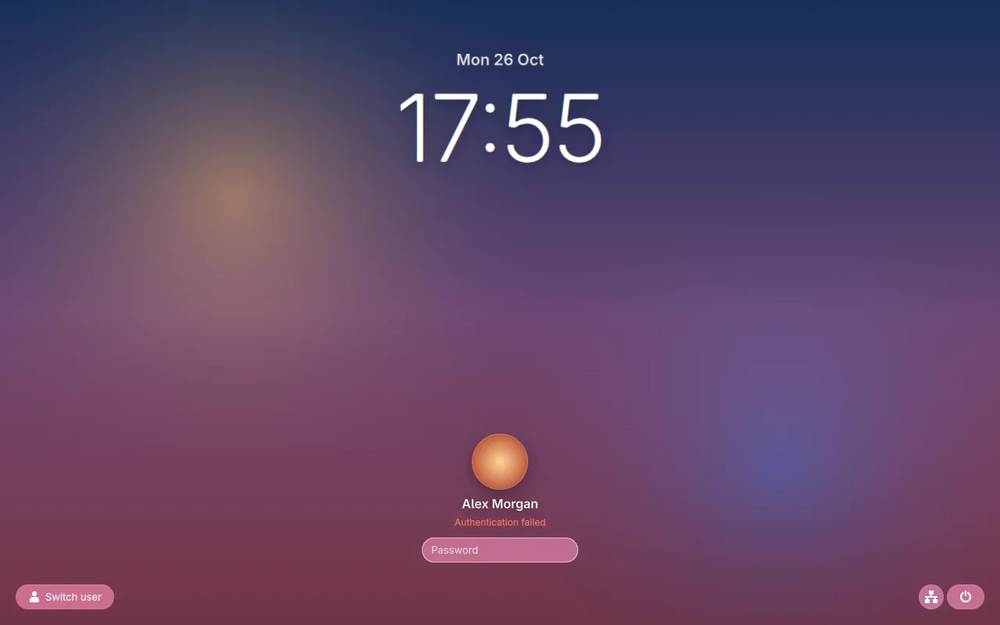
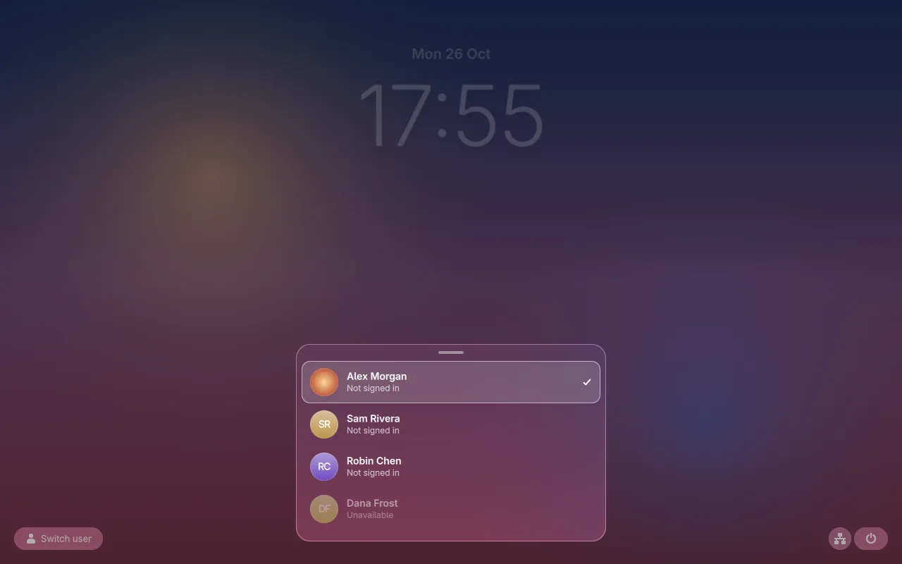
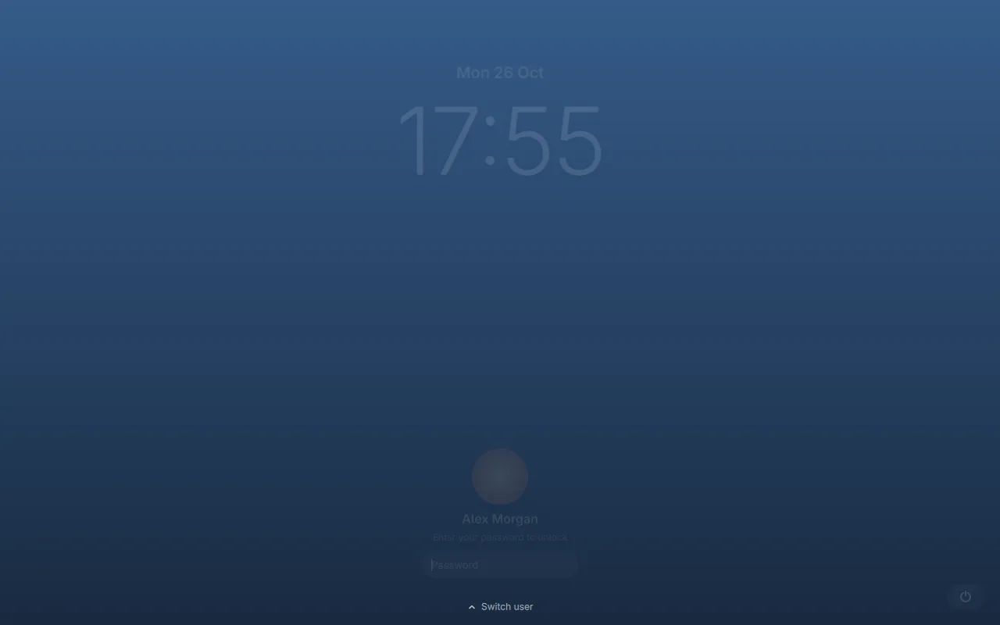
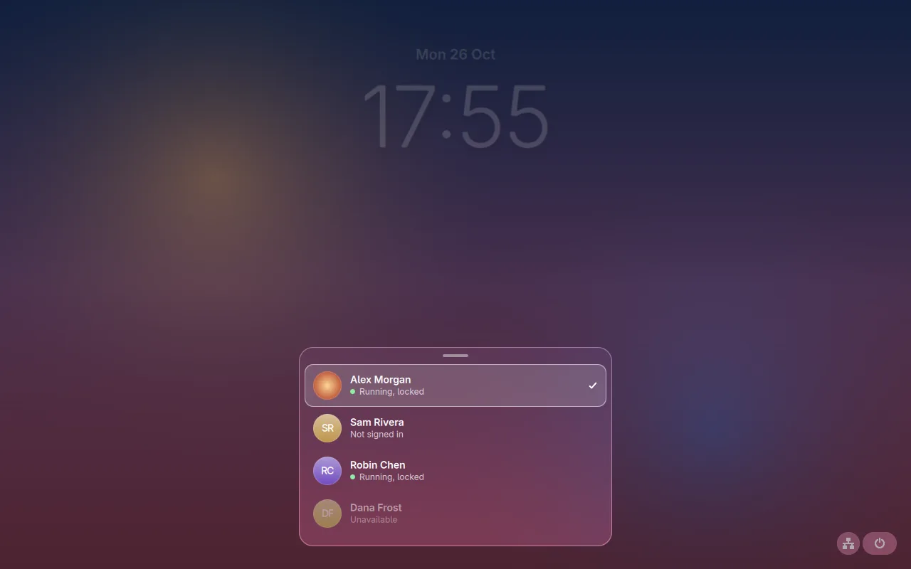
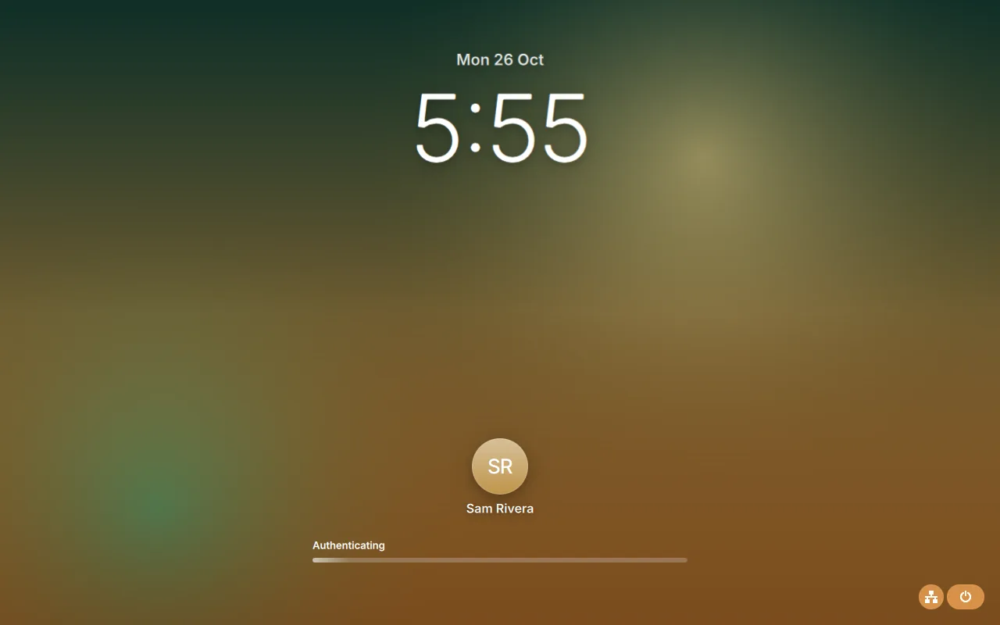
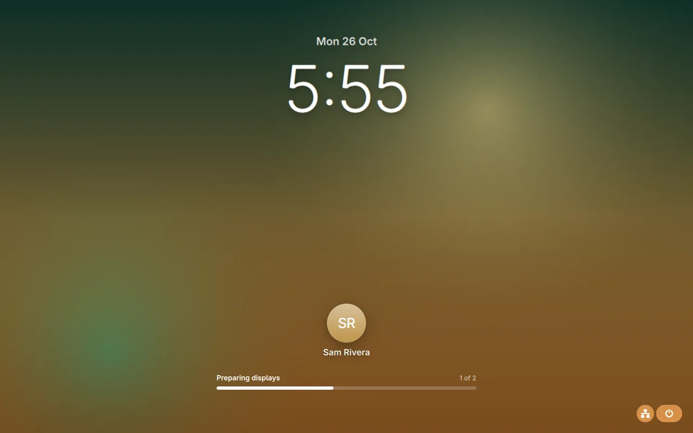
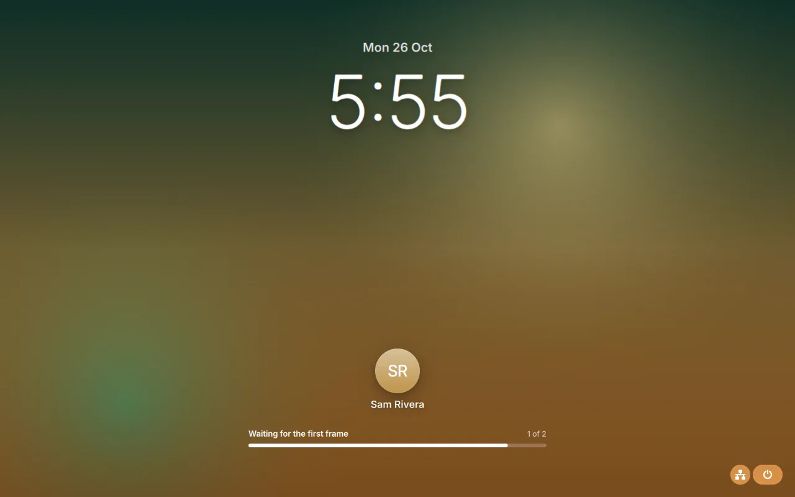
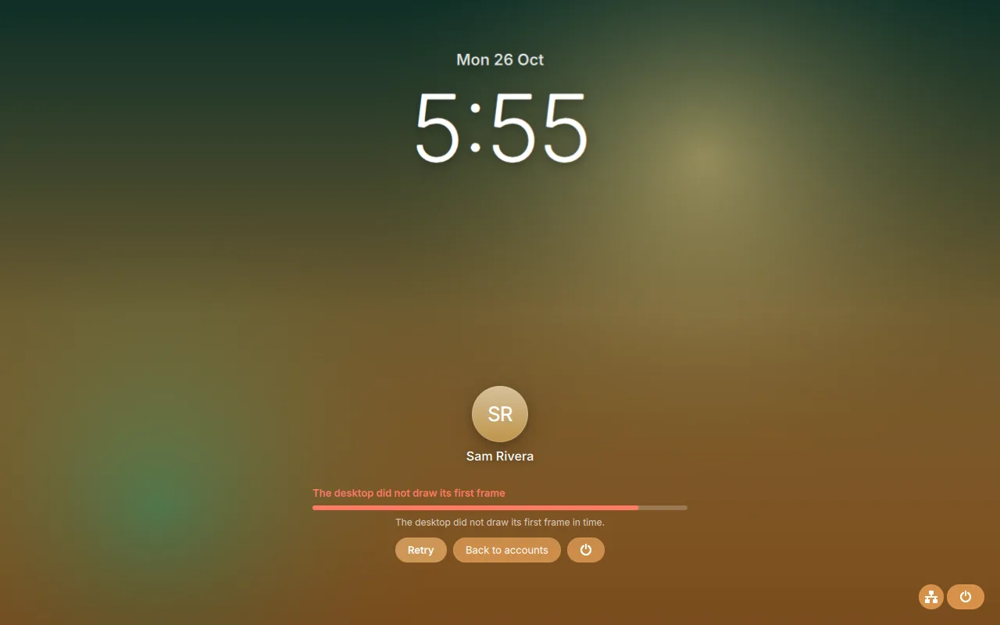
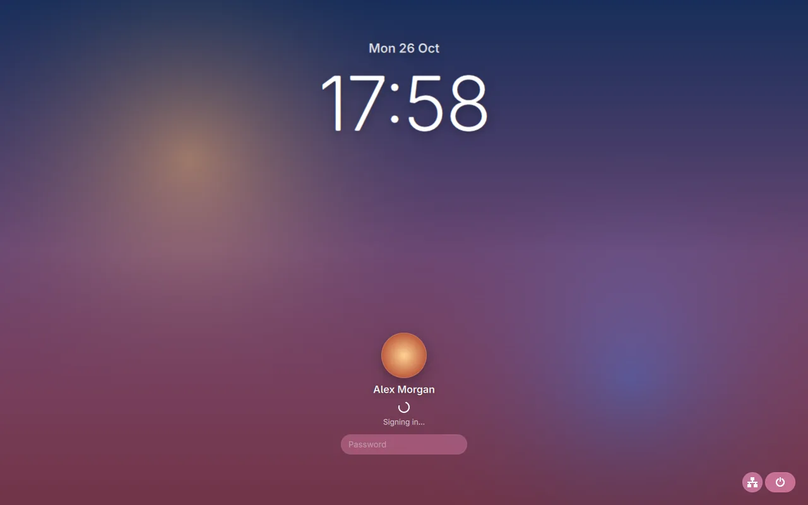
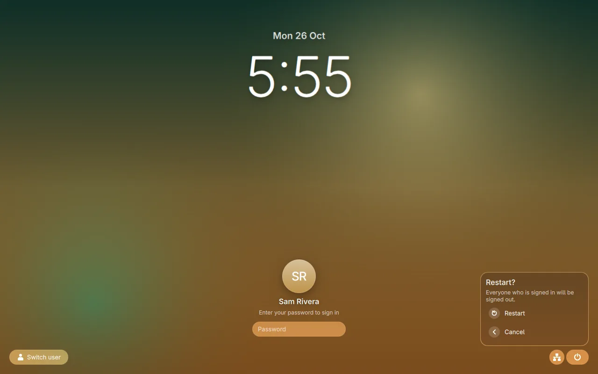

# The bsm greeter

The bsm greeter is one Quickshell program that bsm shows at boot, after a
logout, while a session is starting and whenever a session is locked. It is
the login screen and the lock screen in one, and it is not Gnoblin: it runs as
the restricted `bingux-greeter` account, connects to bsm's greeter socket as a
layer-shell client and talks to bsm over the control socket. It never loads
anything a user supplied.

bsm owns everything outside the greeter's own pixels. When a new session is
ready, bsm fades it in over the greeter. When a locked session is unlocked,
bsm slides the whole greeter up and off the screen. The greeter itself never
animates those hand-overs: after a correct password it shows a quiet
"Signing in" state and keeps its last frame until bsm covers or moves it. See
[the architecture record](architecture.md) for the transitions and the
control protocol (`packages/bsm-proto/src/control.rs`).

The greeter is opt-in with bsm. The standalone lock screen (`ext-session-lock`,
PAM) and the greetd login screen are unchanged; see [locking](../locking.md)
and [the login screen](../login-screen.md).

## What it shows

### Login

At boot the greeter shows the account bsm names as selected, normally the last
one used: its wallpaper, picture, display name, the clock, a password field, a
switch-user button and the power and network controls.


A rejected password shakes the field, shows the reason in red and starts the
next attempt at once. Whatever PAM asks next appears as the field's label:
`Password`, `One-time code` and so on. Secret answers are never echoed; a
visible prompt (such as a code) is.



### Choosing an account

Switch user opens the account list from the bottom edge. Each row states the
real state of that account's session, as bsm reports it:

| Label             | Meaning                                          |
| ----------------- | ------------------------------------------------ |
| `Not signed in`   | No session. Signing in starts a new one.         |
| `Starting`        | A session is starting. It cannot be chosen yet.  |
| `Running, locked` | A session is running. Signing in resumes it.     |
| `Running`         | The session is the foreground one.               |
| `Unavailable`     | The account cannot sign in. The row is disabled. |



Choosing a row changes only what the greeter shows: the wallpaper cross-fades,
the accent, clock format and colour scheme follow the account, and the field
and any half-typed answer are cleared. It never starts or reveals a session.
The next password prompt is for the chosen account. With accounts but none
selected, the list is the whole screen.

### Locked

When a session is locked, the same greeter shows that session owner's unlock
form. The account list is not shown by default; a small `Switch user` handle
at the bottom edge opens it, and so does swiping up from the bottom edge.



The list shows every account with its session state. Choosing another account
shows that account's sign-in form; `Back to <name>` returns to the session
owner.



### Starting a session

After a correct password for an account with no session, the greeter stays on
screen and shows the startup progress that bsm reports. The bar shows the
weighted fraction of the stages that have actually been reached
(`packages/bsm-proto/src/progress.rs`); a stage that counts outputs or
surfaces shows `n of m`. The fill eases between those confirmed values and
never moves on its own.

While the stage in progress has no counts, the fill holds still and a soft
pulse at its leading edge shows that work is going on. That pulse is an
activity cue, not progress.





If a stage fails, the bar stops and turns red, and the greeter says what
failed. `Retry` signs in again (bsm asks for the password again; nothing is
kept), `Back to accounts` returns to the account list and the power button
opens the power menu.



An account whose session is already running is resumed, not started, so it
shows no progress bar. After the password the greeter shows `Signing in...`
until bsm moves it away.



### Power and network

The power button opens Suspend, Restart and Shut Down. Restart and Shut Down
ask for confirmation. The greeter only sends the request; bsm decides whether
the greeter may do it and the screen shows bsm's answer: `Restarting...`, a
`Cancel` button while the request can still be cancelled, or the reason it was
refused.



The network icon next to it is read-only: wired, Wi-Fi or offline, from
NetworkManager's `nmcli`. It is hidden when NetworkManager is not installed.
The greeter cannot join a network.

## Keyboard, pointer, touch and accessibility

* Tab moves between the field, Switch user, the network status and the power
  button. Return activates a focused button.
* In the account list: Up, Down, Home and End move, Return or Space chooses,
  Escape closes. The list opens with the current account selected.
* Mouse and touch: tap a row to choose, tap outside the list or drag its
  handle down to close it, flick a long list. On the locked screen, swipe up
  from the bottom edge to open the list.
* Rows carry their state in their accessible name (for example `Alex Morgan,
  Running, locked`). The status line, progress bar (with its percentage and
  failure message), clock and network icon are exposed to assistive
  technology.
* Reduced motion (the account's published setting, bsm's global one, or
  `BINGUX_REDUCED_MOTION`) collapses every greeter animation to one frame. On
  software rendering the blur is replaced by flat tints, as on the lock screen.

## What the greeter trusts

* Appearance fields come from bsm and are validated: the colour scheme must be
  `dark` or `light`, the accent must be `#rrggbb`, the clock `12h` or `24h`.
  Anything else falls back to the default. Nothing is evaluated.
* Wallpapers and pictures are loaded only from the greeter cache directory
  (`/var/lib/bingux/greeter`; `BSM_GREETER_CACHE` overrides it for testing).
  A path outside it, with `..`, or for an account that opted out of personal
  images shows the neutral tint instead.
* A message that does not belong to the current account, request, challenge or
  launch is dropped: snapshots older than the one shown, prompts and results
  of another conversation, progress of another launch. Broken or oversized
  lines are dropped.
* An answer leaves the field once, inside `auth_response`. The greeter keeps no
  copy and never logs one.
* If bsm goes away, the greeter clears the form, shows `Waiting for the session
  manager` and reconnects. bsm keeps every desktop covered meanwhile.

## What it sends

| When                                           | Message                                                  |
| ---------------------------------------------- | -------------------------------------------------------- |
| connected                                      | `hello` with the protocol version                        |
| an account is chosen                           | `select_user` (appearance only)                          |
| bsm confirms the selection, or the screen opens | `begin_auth` with the intent below                      |
| an account changes during a conversation       | `cancel_auth` for the old challenge                      |
| a password or code is entered                  | `auth_response`                                          |
| the power menu                                 | `power`; `cancel_operation` while it is cancellable      |

The intent of `begin_auth` is `unlock` for the session owner on the locked
screen, `switch` for any other account on the locked screen or for an account
that already has a session, and `login` otherwise. An account that is
`starting` or `unavailable` gets no conversation.

## Shared components

The standalone lock screen and the greeter draw with the same components in
`shell/bingux/auth/`:

| Component         | What it is                                                                       |
| ----------------- | -------------------------------------------------------------------------------- |
| `AuthScreen`      | The layout: wallpaper, clock, account card, corners and the slots a host fills.  |
| `AuthCard`        | Picture, name, status line, response field and retry link.                       |
| `AuthClock`       | Date and time in the account's clock format.                                     |
| `BackgroundView`  | Wallpaper with a cross-fade between accounts and a tint when there is none.      |
| `UserAvatar`      | The round picture, or a monogram.                                                |
| `AccountPicker`   | The account list with session states and slide-up reveal.                        |
| `AuthProgress`    | Startup progress and the failure actions.                                        |
| `AuthTheme`       | The whitelisted appearance: scheme, accent, clock format and reduced motion.     |

`shell/bingux/SessionScreen.qml` is now a thin adapter from the standalone
lock's authentication object to these components; the session bar, the volume
OSD and the exit motion stay there. `shell/bingux/greeter/` holds what only the
greeter has: `BsmGreeterModel`, `BsmAuthClient`, `BsmGreeterScreen`,
`BsmPowerMenu` and `BsmNetworkIndicator`. The entry file is
`shell/bingux/BsmGreeterShell.qml`, at the shell root rather than in
`greeter/`, because Quickshell resolves imports only inside the folder of its
entry file.

Not changed on purpose: one latent fault of the old lock screen is fixed on
the way. With a 12 hour clock it showed `15:45` because Qt's `h` field is a
12 hour field only next to an AM/PM marker; the clock now shows `3:45`.

## Running it

An installed system runs `bingux-bsm-greeter` (from `scripts/bingux-bsm-greeter`),
which unpacks the shell archive next to `bingux-shell` and runs
`BsmGreeterShell.qml`. bsm-helper starts it as the greeter account with
`WAYLAND_DISPLAY` set to bsm's greeter socket and `BSM_CONTROL_SOCKET` to the
control socket.

### Trying it without bsm

`tests/bsm-fake-control.py` is a small server that speaks the real control
protocol. It serves four accounts, a password (`secret`), a one-time code for
Sam (`123456`), scripted startup progress, power operations and failures, and
generates wallpapers and a picture to show.

The greeter covers the screen with exclusive keyboard focus, so do not run it
on your own desktop. Run it in a window instead, with a nested compositor:

```sh
WLR_BACKENDS=wayland sway          # a window on your desktop
# in a terminal inside that window:
mkdir -p /tmp/bsm-fake
python3 tests/bsm-fake-control.py --socket /tmp/bsm-fake/control.sock \
    --driver /tmp/bsm-fake/driver.sock --assets /tmp/bsm-fake/assets \
    --mode login --auto &
BSM_CONTROL_SOCKET=/tmp/bsm-fake/control.sock BSM_GREETER_CACHE=/tmp/bsm-fake/assets \
    build/bingux-shell/quickshell/src/bingux-shell -p shell/bingux/BsmGreeterShell.qml
```

`--auto` moves the startup progress on a short timer after a login; without it
the stages move only when the driver socket says so (`reach`, `count`, `fail`,
`mode`, `drop`; see the script's header). `--mode unlock` starts on the locked
screen of Alex's session, `--no-pictures` shows the opt-out look and
`--deny-power` makes bsm refuse power requests.

### Tests

* `tests/bsm-greeter-ui.py` runs the greeter against the fake server in
  headless Sway and saves a screenshot of every state (login, rejected
  password, account list, appearance change, one-time code, progress at several
  confirmed milestones, failure and retry, power menu, locked unlock, switch
  and sign-in) to `build/bsm-greeter-shots`. It checks what the greeter sent,
  that the bar's width follows the model, and that no secret reaches the
  greeter's output or the server's log. `BSM_GREETER_RENDER=gpu` renders blur
  and motion, as in the screenshots above.
* `tests/bsm-greeter-client.test.py` feeds the client stale, hostile and
  malformed messages without a socket.
* `tests/bsm-greeter-progress.test.py` keeps the greeter's progress arithmetic
  equal to `bsm-proto`'s.
* `tests/shell-archive.py` also runs the installed wrapper from a staged
  install.
* `tests/lock-ui.py` is the standalone lock's harness; it passes unchanged
  after the refactor.

### Not covered

The headless Sway session has no pointer, so clicking, tapping and swiping are
not driven by the tests; the keyboard paths are. The greeter has been run only
against the fake server; no run against the real `bsm` is recorded here.
