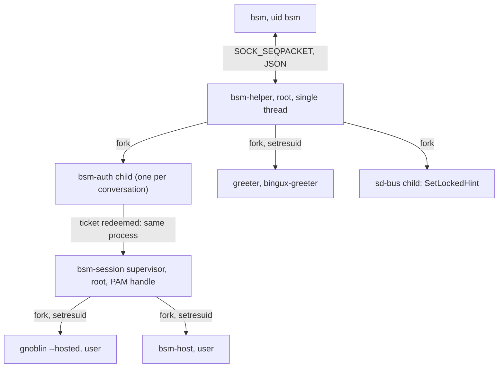

# bsm-helper: the privileged PAM and session helper

`bsm-helper` is the only root part of bsm. It authenticates users through PAM,
opens their sessions as their uid, starts the hosted desktop and the greeter,
and stops them again. The compositor and session manager (`bsm`, account
`bsm`, no capabilities) ask it to do these things over a socket and keep every
policy decision for themselves: the helper keeps no session registry, decides
nothing about who may see what, and refuses only requests that could never be
legitimate (see [Refusals](#refusals)).

Code: `packages/bsm-helper`. Wire types: `packages/bsm-proto/src/helper.rs`.
Architecture decisions D3 and D4: [architecture.md](architecture.md).

## Status

| Area                                                        | State                                                                                                                                                  |
| ----------------------------------------------------------- | ------------------------------------------------------------------------------------------------------------------------------------------------------ |
| Socket, peer check, datagram limits                         | Implemented. Tested unprivileged (`tests/auth_protocol.rs`, `tests/socket_activation.rs`) and as root in the image (`tests/bsm-helper-root.sh`, passed).   |
| PAM conversation (prompts, abort, timeouts, supersede)      | Implemented. Tested unprivileged against the real libpam through a test service directory, and against the image's real `system-auth` stack as root.       |
| Tickets (single use, bound to uid, intent, generation, TTL) | Implemented. Unit and protocol tests.                                                                                                                  |
| Session start, PAM lifetime, termination, adoption          | Implemented. Tested unprivileged with real processes, and as root in the image with `pam_systemd`, a real scope and `setresuid` (all checks passed).       |
| Greeter launch                                              | Implemented. Same split; the root run covers identity, capabilities and private directories.                                                           |
| `SetLockedHint` through logind                              | Implemented with libsystemd's sd-bus. Verified as root in the image: logind reports `LockedHint=yes` then `no`.                                         |
| Real hosted Gnoblin as the leader                           | Not run here: `gnoblin --hosted` is not in the image yet. The tests use `sleep` as leader and bridge.                                                  |

[What ran where](#what-ran-where) lists exactly which suite ran in which
environment, and [Observed on the image](#observed-on-the-image) records what
logind and PAM actually did.

## Processes



* The helper is single threaded on purpose: it `fork`s with PAM state in the
  child, which is only sound without other threads. That is also why logind is
  reached through libsystemd's synchronous `sd-bus` and not through a D-Bus
  crate that starts its own executor thread, and why that call runs in a
  short-lived child (it blocks).
* The long-lived helper never calls PAM. Authentication, `pam_setcred`,
  `pam_open_session` and `pam_close_session` all run in the forked child.
* `PR_SET_DUMPABLE` is 0 in the helper: no core dumps and no `ptrace` of a
  process that has seen a password.

## Socket and peer check

* Path: `paths::HELPER_SOCKET` (`/run/bsm-helper/helper.sock`), created by
  `bsm-helper.socket` (mode 0600, owner `bsm`) and passed in by `LISTEN_FDS`.
  Without socket activation the helper binds `--socket PATH` or
  `socket.path` itself (tests).
* The type must be `SOCK_SEQPACKET`; one datagram is one JSON message of at
  most `MAX_DATAGRAM` (64 KiB). Longer datagrams are detected with
  `MSG_TRUNC` and drop the connection; undecodable datagrams are ignored and
  logged by category only (a message can quote the secret).
* `SO_PEERCRED` uid must equal the `bsm` account (`socket.allowed_user`, or
  `socket.allowed_uid` for tests). Root is not exempt: a root process can open
  the socket but is closed at once. Other peers are closed before any byte is
  read.
* One connection at a time. A second connection is closed; a restarting `bsm`
  is accepted because the old connection's end is seen first.
* When the connection ends, pending conversations and tickets are discarded
  and the greeter is stopped. Desktop sessions are not touched.

## Authentication

`AuthStart{req_id, user, uid, intent, generation, service}`:

| Intent            | Required `service`   | Child after success                                                           |
| ----------------- | -------------------- | ----------------------------------------------------------------------------- |
| `Login`, `Switch` | `bsm-login`          | Parks with the authenticated PAM handle until its ticket is redeemed or ends. |
| `Unlock`          | `bsm-unlock`         | Exits. No session phase, nothing kept.                                        |

Service names are configurable but only these two are ever accepted: the
compositor cannot make a root process run an arbitrary PAM service. `Switch`
uses the login stack because the manager decides after authentication whether
it becomes a new login or a resume.

The child runs `pam_authenticate` then `pam_acct_mgmt` and relays everything
the stack says as `AuthPrompt{req_id, kind, text}`: `echo_off` and `echo_on`
prompts wait for `AuthResponse`, `info` and `error` texts do not. Everything
PAM prints reaches the greeter (fingerprint hints, `pam_faillock` messages,
"password expired"). Password change (`pam_chauthtok`) is out of scope: a
`PAM_NEW_AUTHTOK_REQD` result fails the conversation with PAM's own text.

Rules:

* **One live conversation.** A new `AuthStart` aborts the running one
  (`AuthDone{ok:false, code:cancelled}` for the old `req_id`). Switching account
  is `AuthAbort` plus `AuthStart`; nothing is retargeted.
* **Stale responses are dropped.** An `AuthResponse` is delivered only to the
  live conversation with that `req_id` and only while a prompt is waiting.
* **Abort.** `AuthAbort` tells the child, reports `cancelled`, and kills the
  child after one second if it is still busy. Its result is never used, even if
  it authenticated in the meantime.
* **Timeouts.** `pam.prompt_timeout_secs` (60 s) bounds one answer, measured
  in the child. `pam.conversation_timeout_secs` (120 s) bounds the whole
  conversation and kills the child. Both report `timeout`.
* **Crash safety.** An authentication child has `PR_SET_PDEATHSIG=SIGKILL` and
  sees EOF when the helper drops its socket, so it ends when the helper dies,
  when `bsm` disconnects, when it is aborted or superseded.
* **Secrets.** A response is never logged. It travels in a `Zeroizing<String>`;
  receive buffers are zeroed after parsing; the copy handed to libpam is
  zeroed after `strdup`. Limit: `serde_json` may keep transient copies of an
  escaped string in its scratch buffer that this code cannot reach. Lockout
  policy is the distribution's: nothing here counts failures or delays.

### Tickets

On success the helper mints a 64-bit ticket from `getrandom(2)` (never zero,
retried on a collision). A ticket records uid, user, intent and generation and
expires after `TICKET_TTL_SECS` (30 s; the configuration can only shorten it).

`OpenSession` redeems it. Redemption removes the ticket **first**, then checks
generation, intent (`Login` or `Switch`) and expiry, so any attempt, passing or
not, burns it. Results: unknown, expired or wrong intent give `unauthorised`; a
wrong generation gives `stale_generation`. At most 64 tickets are outstanding.

A ticket's payload is the parked child. Dropping the payload (expiry, eviction,
a failed redemption, connection loss) closes the child's socket and ends it.
There is no pid to signal, so a recycled pid cannot be hit.

## Why one PAM handle

PAM requires `pam_setcred` to follow the `pam_authenticate` it belongs to, and
modules rely on state kept in the handle between the phases: `pam_gnome_keyring`
keeps the password to unlock the keyring in its session phase, Kerberos and
sssd credentials follow the authentication, `pam_systemd_home` needs the
password at session time. A design that authenticates in one process and opens
the session in a fresh handle loses all of that. So the child that
authenticated a login becomes the session supervisor when its ticket is
redeemed: one handle from `pam_authenticate` to `pam_close_session`.

The price is that a parked child holds the secret inside libpam for up to the
ticket lifetime. It is a root process of its own (not the long-lived helper),
reachable only through the helper, and it dies with the ticket.

## Session start

`OpenSession{req_id, ticket, session, generation, socket_path, output_hints}`.
After the ticket checks, the helper validates the arguments
([Refusals](#refusals)) and sends `StartSession` to the parked child, which
then:

1. Clears `PR_SET_PDEATHSIG`, calls `setsid`, becomes a child subreaper and
   names itself `bsm-session`. From here the supervisor **survives the
   helper** ([Restart and adoption](#restart-and-adoption)).
2. Puts the session variables in the PAM environment (`pam_putenv`):
   `XDG_SESSION_TYPE=wayland`, `XDG_SESSION_CLASS=user`,
   `XDG_SESSION_DESKTOP`, `DESKTOP_SESSION`, `XDG_CURRENT_DESKTOP`,
   `BSM_SESSION_ID`, `BSM_GENERATION`. `XDG_SEAT` and `XDG_VTNR` are never set:
   hosted sessions are seatless logind sessions (D4).
3. `pam_setcred(ESTABLISH_CRED)` then `pam_open_session`. With `pam_systemd` in
   the stack this creates the logind session and its scope, starts the user
   manager and `/run/user/<uid>`, and moves the supervisor into
   `session-<id>.scope`.
4. Reads the PAM environment (`pam_getenvlist`), which now has
   `XDG_RUNTIME_DIR` and `XDG_SESSION_ID`, and reads its own cgroup. With
   `session.require_scope` (default) it fails the login unless the cgroup is a
   `.scope` different from the helper's. With `session.require_user_runtime`
   (default) it waits up to `runtime_wait_secs` for `/run/user/<uid>` (owned by
   the uid) and its `bus` socket.
5. Starts the **leader** and the **bridge** as the user: `setsid`,
   `initgroups`, `setresgid`, `setresuid`, then proof that root cannot be
   regained (`setuid(0)` must fail), `umask 022`, `PR_SET_PDEATHSIG=SIGKILL`
   (set after the credential change, which would clear it), `chdir` to the
   home, `execve`. An exec failure is reported through a close-on-exec pipe,
   so a missing binary fails the login with the path in the message instead of
   becoming a session that ends a moment later.
6. Creates the adoption socket, then reports `SessionOpened{host_pid,
   leader_pid, scope, logind_session}`. `host_pid` is the exact pid of the
   bridge, which is the process that connects to the brokered socket. `scope`
   is `session-<id>.scope`; `logind_session` is `XDG_SESSION_ID`.

Commands (`session.gnoblin`, `session.bridge`, in `/etc/bsm/helper.toml`) take
placeholders `{wayland_display}` (`bsm-<session>`), `{session_id}`,
`{generation}`, `{runtime_dir}`, `{uid}`, `{user}`. Defaults:

```
/usr/bin/gnoblin --hosted --wayland-display {wayland_display}
/usr/libexec/bsm/bsm-host
```

Exactly what the leader needs, per the Gnoblin hosted-mode agreement: `HOME`,
`USER`, `XDG_RUNTIME_DIR`, `DBUS_SESSION_BUS_ADDRESS=unix:path=<runtime>/bus`,
`XDG_SESSION_TYPE=wayland`, `PATH`; never `WAYLAND_DISPLAY` or `DISPLAY`.

### Environment

Built from nothing, not inherited: `PATH`, locale variables from
`/etc/locale.conf`, `session.extra_env`, then the PAM environment, then the
values the helper forces (`HOME`, `USER`, `LOGNAME`, `SHELL`,
`XDG_RUNTIME_DIR`, the `XDG_SESSION_*` set, `DESKTOP_SESSION`,
`DBUS_SESSION_BUS_ADDRESS`, `BSM_SESSION_ID`, `BSM_GENERATION`). The helper's
values win. PAM modules and the configuration cannot inject `LD_*`, `XDG_SEAT`,
`XDG_VTNR`, `WAYLAND_DISPLAY`, `DISPLAY`, `BASH_ENV`, `ENV` or
`BSM_HOST_SOCKET`.

`BSM_HOST_SOCKET` (the brokered socket path) and `BSM_OUTPUT_HINTS`
(`1920x1080,...` from `output_hints`) exist **only in the bridge's
environment**. `BSM_SESSION_ID` and `BSM_GENERATION` reach both, for `bsmctl`
and the readiness reporter.

### Scope choice

The task allowed a transient scope through `StartTransientUnit` or the logind
session scope. The helper uses the **logind session scope** that
`pam_systemd` creates:

* It already is a systemd scope in `user-<uid>.slice`, it is the scope logind
  accounts the session to, and `loginctl` shows the same processes. A second,
  helper-made scope would split the session across two units and logind would
  not know the second.
* No D-Bus call is needed for it, so the root helper stays free of a bus client
  on the hot path.
* The compositor's cgroup check (`/proc/<pid>/cgroup` contains `scope`)
  compares against this name.

Cost: when `pam_systemd` is missing from the stack there is no scope.
`session.require_scope = true` (default) turns that into a failed login with an
explicit message. The unprivileged test configuration sets it to `false`; the
helper then reports the last component of whatever cgroup it is in and stops
processes by process group.

User-manager services are **not** in the session scope. They live under
`user@<uid>.service` and are not ended by `CloseSession`; ending the last
session of a user stops `user@<uid>.service` through logind unless lingering is
enabled.

## Session end

A session ends when the **leader or the bridge** exits (a hosted desktop without
its bridge has no pixel path and bsm cannot repair it), when `CloseSession`
arrives, or when the supervisor gets SIGTERM.

1. SIGTERM to every process in the session scope except the supervisor (read
   from `cgroup.procs`; without a scope, to the leader's and bridge's process
   groups).
2. Wait `grace_ms` (the request's value; `session.default_grace_ms` when the
   leader ended by itself). Then SIGKILL, repeated, for up to three more seconds.
   Orphans are reparented to the supervisor (subreaper) and reaped there.
3. `pam_close_session`, `pam_setcred(DELETE_CRED)`, `pam_end`.
4. `SessionExited{session, generation, status}`: the exit status of the primary
   process that ended first, or the negative signal number. For a requested
   close, the leader's status after SIGTERM.

Only that session's scope is touched. `pam_close_session` runs only here, never
when authentication ends. A failed start closes the PAM session it opened.

`CloseSession` with an unknown `(session, generation)` is ignored and logged. A
stale generation changes nothing.

### Restart and adoption

`bsm` restarting must not end user sessions (architecture invariant 9), and
neither may a helper crash or upgrade. The supervisor therefore does not depend
on the helper: it keeps a listening `SOCK_SEQPACKET` socket at
`<state_dir>/sessions/<session>-<generation>.sock` (root, mode 0600). A helper
that starts scans that directory, connects to each socket, and reads the
supervisor's `Opened` description before it serves the first request; stale
sockets (connection refused) are removed. Adopted sessions can be closed and
report `SessionExited` like any other. `SessionOpened` is not repeated.

`bsm-helper.service` uses `KillMode=process`; the supervisors are outside the
unit's cgroup anyway once `pam_systemd` moved them into the scope. SIGTERM to
the helper stops it cleanly and leaves sessions running; it kills pending
conversations and the greeter.

## logind lock hint

`SetLockedHint{req_id, session, generation, locked}` (additive request) calls
`org.freedesktop.login1.Session.SetLockedHint` on the session's logind object
(`sd_bus_path_encode` of the logind session id), as root, in a short-lived
child. The answer is `LockedHintResult{req_id, ok, code, message}`:
`no_session` for an unknown session, `not_supported` when the session has no
logind session, `logind_failure` otherwise.

## Greeter

`SpawnGreeter{req_id, generation, wayland_socket, control_socket}` runs
`greeter.command` (default `/usr/bin/bingux-bsm-greeter`) as `bingux-greeter`:

* Both socket paths must be inside `greeter.socket_root` (`/run/bsm`), with no
  `..`. The account must exist and not be root.
* Private directories `/run/bsm-greeter/<generation>/{rt,home}` are created
  (root creates, then `chown` to the greeter, mode 0700, previous leftovers
  removed first) and removed when the greeter exits. Leftovers of a crashed
  helper are removed at start.
* Environment: `PATH`, locale, `HOME` and `XDG_*_HOME` in the private home,
  `XDG_RUNTIME_DIR`, `WAYLAND_DISPLAY=<absolute socket path>`,
  `BSM_CONTROL_SOCKET`, `BSM_GENERATION`, `QT_QPA_PLATFORM=wayland`,
  `XDG_SESSION_TYPE=wayland`, plus `greeter.extra_env`. No session bus, no
  seat, no inherited variable, no `LD_*`.
* Identity as for sessions; supplementary groups from `initgroups` (the image
  puts `bingux-greeter` in `render` for GPU buffers). No PAM session.
* `GreeterSpawned{req_id, generation, pid}` with the exact pid (the compositor
  matches it with `SO_PEERCRED`). `GreeterExited{generation, status}` on exit;
  a greeter that cannot be started gives `GreeterExited` with status 127 and no
  `GreeterSpawned`. `KillGreeter` sends SIGTERM to the process group, SIGKILL
  after two seconds. A new `SpawnGreeter` replaces the old greeter (its
  `GreeterExited` is sent first). The greeter has `PR_SET_PDEATHSIG` and is also
  stopped when the connection to `bsm` ends.

## Refusals

| Request                    | Refused when                                                                                                       | Code               |
| -------------------------- | ------------------------------------------------------------------------------------------------------------------ | ------------------ |
| `AuthStart`                | service does not match the intent; duplicate `req_id`                                                              | `invalid_argument` |
| `AuthStart`, `OpenSession` | uid does not belong to the name; uid 0; uid below `session.min_uid` (1000); when root, the `bsm` or greeter account | `invalid_account`  |
| `OpenSession`              | ticket unknown, expired, used, wrong intent                                                                        | `unauthorised`     |
| `OpenSession`              | ticket for another generation                                                                                      | `stale_generation` |
| `OpenSession`              | session id not `[A-Za-z0-9_-]{1,32}`; socket path outside `session.socket_dir` or with `..`; bad output hints; duplicate hosted session id (`busy`) | `invalid_argument` |
| `SpawnGreeter`             | sockets outside `greeter.socket_root`                                                                              | `GreeterExited` 127 |

Without root the helper can only start its own uid, which is also the
connecting account's, so the service-account refusal is skipped; the
unprivileged tests depend on that.

## Configuration

`/etc/bsm/helper.toml`, optional, every key has the production default. Unknown
keys fail the start. When the helper runs as root the file must be owned by
root and not group or world writable, and a `pam.confdir` must be too.
`--config FILE`, `--socket PATH`, `--allowed-uid UID`, `--pam-confdir DIR`
override for tests. Keys: `state_dir`, `[socket] path allowed_user allowed_uid`,
`[pam] login_service unlock_service confdir conversation_timeout_secs
prompt_timeout_secs ticket_ttl_secs`, `[session] gnoblin bridge min_uid path
session_desktop current_desktop require_scope require_user_runtime
runtime_wait_secs start_timeout_secs default_grace_ms socket_dir locale_conf
extra_env`, `[greeter] user command runtime_root socket_root path extra_env`.

`pam.confdir` points libpam at another service directory
(`pam_start_confdir`). Production leaves it unset. It exists for tests, is
checked for root ownership when the helper is root, and no permissive service
ships anywhere in the repository.

If a PAM service named in the request does not exist, Linux-PAM falls back to
the `other` service of the same directory. A directory without `other` fails
closed (the tests assert it); on a real system `/etc/pam.d/other` is `pam_deny`
on both Fedora and Arch.

## PAM files

`packaging/bsm/pam/bsm-login` and `bsm-unlock` stack like the distribution's
login: `auth include system-auth` (so `pam_faillock` lockout, `pam_unix` and
`pam_fprintd` are the machine's own policy and bsm invents none), `account`
with `pam_nologin`, and for `bsm-login` the session modules (`pam_keyinit`,
`pam_loginuid`, `system-auth`'s session, `pam_systemd`, `pam_gnome_keyring`).
The libpam FFI is hand written (about twelve functions and two structs); the
reason `pam-sys` and `pam-client2` were not used is in `src/pam.rs`: a
build-time bindgen dependency and a conversation model built for a handle that
stays in one process, where this one lives across a fork and a socket.

## Tests

| Suite                                                | Runs as   | What it proves                                                                                                                                                                                                     |
| ---------------------------------------------------- | --------- | ------------------------------------------------------------------------------------------------------------------------------------------------------------------------------------------------------------------ |
| `cargo test --lib` (unit)                            | user      | libpam trampoline (all four message kinds, interruption, limits), real PAM conversations through a test service (success, wrong password, abort, timeout, parent loss, deny stack, missing service), tickets, config, environment, cgroup parsing, greeter directories. |
| `cargo test --test auth_protocol`                    | user      | Real binary and socket: peer uid check, single connection, garbage and oversized datagrams, whole conversations, refusals, stale responses, supersede, timeouts, ticket rules (single use, expiry, generation, intent, connection loss), parked child lifetime, children die with helper and connection, rapid restarts. |
| `cargo test --test session_lifecycle`                | user      | Real processes: PAM session opened once and closed only at the end or on failure, PAM environment seen by a module (seatless wayland user), process environments, leader and bridge exit end the session, SIGKILL after grace, one session closed while another runs, adoption after helper kill -9 and after SIGTERM, adopted session reports its exit, greeter identity-free parts (directories, environment, replacement, death with the connection). The same PAM process authenticates and supervises (`parent_of(leader)`). |
| `tests/bsm-helper-root.sh`                           | root, in the image | `pam_systemd`, logind (`Type`, `Class`, `Seat`, `Active`, `Scope`, `LockedHint`), scope membership, real uid/gid/capabilities of leader, bridge and greeter, supplementary groups, user manager and bus, `pam_faillock` policy, scope-wide stop including a `setsid` orphan, two users, adoption, the greeter as `bingux-greeter`. |
| `tests/bsm-helper-vm.py`                             | host      | Builds, stages and boots the live ISO and runs the script above.                                                                                                                                                   |

Unprivileged tests drive libpam through `pam_start_confdir` with a temporary
directory. The stacks use `pam_echo` (info text), `pam_exec expose_authtok`
(makes libpam call the conversation for a hidden prompt and checks the answer in
a script), `pam_permit` and `pam_deny`, and a `pam_exec` session hook that
writes the PAM type and the PAM environment to a file, which is how the tests
see that `pam_open_session` ran once, `pam_close_session` ran at the right time
and `XDG_SEAT` was absent. Echo-on and error prompts are not produced by these
modules; they are covered by driving the real libpam trampoline directly. One
quirk worth knowing: `pam_exec` has no `setcred` of its own, so a stack made
only of it returns `PAM_PERM_DENIED` from `pam_setcred`; the test stack ends
`auth` with `pam_permit` like every real stack ends with a module that answers
`setcred`.

Running the root checks by hand in the image: copy `bsm-helper`,
`bsm-helper-probe` (`cargo build --release --examples`) to
`/usr/libexec/bsm/`, install the PAM files, units and sysusers file from
`packaging/bsm`, then as root `sh tests/bsm-helper-root.sh`. The script creates
the accounts `bsmt1` and `bsmt2`, rewrites `/etc/bsm/helper.toml` (restoring it
afterwards) and prints `PASS`, `FAIL` and `INFO` lines. `tests/bsm-helper-vm.py`
does all of that in QEMU.

`examples/bsm-helper-probe.rs` is a scripted client for those checks
(`ping`, `login`, `open`, `close`, `lock`, `greeter`, `wait-exit`); every event
is printed as one JSON line.

## Observed on the image

Run of `tests/bsm-helper-vm.py` on 2026-10-26 against
`distro/out/bingux-os-2026.10.24-x86_64.iso` (Bingux OS, Arch, kernel
7.2.11, systemd 262, plain boot without `bingux.bsm`, so the live user's greetd
session owned seat0 on tty1 during the run): 108 checks passed, 0 failed. The
helper binary was built on the Fedora 43 host and ran on the image (all
libraries resolved). The script's output is kept by the run in
`distro/out/bsm-test/helper-root.txt` (not tracked, `distro/out/` is ignored).

Facts, in the order the design questions arise:

* **Session record.** `loginctl show-session` of a hosted login:
  `Type=wayland`, `Class=user`, `Active=yes`, `State=active`, `Remote=no`,
  `Service=bsm-login`, `Desktop=gnoblin`, `Scope=session-19.scope`,
  `LockedHint=no`, `CanLock=yes`, `VTNr=0`, **no `Seat` property** (logind omits
  an empty seat). `Leader=` is the supervisor (`bsm-session`), not the desktop:
  it is the process that called `pam_open_session`.
* **Seatless is active.** A session without a seat is `Active=yes` and
  `State=active` at once. The live user's seat0 session on tty1 stayed
  active at the same time; opening a hosted session did not touch it. D4 holds.
* **Two sessions per login.** logind lists a `user` class session (ours) and a
  `manager` class session for the user manager (`systemd --user`), both
  seatless. The manager session outlives the hosted session by a moment after
  logout; tests look at class `user`.
* **Scope.** `session-<id>.scope`, equal to `SessionOpened.scope` and
  `loginctl`'s `Scope=`. The supervisor, the leader and the bridge are all in
  it; the helper's own cgroup is not. Stopping the scope's processes also
  stopped a `setsid` background process started by the leader.
* **User manager and bus.** After `pam_open_session` returned, `/run/user/<uid>`,
  `user@<uid>.service` and the bus socket `/run/user/<uid>/bus` existed (the
  helper waits for them anyway and fails the login if they do not appear).
* **Identity.** Leader, bridge and greeter run with real, effective, saved and
  filesystem uid equal to the account and `CapEff` 0. Supplementary groups were
  applied (`video` for the test account, `render` and one more for the greeter).
  The helper itself runs as root with `Seccomp: 0` and `NoNewPrivs: 0`, so
  desktops inherit no filter and setuid helpers work.
* **Environment.** `XDG_SESSION_TYPE`, `XDG_SESSION_CLASS`,
  `XDG_SESSION_DESKTOP`, `DESKTOP_SESSION`, `XDG_RUNTIME_DIR`, `XDG_SESSION_ID`
  (from `pam_systemd`), `USER`, `LOGNAME`, `HOME`, `BSM_SESSION_ID`,
  `BSM_GENERATION` and the bus address reach the leader and the bridge;
  `XDG_SEAT`, `XDG_VTNR`, `WAYLAND_DISPLAY` and `DISPLAY` reach neither;
  `BSM_HOST_SOCKET` reaches the bridge only.
* **PAM lifetime.** Five seconds after login the logind session was still
  there: no premature `pam_close_session`. Closing the session, the leader
  dying (`SIGKILL`, reported as status -9) and a failed start all ended with
  `pam_close_session` and no `user` class session left.
* **One handle, proven by the keyring.** The journal shows
  `gkr-pam: stashed password to try later in open session` in the auth phase and
  `gkr-pam: unlocked login keyring` in the session phase of the same PAM
  handle. With a fresh handle per phase the second line could not occur.
* **Lockout is the distribution's.** The image's `system-auth` has
  `pam_faillock`; after three wrong passwords through the helper the correct
  password was refused (`pam_faillock ... temporarily locked out due to 3
  consecutive failed login attempts`), and worked again after `faillock
  --reset`. The helper counted and delayed nothing.
* **LockedHint.** `SetLockedHint` from the root helper changed logind's
  `LockedHint` to `yes` and back to `no`.
* **polkit.** `pkcheck --action-id org.freedesktop.login1.reboot` (allowed
  without authentication for an active local session): exit 0 for the live
  user's seat0 session, exit 2 (authentication required) for the hosted session.
  So polkit treats a seatless session as not local, as architecture.md
  predicts. The `bsm.rules` are not part of this run; whether they cover each
  needed action is the packaging's check.
* **Adoption.** Stopping `bsm-helper.service` left the session, its processes and
  its logind session running; a helper started on demand adopted it and closed
  it on request.
* **Failures.** A missing bridge binary failed the login with
  `bridge: cannot execute /nonexistent/bsm-host: No such file or directory`.
  Connections from root and from another account were refused.

Found by this run and fixed: at shutdown the helper unlinked its configured
socket path, which under socket activation is the socket unit's file, so the
next request found no socket. The helper now removes only a socket it bound
itself (`tests/socket_activation.rs`).

Not observed: audio and device ACLs (`uaccess`) for a seatless session, camera,
inhibitors, suspend. Hosted Gnoblin and `bsm-host` were not in the image.

## What ran where

| Suite                                          | Environment                                             | Result                                                |
| ---------------------------------------------- | ------------------------------------------------------- | ----------------------------------------------------- |
| `cargo test` (unit, protocol, lifecycle, activation) | Fedora 43 host, unprivileged                       | 43 + 21 + 16 + 1 tests passed                         |
| `tests/bsm-helper-root.sh` via `tests/bsm-helper-vm.py` | QEMU, live ISO of 2026-10-24 (Arch), root in the guest | 108 checks passed, 0 failed                           |
| Hosted Gnoblin and the real bridge as leader and bridge | not run                                         | blocked on `gnoblin --hosted` and `bsm-host` in the image |

Events while `bsm` is not connected: the end of a session is queued (at most
64) and delivered to the next connection, so a restarting `bsm` learns that a
session ended in between. Other events (prompts, `SessionOpened`) are dropped
with the connection, because their requests are gone with it.
