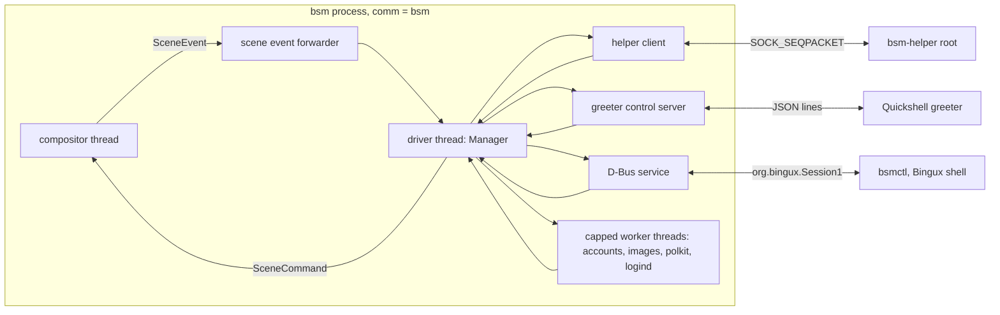

# bsm manager: the session manager core, the runtime, `bsm` and `bsmctl`

This page documents `packages/bsm-manager` (library), `packages/bsm` (binaries `bsm`
and `bsmctl`) and how they are tested. The design record is
[architecture.md](architecture.md); the wire types are in `packages/bsm-proto`.

Status words used below: **tested** means a test in this repository ran and passed on the
development host; **unverified** means it was not run (and why).

## Layout

| Part                                  | What it is                                                                                                              |
| ------------------------------------- | ----------------------------------------------------------------------------------------------------------------------- |
| `bsm-manager/src/core`                | The pure state machine `Manager::handle(now, Input) -> Vec<Effect>`. No I/O, no clock reads, injected randomness (`Rng`). |
| `bsm-manager/src/runtime`             | The threads and sockets around it: driver, helper client, greeter control server, D-Bus service and client, logind.     |
| `bsm/src/main.rs`, `run.rs`           | `bsm`: settings, logging, readiness, signals; the compositor runs on the main thread, the runtime on its own threads.   |
| `bsm/src/bin/bsmctl.rs`, `ctl.rs`     | `bsmctl`: the command line client of `org.bingux.Session1`.                                                             |
| `bsm/tests`                           | Process tests and the multi user flows against the real compositor.                                                     |

The core is one process-wide value owned by one thread (the driver). Everything else talks to
it through a bounded channel. The compositor thread never waits on PAM, D-Bus or the helper.



## The state

The manager keeps these fields apart on purpose. None is derived from another by a boolean.

| Field           | Meaning                                                                                    |
| --------------- | ------------------------------------------------------------------------------------------ |
| `selected_uid`  | Whose avatar, wallpaper and theme the greeter shows. Changing it reveals nothing.          |
| `last_used_uid` | The account that last reached the foreground. Persisted. Seeds `selected_uid` at boot.     |
| `foreground`    | The seat's active session; stays set while that session is locked.                         |
| `protected`     | Sessions whose protection the compositor acknowledged (`SceneEvent::Protected`).           |
| `challenge`     | The authentication target of the one conversation in flight.                               |
| `input_owner`   | Who the manager last told the compositor owns physical input (`InputOwner`).               |

`SeatState` is computed from these after every input (`compute_seat`), never assigned by hand.

### Session states and the legal table

`SessionState` changes only through `core::tables::session_legal`; an illegal change is refused
and logged at error level. The table is tested edge by edge against this list.

| From                                   | To                                                         |
| -------------------------------------- | ---------------------------------------------------------- |
| Creating                               | PamOpening                                                 |
| PamOpening                             | GnoblinStarting                                            |
| GnoblinStarting                        | BinguxStarting                                             |
| BinguxStarting                         | OutputReady                                                |
| OutputReady                            | ReadyBackground                                            |
| ReadyBackground                        | Foreground                                                 |
| Foreground                             | LockRequested                                              |
| LockRequested                          | LockedGreeterForeground, LockedBackground                  |
| LockedGreeterForeground                | Foreground, LockedBackground                               |
| LockedBackground                       | Foreground, LockedGreeterForeground                        |
| any running state                      | Stopping, Failed                                           |
| Stopping, Failed                       | Terminated                                                 |
| (nothing)                              | LockedBackground, only for a session recovered at start    |

`OperationPhase` and `TransitionState` have their own tables (`phase_legal`, `transition_legal`).
After `Committed` only `Completed` or `Failed` are legal for a phase: there is no cancel after the
point of no return.

### Operations

At most one operation is in flight. Each has an id, a requester and a phase
(`Requested`, `Authorising`, `Preparing`, `Animating`, `Committed`, `Completed`, `Failed`,
`Cancelled`) with a reason code on failure, and a `TransitionState`
(`Idle`, `WaitingForAuth`, `WaitingForFrames`, `Prepared`, `Animating`, `Committed`, ...).

| Operation | Starts at                | Flow                                                                                                                                                                  |
| --------- | ------------------------ | --------------------------------------------------------------------------------------------------------------------------------------------------------------------- |
| Reveal    | greeter `BeginAuth`      | auth (`WaitingForAuth`) -> success -> launch or existing session (`WaitingForFrames`) -> gate satisfied -> `BeginTransition` (`NewLoginFade` or `UnlockSlideUp`) -> `Committed` -> `Completed`. |
| Lock      | `RequestLock`            | `SetInputOwner(None)`, `Protect`, wait for `Protected`, then `SetInputOwner(Greeter)` and `BeginTransition(Lock)`.                                                    |
| Switch user | `RequestSwitchUser`    | As Lock, kind `SwitchUser`; the seat state is `SwitchingUser` until someone is revealed.                                                                              |
| Logout    | `RequestLogout`          | Visible session: `BeginTransition(LogoutFade)`, at `Committed` input goes to the greeter and `CloseSession` is sent for that session only. Hidden session: closed at once; the operation ends when the helper reports the exit. |
| Power     | `Request{Suspend,Reboot,PowerOff}` or greeter `Power` | polkit (session callers) and the inhibitor query, both answered -> `Preparing` (suspend: protect everything first) -> fade -> `Committed` -> only then logind is called -> `Completed` on acceptance; on refusal the compositor takes the cover away first and input returns when it confirms the restored scene. |

Rules that apply to all of them:

* An operation that has begun a compositor transition, has committed, or is a lock is never
  interrupted by a new request (`Busy`). Earlier phases (authentication, launching, power checks)
  are cancelled at once by a new request; a launch in flight is closed.
* `CancelOperation` works before `Committed`. For a running transition the compositor decides: it
  answers `Cancelled` (scene restored) or, if the commit won the race, `Committed`.
* The greeter may act (`SelectUser`, `BeginAuth`, `Power`) only while no session is `Foreground` or
  `LockRequested` and the system is not shutting down. While an operation other than a conversation
  waiting for answers is in flight, `SelectUser` and `BeginAuth` answer `Busy`. A greeter UI should wait
  for the `Operation` event with phase `Completed` before it lets the user pick another account.
* A compositor transition event for an operation that has not sent `BeginTransition` is ignored.

### Authentication

A challenge binds one PAM conversation to the account, the intent, the generation it may launch
(or the existing session and generation it may resume), the operation it belongs to and a deadline
(`auth_timeout`, 120 s). The PAM service follows the intent: `bsm-unlock` for `Unlock`, `bsm-login`
for `Login` and `Switch` (the helper rejects any other pairing).

* Success is single use: the challenge leaves the manager before the result is acted upon, so a
  repeated or late `AuthDone` finds nothing.
* A mid-flight change of the selected account, a lost greeter, a lost helper, the end of its
  operation or the deadline ends the conversation (`AuthAbort` to the helper, `AuthResult{ok:false}` to
  the greeter). Events of the helper for any other request id are dropped.
* Success never reveals anything. It lets the operation continue to its own gated transition. A new
  login creates the session record and asks the compositor for the brokered socket; `OpenSession` follows.
* After `max_failures` (5) consecutive failures of one account, further attempts of that account are
  refused with `Busy` for `failure_cooldown` (30 s). This sits in front of PAM's own lockout policy and
  never replaces it.
* Secrets: `ClientMessage::AuthResponse` is forwarded to the helper and nowhere else. `Debug` of
  `Input` and `Effect` redacts it; a test searches every effect and log record of a login for the password.

### The reveal gate (new login)

Stages are `bsm_proto::progress::Stage`. Each is reached only by its own evidence and only in order
(`ProgressModel::reach` refuses anything else). Facts reported early (a surface mapped, Bingux launched)
are remembered but do not advance the bar until their predecessors are reached.

| Stage               | Reached by                                                                                                          |
| ------------------- | ------------------------------------------------------------------------------------------------------------------- |
| `AuthAccepted`      | A valid single-use auth result for a new login.                                                                     |
| `PamSession`        | `SessionOpened` that matches the open request, generation and a non empty scope and bridge pid.                     |
| `HostConnected`     | `SessionConnected` after `BindHost` (the compositor verified uid, scope and pid).                                   |
| `GnoblinReady`      | The bridge's `GnoblinReady` report, after `HostConnected`.                                                           |
| `OutputsConfigured` | One `OutputConfigured` report **and** an acknowledged configure for every current output (counted n of m).         |
| `BinguxLaunched`    | The bridge's `BinguxLaunched` report.                                                                                |
| `SurfacesMapped`    | `SurfacesMapped` with `mapped >= required > 0` for every current output (counted).                                  |
| `DesktopReady`      | The `DesktopReady` report, accepted only once `SurfacesMapped` is reached, **and** on every output a presented frame after it (`presented_frames` above its value at the report; counted). |
| `ReadyToReveal`     | Outputs unchanged since `OutputsConfigured`; the session becomes `ReadyBackground`.                                  |

Per-stage timeouts (`stage_timeout` 60 s, `GnoblinReady` 90 s) end in `Failed` with the stage, the
code (`timeout`) and a message in the progress model, which stays in the greeter snapshot until the
user goes back (`CancelOperation`) or retries (a new `BeginAuth`). The failed session is closed
(`CloseSession`) and removed once the helper reports its exit (or after `close_timeout`). A change of the
outputs after `OutputsConfigured` fails the launch with `output_not_ready`.

The reveal itself (`try_reveal`) additionally requires: the right session and generation, a revealable
state, the greeter connected (so there is something underneath), the greeter authoritative, and an
acknowledged, presented frame on every current output. If the greeter is gone it waits; `frames_timeout`
(10 s) turns an endless wait into `Failed`. `SetInputOwner(Session)` is sent only when the compositor
reports `Committed`, so the keystrokes that authenticated stay with the greeter.

### Crashes, restarts and recovery

* Greeter crash (helper `GreeterExited`, compositor `GreeterGone`, helper loss): the conversation is
  ended, `DropGreeter` closes the control connection, a new greeter is requested after
  `greeter_respawn_delay`. Nothing protected is released and no input goes to a session.
* A session's Gnoblin crash (helper `SessionExited`, compositor `SessionGone`): only that session
  fails; anything in flight that involved it is aborted with the cover plus greeter as the fallback
  scene; the greeter receives an `Error`; other sessions are untouched.
* bsm restart: the registry (id, generation, uid, scope, bridge pid) is persisted atomically in
  `state.json`. At start each entry is probed (`runtime/recovery.rs`): it is alive only if its bridge
  process still exists **and** is still inside the recorded scope. Live entries come back as
  `LockedBackground` and protected, never foreground; the compositor is asked to register them and bind
  the recorded pid so that a reconnecting bridge can attach. If the bridge does not reconnect within
  `recovery_reconnect` (30 s) the session is closed. Whether `bsm-host` reconnects to the same brokered
  socket path after bsm restarts is the bridge's behaviour and is **unverified** here.
* Helper loss: a conversation in flight and any launch waiting on the helper fail visibly; the client
  reconnects with backoff and the greeter is respawned when needed.

### Sleep

logind's `PrepareForSleep(true)` makes the manager protect every visible session and wait for the
acknowledgements (at most `2 * protect_timeout`), then show the greeter and release the delay inhibitor
(`Effect::SleepReady`). On resume it re-sends `Protect` for every protected session and shows the greeter.
A suspend requested through bsm does the same through its own operation, so resume always lands on the
lock screen.

## Greeter control socket

`paths::GREETER_CONTROL_SOCKET` (or `<runtime_dir>/greeter-control.sock`). Mode 0660, group set to the
greeter's when bsm may chown. On accept the server reads `SO_PEERCRED` and asks the manager; it is accepted
only if the uid is the greeter account **and** the pid is the process `bsm-helper` started for the current
greeter generation, and no other connection is attached. A connection that gets no verdict in 5 s is closed.
Lines are limited to 64 KiB; 10 malformed lines disconnect; outgoing messages go through a bounded queue and a
slow reader is disconnected. `Hello` is required first and answered with a full `Snapshot`; a snapshot is
sent again on every change of the selected user, the sessions, the mode, the appearance or the progress.

## D-Bus: `org.bingux.Session1`

Bus name `org.bingux.Session1`, object `/org/bingux/Session1`, interface `org.bingux.Session1`
(`bsm_proto::paths`). The service is `runtime/dbus.rs`, the typed client is `runtime/client.rs`.
Every call is answered within a bound (5 s, 25 s for `PublishAppearance`); the bounded driver queue and a
cap on in-flight workers stop a flood from growing without limit.

### Interface XML

```xml
<interface name="org.bingux.Session1">
  <method name="GetUsers">             <arg type="a(usssstt)" direction="out"/> </method>
  <method name="GetSessions">          <arg type="a(stussbbu)" direction="out"/> </method>
  <method name="GetSelectedUser">      <arg type="b" direction="out"/> <arg type="u" direction="out"/> </method>
  <method name="GetForegroundSession"> <arg type="b" direction="out"/> <arg type="s" direction="out"/> <arg type="t" direction="out"/> </method>
  <method name="GetStatus">            <arg type="a{sv}" direction="out"/> </method>
  <method name="GetOutputs">           <arg type="a(siiuuuuu)" direction="out"/> </method>
  <method name="GetTransitions">       <arg type="a(tsssss)" direction="out"/> </method>
  <method name="SelectGreeterUser">    <arg name="uid" type="u" direction="in"/> </method>
  <method name="RequestLock">          <arg name="session" type="s" direction="in"/> <arg type="t" direction="out"/> </method>
  <method name="RequestSwitchUser">    <arg type="t" direction="out"/> </method>
  <method name="RequestLogout">        <arg name="session" type="s" direction="in"/> <arg type="t" direction="out"/> </method>
  <method name="RequestSuspend">       <arg type="t" direction="out"/> </method>
  <method name="RequestReboot">        <arg type="t" direction="out"/> </method>
  <method name="RequestPowerOff">      <arg type="t" direction="out"/> </method>
  <method name="CancelOperation">      <arg name="operation_id" type="t" direction="in"/> </method>
  <method name="PublishAppearance">
    <arg name="color_scheme" type="s" direction="in"/> <arg name="accent" type="s" direction="in"/>
    <arg name="clock_format" type="s" direction="in"/> <arg name="reduce_motion" type="b" direction="in"/>
    <arg name="show_personal_images" type="b" direction="in"/>
    <arg name="wallpaper_fd" type="ah" direction="in"/> <arg name="avatar_fd" type="ah" direction="in"/>
  </method>
  <signal name="SessionsChanged">        <arg name="revision" type="t"/> </signal>
  <signal name="SelectedUserChanged">    <arg name="revision" type="t"/> <arg name="has" type="b"/> <arg name="uid" type="u"/> </signal>
  <signal name="AppearanceChanged">      <arg name="uid" type="u"/> <arg name="revision" type="t"/> </signal>
  <signal name="SessionLaunchProgress">
    <arg name="session" type="s"/> <arg name="generation" type="t"/> <arg name="revision" type="t"/>
    <arg name="reached" type="as"/> <arg name="counted_stage" type="s"/> <arg name="done" type="u"/> <arg name="total" type="u"/>
    <arg name="fraction" type="u"/> <arg name="label" type="s"/>
    <arg name="failure_stage" type="s"/> <arg name="failure_code" type="s"/> <arg name="failure_message" type="s"/>
  </signal>
  <signal name="SessionReadinessChanged"> <arg name="session" type="s"/> <arg name="generation" type="t"/> <arg name="ready" type="b"/> </signal>
  <signal name="ForegroundChanged">      <arg name="has" type="b"/> <arg name="session" type="s"/> <arg name="generation" type="t"/> </signal>
  <signal name="LockStateChanged">       <arg name="session" type="s"/> <arg name="locked" type="b"/> </signal>
  <signal name="TransitionChanged">
    <arg name="operation_id" type="t"/> <arg name="kind" type="s"/> <arg name="phase" type="s"/> <arg name="state" type="s"/> <arg name="reason" type="s"/>
  </signal>
  <signal name="OperationFinished">      <arg name="operation_id" type="t"/> <arg name="success" type="b"/> <arg name="reason" type="s"/> </signal>
</interface>
```

(`runtime::dbus::INTROSPECTION_XML` is the authoritative text; a test compares it with the live
introspection of the running service.) Row layouts: `GetUsers` = uid, user name, display name, availability,
session id (empty if none), avatar revision, wallpaper revision. `GetSessions` = id, generation, uid, state,
availability, foreground, locked, progress 0..100. `GetTransitions` = operation id, kind, phase, state,
reason, session. Enumerations travel as their serde snake_case names. Request methods return an operation
id and never wait; the outcome is `TransitionChanged` and `OperationFinished`.
`PublishAppearance` takes each image as an array of zero or one file descriptors that the caller opened
itself (see [appearance](appearance.md)); bsm never opens a path supplied by a user, and the service refuses
anything that is not a read-only regular file of at most 16 MiB.

### Who may call what

The caller is classified by the manager, never by the message: the runtime reads the peer uid and pid from
the bus and the pid's cgroup from `/proc/<pid>/cgroup`. A caller is a session only if its cgroup lies inside
that session's scope (as recorded from the helper's `SessionOpened`) **and** its uid is the session's uid.
`cgroup_in_scope` matches on path component boundaries, so a cgroup that merely contains the scope name does
not count.

| Method                              | root          | greeter account | own hosted session        | other local user |
| ----------------------------------- | ------------- | --------------- | ------------------------- | ---------------- |
| `Get*` (read only)                  | yes           | yes             | yes                       | yes              |
| `SelectGreeterUser`                 | yes           | yes             | no                        | no               |
| `RequestLock(session)`              | any session   | no              | itself only               | no               |
| `RequestSwitchUser`                 | foreground    | no              | itself only               | no               |
| `RequestLogout(session)`            | any session   | no              | itself only               | no               |
| `RequestSuspend/Reboot/PowerOff`    | yes           | no (control socket) | polkit (below)        | no               |
| `CancelOperation(id)`               | any           | its own         | its own                   | no               |
| `PublishAppearance(...)`            | no            | no              | its own uid               | its own uid      |

* `Get*` exposes session ids, states and account names, the same as `loginctl list-sessions`. It never
  exposes window titles, surfaces or anything from inside a session.
* Power requests from a session need polkit: `CheckAuthorization` for the caller's bus name with
  `org.freedesktop.login1.{suspend,reboot,power-off}`, or the `-multiple-sessions` variant when another
  uid has a running session; a challenge is a refusal. The inhibitor query follows: a logind `block`
  inhibitor that covers `shutdown` (or `sleep`) fails the request with `inhibited`. Root skips polkit only.
  The greeter's own power requests come over the control socket and are gated by `[greeter_power]` in
  `bsm.toml`, and only while the greeter is active. bsm then calls logind as the `bsm` account; the
  `bsm.rules` polkit file must allow that account the six `login1` actions.
* There is no method that unlocks a session, reveals a desktop or acts on behalf of another account.
  Unlocking needs the control socket, a PAM result from the helper and the gated transition.

### Errors

`BsmError` becomes the D-Bus error `org.bingux.Session1.Error.<Code>`, `<Code>` being the CamelCase name
of the code. The same snake_case string is used on the control socket and by `bsmctl --json`. Never reused.

| Code (`ErrorCode`)      | D-Bus name suffix       | Meaning                                                           |
| ----------------------- | ----------------------- | ----------------------------------------------------------------- |
| `unauthorised`          | `Unauthorised`          | The caller may not do this (or polkit said no).                   |
| `invalid_account`       | `InvalidAccount`        | Not an eligible account.                                          |
| `no_session`            | `NoSession`             | No such session, operation or locked session.                     |
| `already_locked`        | `AlreadyLocked`         | The session is already locked or locking.                         |
| `busy`                  | `Busy`                  | Another transition runs, past the point of no return, or throttled. |
| `stale_generation`      | `StaleGeneration`       | The request refers to a challenge or generation that is gone.     |
| `cancelled`             | `Cancelled`             | Cancelled by the user, a new selection or a lost greeter.         |
| `pam_failure`           | `PamFailure`            | PAM refused.                                                      |
| `logind_failure`        | `LogindFailure`         | logind, polkit or the inhibitor query failed.                     |
| `output_not_ready`      | `OutputNotReady`        | Frames are not presented on every output, or the outputs changed. |
| `transition_interrupted`| `TransitionInterrupted` | A transition ended early; the scene fell back to cover and greeter. |
| `inhibited`             | `Inhibited`             | A blocking inhibitor refuses the action.                          |
| `shutdown_rejected`     | `ShutdownRejected`      | logind refused the power action after authorisation.              |
| `timeout`               | `Timeout`               | A stage, a check or a call did not finish in time.                |
| `helper_failure`        | `HelperFailure`         | `bsm-helper` is unavailable or reported a failure, or a session died. |
| `invalid_argument`      | `InvalidArgument`       | Malformed request.                                                |
| `not_supported`         | `NotSupported`          | For example power actions with `--system-services none`.          |
| `internal`              | `Internal`              | A bug or an unexpected failure.                                   |

## `bsm`

```
bsm [--backend drm|winit|headless] [--config PATH] [--runtime-dir DIR] [--state-dir DIR]
    [--helper-socket PATH] [--dbus system|session|none|ADDR] [--system-services logind|none]
    [--outputs WxH[,WxH...]] [--frame-dump DIR] [--print-config] [--version] [--help]
```

* The binary is named `bsm` and is exec'd directly; the process name is verified at start (and set with
  `prctl` if a wrapper renamed it). **Tested:** `ps -o comm= -p <pid>` of `bsm --backend headless` prints
  `bsm`, `/proc/<pid>/comm` is `bsm`.
* Under systemd it sends `READY=1` once the compositor has reported its outputs and the D-Bus name is
  owned, `STOPPING=1` on SIGTERM/SIGINT, and `WATCHDOG=1` at half of `WATCHDOG_USEC`. Stopping the driver
  does not close sessions: a restart of bsm must not end them.
* Logs go to stderr through `tracing`; `BSM_LOG` is the filter (default `info`), `BSM_LOG_FORMAT=json`
  switches to JSON. Session ids are fields; credentials never appear.
* `--dbus` is where the service lives; polkit and logind are always on the system bus
  (`--system-services none` disables them for development and refuses every power action).
* In `winit` and `headless` mode a missing greeter account is replaced by the current uid, with a warning;
  in `drm` mode it is an error.
* There is no mock authentication in the binary and no `test-auth` feature: the tests use a fake
  `bsm-helper` that speaks the real helper protocol, so nothing in `bsm` is bypassed.

### `/etc/bsm/bsm.toml`

Every key is optional and unknown keys are errors (a typo never silently keeps a default).

```toml
backend = "drm"                    # drm | winit | headless
runtime_dir = "/run/bsm"
state_dir = "/var/lib/bsm"
helper_socket = "/run/bsm-helper/helper.sock"
greeter_user = "bingux-greeter"
greeter_socket_mode = "0660"
host_exe = "/usr/libexec/bsm/bsm-host"
hidden_users = ["backup"]          # in addition to /etc/bsm/hidden-users
reduce_motion = false
cover = "#0d1117"                  # the opaque colour behind everything
dbus = "system"                    # system | session | none | an address
system_services = "logind"         # logind | none

[greeter_power]                    # what the greeter may do before anybody signs in
suspend = true
reboot = true
poweroff = true

[timeouts]                         # seconds
stage = 60
gnoblin_ready = 90
auth = 120

[transitions]                      # milliseconds
new_login_ms = 420
unlock_ms = 520
lock_ms = 240
logout_ms = 320
power_ms = 360
```

## `bsmctl`

Read only: `status`, `sessions`, `users`, `outputs`, `transitions`, `monitor`. Actions: `lock [SESSION]`,
`logout [SESSION]`, `switch-user`, `suspend`, `reboot`, `poweroff` (alias `power-off`), `cancel OPERATION`,
and for root or the greeter `select-user UID`. Options: `--json`, `--wait`, `--timeout SECONDS`,
`--bus system|session|ADDRESS`.

* `--json`: one JSON document per command; errors are one line `{"error":"<code>","message":"..."}` and
  exit status 1. An action prints one line `{"operation_id":N}` and returns at once. With `--wait` it
  blocks until `OperationFinished` and prints `{"operation_id":N,"success":bool,"reason":..}`; exit 0 only
  on success. 64 bit generations are printed as decimal strings.
* `monitor --json` runs until killed, one JSON object per line with an `event` tag, flushed per line:
  `sessions_changed`, `foreground_changed`, `lock_state_changed`, `transition`, `operation_finished`,
  `progress` (a full progress model), plus `selected_user_changed`, `appearance_changed`,
  `session_readiness_changed`. The subscription exists before a request is sent when `--wait` is used, so
  a fast operation cannot be missed.
* No command can override authentication, unlock or expose another desktop; the service has no such
  method, and `bsmctl` has no word for it (a unit test asserts `unlock`, `login`, `activate` do not parse).

## Tests

All commands run from the package directory with a private target directory, for example
`export CARGO_TARGET_DIR=/tmp/bsm-target/manager`.

| What                                   | Command                                                                       | Result on the development host        |
| -------------------------------------- | ----------------------------------------------------------------------------- | ------------------------------------- |
| Core, tables, runtime, D-Bus, logind   | `cd packages/bsm-manager && cargo test`                                       | 115 passed                            |
| Longer randomised invariant run        | `BSM_FUZZ_SEEDS=300000 cargo test --release randomised`                        | passed (300000 seeds, 250 steps each) |
| CLI, config, bsmctl                    | `cd packages/bsm && cargo test --no-default-features --lib`                    | 14 passed                             |
| Real `bsm` and `bsmctl` processes      | `cargo test --no-default-features --test binary`                               | 3 passed                              |
| Multi user flows, real compositor      | `cargo test --no-default-features --test headless_flows`                       | 7 passed (repeated three times)       |

`--no-default-features` skips the winit and DRM backends, whose system libraries are only needed on the
installed system; the headless backend is always built.

### What the core tests assert (`core/tests`)

Behaviour and invariants, not calls. Among others: auth success is single use; a change of the selected
account mid-auth cancels the challenge and a late success for it authorises nothing; stale generations of
every callback change nothing; readiness needs the stages in order, a frame on **every** output after the
`DesktopReady` report, and unchanged outputs; a stage timeout ends in a visible failure and a retry works;
a greeter crash keeps everything protected and grants no input; one session's crash leaves the others;
lock waits for `Protected` and keeps asking if it never comes; unlock and switch-back resume the same
generation without `OpenSession`; no transition ever has both a source and a target desktop; logout closes
only its session; power needs polkit and the inhibitor check before any fade and calls logind only after the
compositor committed; recovered sessions are protected and never foreground; the D-Bus ACL table above;
secrets never appear in `Debug`. A randomised run feeds arbitrary event orders and checks
`Manager::check_invariants()` after every input (it found two real bugs: a conversation outliving its
operation, and a compositor event committing an operation that had not begun).

### The multi user flows (`bsm/tests/headless_flows.rs`)

The rig starts the real manager runtime and the real headless compositor (stepped clock), a fake helper
over a real `SOCK_SEQPACKET` socketpair, a greeter (Wayland layer surfaces plus the JSON control socket) and
Gnoblin-like bridges (`bsm_session_host_v1` clients that report in the documented order). Each scenario
re-runs itself inside a user namespace with a range of uids mapped (`unshare --map-users=auto`, using the
user's `/etc/subuid`), and each client thread switches its own credentials with a raw `setresuid` before it
connects, so the compositor's `SO_PEERCRED` check and the manager's uid rules are exercised with real,
different uids. Set `BSM_SKIP_USERNS=1` to skip knowingly where user namespaces are unavailable.
Assertions are on composed frames and plans, compositor focus, the manager's session states and the helper's
lifecycle. Scenarios:

1. login with real progress (every update in stage order, the bar never goes back, 100 at the end), no
   desktop pixel before the reveal, the desktop fading in **over** the greeter with growing opacity;
   lock (no frame composes the session afterwards, focus with the greeter); wrong password changes nothing;
   unlock with the greeter sliding up monotonically while the desktop shows only where it left; no relaunch.
2. switch A to B and back: one launch per account, A resumes through the slide-up with its own generation,
   nothing was closed, and no frame ever shows two desktops.
3. logout fades only that session out and closes only it; a crash of B's Gnoblin returns to the greeter and
   leaves A.
4. wrong password; a launch that never becomes ready ends in a visible failure with only greeter frames,
   cleanup and a retry.
5. greeter crash while locked: the cover (not the desktop) is shown, the greeter is respawned, the session is
   still locked and still needs the password.
6. power: polkit refusal changes nothing; logind refusal fades the cover in, calls logind only once the cover
   is up, and puts the desktop and input back; acceptance keeps the cover.

Frames of the last run are written as PNG under `$BSM_TEST_ARTIFACTS` (default `/tmp/bsm-artifacts/bsm-flows`).

## Unverified, blocked and open

* **Real logind and polkit** were not run: `runtime/system.rs` is tested against fake `login1` and
  `PolicyKit1` services on a private bus, and the flows use a test double for `SystemServices`. The
  `bsm.rules` file and the system bus policy belong to the packaging slice.
* **PAM, the helper and real hosted Gnoblin** are not part of these tests; the helper is a fake that
  follows the documented contract, the bridge is a test client. End to end with the real ones is the VM
  test of the packaging slice.
* **`LockedHint`** is set through the helper (`SetLockedHint`) for sessions that report a logind session.
* **bsm restart with reconnecting bridges** is tested in the core (protected, never foreground, closed after
  the window) but not with a real bridge.
* **DRM and winit backends** were not run by this slice; `--backend winit` and `--backend drm` build and
  parse, and the compositor owner documents their status.
* **Hotplug during a transition** is handled by the compositor; the manager fails a launch whose outputs changed
  after configuration and holds an unlock until every current output has a fresh frame.
* Multiple sessions per uid are not supported; the most recently foreground one would be chosen (the manager
  refuses to hold two running sessions of one uid at all).
