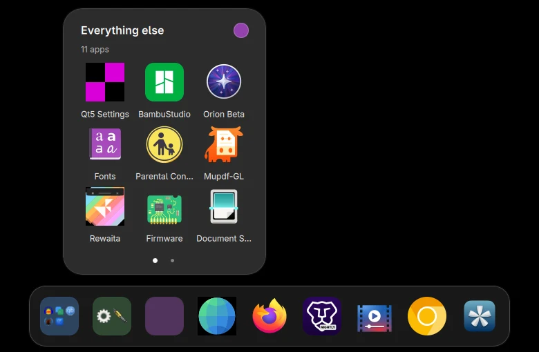

# Dock folders

A dock folder keeps several apps under one icon. The closed folder is a tile in
its colour with a small grid of its apps. Click it to open the apps in a card
above the dock.



## Make a folder

Drag an app onto another app in the dock and hold it over the middle of the
tile for about half a second. The target tile lights up, and when you let go
the two apps become a folder at the target's place in the dock. The new folder
opens at once with its name selected: type a name and press Enter, or press
Escape to keep "Folder".

Let go sooner, or over the edge of a tile, and the app is only moved. Other
tiles slide aside for a dragged app only after it pauses at their edge, so a
tile does not run away from the pointer. Only apps can be dropped onto a tile:
a folder cannot go into another folder.

An app in a folder is pinned. It is no longer a separate dock icon, but a
window it opens still shows on the folder (the folder shows which of its apps
has focus) and under the app in the card.

## Use a folder

| Do this                                   | To get this                                                            |
| ----------------------------------------- | ---------------------------------------------------------------------- |
| Click the folder                          | Open or close its card                                                 |
| Click an app in the card                  | Open it, or focus or minimise it as for any dock icon; the card closes |
| Click the name                            | Rename the folder in place; Enter saves, Escape cancels                |
| Click the coloured dot                    | Choose the folder's colour, or ungroup it                              |
| Drag an app inside the card               | Move it to another place in the folder                                 |
| Drag an app out of the card onto the dock | Take it out; it lands before the tile you drop it on                   |
| Drag an app out of the card onto a folder | Move it to that folder                                                 |
| Drag an app out of the card anywhere else | Take it out; it lands just after the folder                            |
| Drag an app from the dock onto the folder | Add it at the end, or at the place you drop it in the open card        |
| Hold a dragged app over a closed folder   | Open it, so you can drop at an exact place                             |
| Right-click the folder                    | Open, Rename, Change colour, Ungroup                                   |
| The × on an app in the card               | Take the app out of the folder                                         |

A folder shows nine apps per page. More apps make more pages: scroll, swipe or
use the dots. The closed folder shows up to nine apps in a 3 by 3 grid, or four
in a 2 by 2 grid for a folder of four or fewer apps and for a dock whose icons
are under 44 pixels. When the apps do not fit, the last cell says how many more
there are (`+3`).

### Keyboard

The card takes the keyboard when it opens.

| Key                 | Action                                              |
| ------------------- | --------------------------------------------------- |
| Arrow keys          | Move over the apps. The first press shows the focus |
| Home, End           | First and last app                                  |
| Page Up, Page Down  | Previous and next page                              |
| Enter or Space      | Open the focused app                                |
| Ctrl and an arrow   | Move the focused app within the folder              |
| Delete or Backspace | Take the focused app out of the folder              |
| F2                  | Rename the folder                                   |
| Escape              | Stop renaming, then close the card                  |

Every control has an accessible name and role. An app in the card is a button
named for the app, described as "Running, 2 windows" or "Not running". The
folder's dock icon is a button named for the folder that says how many apps it
holds.

The dock itself does not take keyboard focus (it is a layer surface with no
keyboard interactivity), so the folder's dock icon cannot be reached by key.

## A folder with one app is dissolved

Taking an app out of a two-app folder dissolves the folder: the remaining app
takes the folder's place in the dock and the app you took out follows it. An
empty folder disappears too. A folder only lasts while it holds two or more
apps. A dock slot costs width, and a folder of one app only adds a click between
you and the app.

A settings file that holds an empty or one-app folder (written by an older
version, or by hand) is tidied the first time the dock reads it, and the cleaned
file is saved.

## Where folders are saved

Folders live in `desktop.dock_folders`, next to the dock's `desktop.dock_apps`
(`pinned_apps` and `order`), in `~/.config/bingux/bingux.toml`. The shell writes
them; `bingux-config check` validates them like any other key.

```toml
[desktop]
dock_apps = { pinned_apps = ["firefox", "foot", "org.gnome.Nautilus"], order = ["folder:mvvq51rx", "firefox"] }

[[desktop.dock_folders]]
id = "folder:mvvq51rx"                  # "folder:" and lower-case letters or digits; the shell chooses it
name = "Work"                           # 1 to 64 characters
color = "blue"                          # blue, teal, green, yellow, orange, red, pink, purple or slate
apps = ["foot", "org.gnome.Nautilus"]   # desktop entry ids without ".desktop"; each app in one folder
```

- A folder's id appears in `dock_apps.order` where the folder sits in the dock.
  An app in a folder is not listed in `order`.
- Every member is also in `pinned_apps`, so dissolving a folder never unpins it.
- Up to 64 folders of up to 256 apps each. An app can be in one folder only.
  `bingux-config` refuses anything else and names the key.

## Position and size

The dock stays on the bottom edge and aligns left, centre or right
(`dock_alignment`). The card centres on the folder's tile and the shell keeps it
on the screen, so a folder at the left or right end of the dock opens inward.
The card follows its tile when the dock reflows, for example when the folder is
made. The icons in the card are as large as the dock's icons, from 44 to 64
pixels, so a large dock gets large icons and a small one stays compact
(`dock_size`, 32 to 80).

With reduced motion the card opens without the apps flying out of the folder and
nothing pulses.

## Testing

```sh
node --test tests/dock-folders.test.mjs        # the model, no display needed

QS_TEST_BIN=build/bingux-shell/quickshell/src/bingux-shell \
QML_IMPORT_PATH=build/qml python3 tests/dock-folders.py
```

The runner starts a private headless Sway session (a virtual output, pointer
and keyboard), so nothing touches the host display or its input devices. It runs
the dock's folder operations, the saved file (read back through
`bingux-config`), and real pointer and keyboard use at three dock sizes and
alignments, in normal and reduced motion. `--output DIR` keeps the screenshots
of the pointer run.
