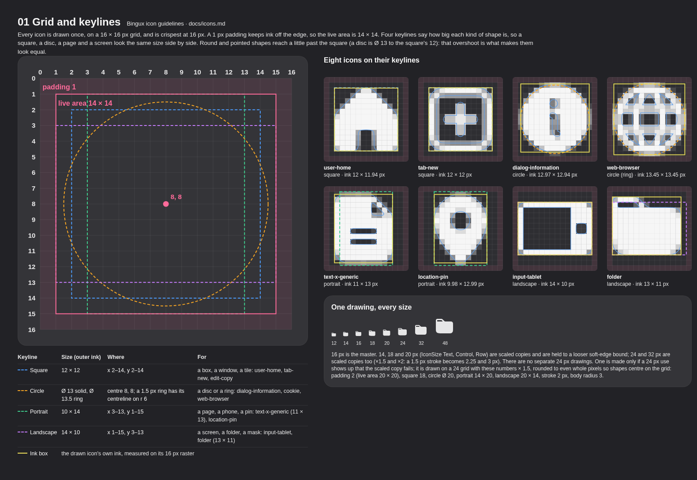
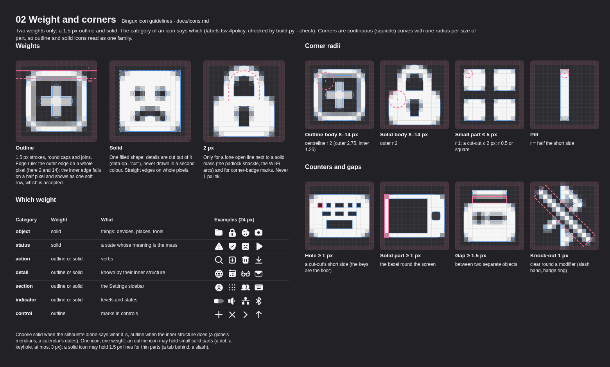
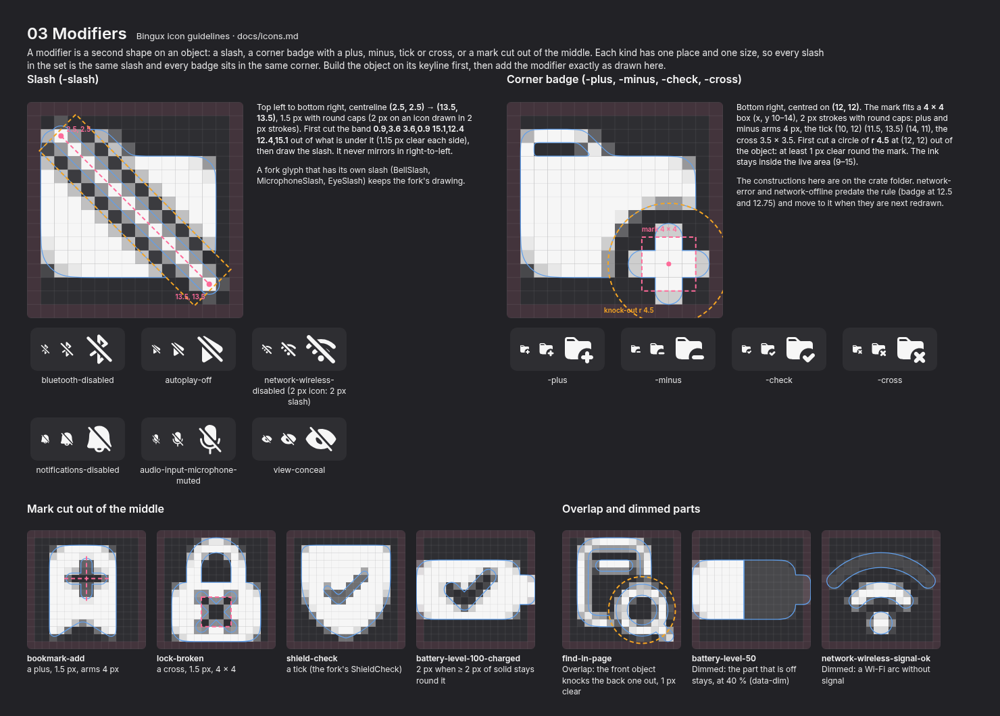
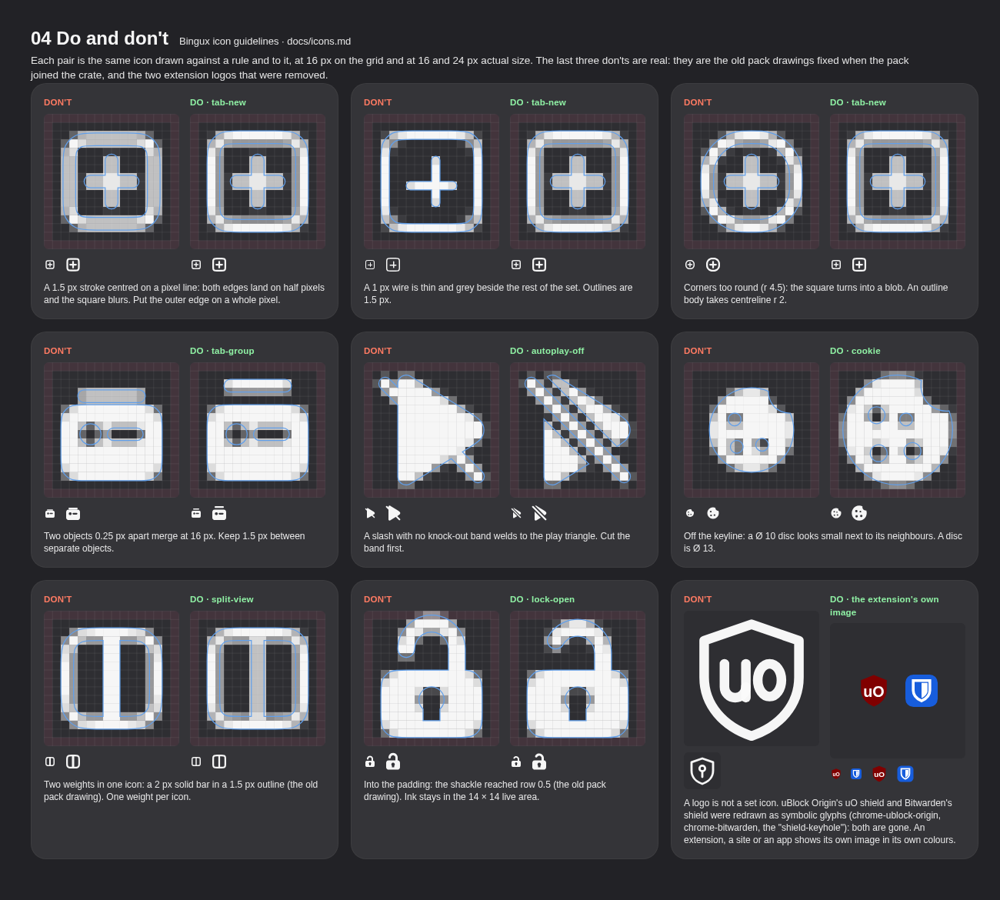

# Bingux icons

This is the one source of truth for the Bingux icon set: how an icon is drawn, named, checked and added. How an
application _uses_ an icon (`icon(Icon::Search, IconSize::Control, colour)`, the sizes, the `chat-icons` feature) is
[bingux-ui.md, Icons](bingux-ui.md#icons). The pictures below are the frames "Icons / Guidelines" on the
[Bingux: Icons canvas](https://doop.drewett.dev/c/U36E5dVEoo) (bingux-doop `frames/icons/30-guidelines.mjs`); in them
the squares are an icon's real 16 px pixels and the thin blue line is its vector outline.

There is one set. The glyphs the Browser design once drew in a separate Doop "pack" are in it
(`feat/icon-set`, 2026-11-27); nothing outside `scripts/icons/src` is a Bingux symbolic icon.

| Path                                  | What it is                                                                   |
| ------------------------------------- | ---------------------------------------------------------------------------- |
| `scripts/icons/src/NAME-symbolic.svg` | the source: a `<fork/>` line or a drawing in the Bingux icon dialect         |
| `scripts/icons/labels.tsv`            | one row per icon (where it is used, metaphor, glyph) and the directive lines |
| `scripts/icons/build.py`              | the compiler and the rule checks                                             |
| `crates/ui/icons/NAME-symbolic.svg`   | the compiled icon, one fill path, tinted at draw time (never edit)           |
| `shell/bingux/icons/`                 | the shell's copy, written by `build.py`                                      |
| `scripts/icons/golden.json`           | every icon as approved, measured at 16 to 32 px (`golden.py`)                |
| `crates/ui/src/icons.rs`              | `Icon`, one variant per icon, `include_bytes!` of the compiled file          |

Most icons are the drawings of the chat app's icon fork (`@chat/icons`, a rounded fork of Phosphor: continuous
"squircle" corners, its own fill and bold weights), put on the 16 px grid without being redrawn. The rest are drawn by
hand in the dialect (`custom` rows). Both follow the rules below.

## Contents

1. [The grid](#the-grid)
2. [Keylines](#keylines)
3. [Weight: outline and solid](#weight-outline-and-solid)
4. [Corners](#corners)
5. [Counters and gaps](#counters-and-gaps)
6. [Pixel snapping](#pixel-snapping)
7. [Optical centring](#optical-centring)
8. [Modifiers](#modifiers)
9. [Names](#names)
10. [What is not an icon](#what-is-not-an-icon)
11. [Choose the icon for where it is used](#choose-the-icon-for-where-it-is-used)
12. [Fitting a fork glyph](#fitting-a-fork-glyph)
13. [Checks](#checks)
14. [Add or change an icon](#add-or-change-an-icon)
15. [Review checklist](#review-checklist)
16. [Known deviations](#known-deviations)

## The grid



| Rule           | Value                                                                                                                                                                                                      |
| -------------- | ---------------------------------------------------------------------------------------------------------------------------------------------------------------------------------------------------------- |
| Box            | 16 × 16 px. Every icon is drawn once, at 16 px, in px coordinates (`viewBox="0 0 16 16"`)                                                                                                                  |
| Padding        | 1 px on every side                                                                                                                                                                                         |
| Live area      | 14 × 14 px, x and y 1 to 15. Ink stays inside it                                                                                                                                                           |
| Full box       | Only where the footprint is the point: the battery family (16 × 8, the nub in the padding) and the brightness sun's rays (15.5)                                                                            |
| Fill the space | The ink's long side is 10 to 16 px (8 to 13 for a mark, `#mark`); aim for the keyline (12 to 14). Kieran: "you need to make sure the icons are aligned to the grid, and you utilise all the space" (IC-01) |

**Sizes.** 16 px is the master and the crispest size. `IconSize` draws it at 12 to 20 px and 48 px
([bingux-ui.md](bingux-ui.md#icons)); 14, 18 and 20 px are scaled copies held to a looser soft-edge bound, and
`golden.py` also records 24 and 32 px.

**The 24 px policy.** There are no 24 px drawings: at 24 px the 16 px master is scaled by 1.5 (a 1.5 px stroke draws
2.25 px). A 24 px drawing is made only when an icon is shown at 24 px in a lasting place and the scaled copy fails the
24 px soft-edge bound. It is then drawn on a 24 grid with these rules × 1.5, rounded to even whole pixels so shapes
centre on the grid: padding 2 (live area 20 × 20), square 18 × 18, circle Ø 20, portrait 14 × 20, landscape 20 × 14,
stroke 2 px, body radius 3. The shell's hand-made 24 px strokes (`capture-*`, `control-centre`) are not variants: they
are second drawings of set icons and merge into them (the naming table, see [Names](#names)).

## Keylines

A keyline is the size of the outer ink for one kind of shape. Shapes of different kinds look the same size when they
sit on their own keyline: a disc is bigger than the square, a page taller and narrower, a screen wider and lower.
These are measured from the set (`build.py --measure`), not invented: Phosphor's 256 grid at 1/16 gives the same.

| Keyline   | Outer ink                            | Where on the grid                         | For                                                                |
| --------- | ------------------------------------ | ----------------------------------------- | ------------------------------------------------------------------ |
| Square    | 12 × 12                              | x 2–14, y 2–14                            | a box, a window, a tile: `house`, `square-plus`, `squares-overlap` |
| Circle    | Ø 13 solid; Ø 13.5 for a 1.5 px ring | centre (8, 8); a ring's centreline is r 6 | a disc or a ring: `circle-info`, `cookie`, `globe`                 |
| Portrait  | 10 × 14                              | x 3–13, y 1–15                            | a page, a phone, a pin: `file-text`, `map-pin`                     |
| Landscape | 14 × 10                              | x 1–15, y 3–13                            | a screen, a folder, a mask: `tablet`, `folder`                     |

- A keyline is an envelope, not a mandate: a narrow object (a phone, a bookmark, an hourglass) is narrower than its
  keyline, never taller or wider.
- The fork's pages (11 × 13) and folders (13 × 11) sit between the square and their keyline and are moved half a pixel
  so their edges land on whole pixels (x 2–13, y 1–14). That is within the rules; a new drawing uses the keyline.
- Round and pointed shapes overshoot: a disc is Ø 13 to the square's 12, a ring 13.5, a pin's point may reach the
  live area's edge. The overshoot is what makes them look as big as the square.

## Weight: outline and solid



There are two weights.

| Weight  | Drawn as                                                                                                         |
| ------- | ---------------------------------------------------------------------------------------------------------------- |
| Outline | 1.5 px strokes, round caps and round joins: the fork's `bold`                                                    |
| Solid   | one filled shape; details are cut out of it (`data-op="cut"`), never drawn in a second colour: the fork's `fill` |

Other stroke widths, and only where named:

| Width | Only for                                                                                                                                                                                                 |
| ----- | -------------------------------------------------------------------------------------------------------------------------------------------------------------------------------------------------------- |
| 2 px  | a lone open line beside a solid mass (the padlock shackle), the drawn Wi-Fi family's arcs, the Desktop monitor's frame, the mark of a corner badge, a mark cut out of a large solid (the battery's tick) |
| 1 px  | never a line on its own: the stroke that rounds a filled shape's corners (`pencil`), a cut, and text lines on a page knocked out of a solid (`folder-file-text`)                                         |
| 3 px  | a cut only                                                                                                                                                                                               |

The fork's `regular` weight (1 px wire) is not used: at 16 px it reads thin, small and rounder than the fills beside
it, because the fork's corner radius is large next to a 1 px line. A named icon is never thickened or thinned to a
whole pixel (an offset with round joins also rounds the corners): a 1.5 px stroke has one half-covered pixel row per
edge, which is how it looks, and is accepted.

**One icon, one weight.** An outline icon may hold small solid parts (a dot, a keyhole: 3 px at most). A solid icon
may hold 1.5 px lines for thin parts (the tab behind `tabs`, a slash). A 2 px solid bar inside a 1.5 px outline is
two weights (the old pack `window-split`).

### Which weight: the category

Each icon has a category in `labels.tsv` (`#policy <category>: ...` lines); the category decides the weights it may
take, and `build.py --check` fails a fork icon whose weight does not match. Choose solid when the silhouette alone says
what the thing is, outline when its inner structure does (a globe's meridians, a calendar's dates). The look is the
one released in `5d49113`.

| Category    | Weight           | What belongs there                                                                                                                                                                                                                                                               |
| ----------- | ---------------- | -------------------------------------------------------------------------------------------------------------------------------------------------------------------------------------------------------------------------------------------------------------------------------- |
| `object`    | `fill`           | Things: devices (laptop, printer, webcam, headphones), places (folders, home, trash), tools, lock, bell, sun/moon, cookie, map pin, the private-window mask                                                                                                                      |
| `status`    | `fill`           | Badges whose meaning is the mass: error, info, warning, help, secure/insecure, VPN, play, pause, eject, starred, trackers blocked, tab crashed, not responding                                                                                                                   |
| `detail`    | `bold` or `fill` | Things recognised by their inner structure: globe (`bold`), envelope, calendar with dates, text and document files, eye (`fill`), touchpad, reading glasses (`bold`); the phone and the tablet are drawn                                                                         |
| `section`   | `bold` or `fill` | The settings sidebar: Network, Bluetooth, Search, Power and Applications (`DotsNine`: nine round dots) are outlines; Displays, Sound, Appearance, Accessibility, Date and time, Users, Mouse and About are fills; the Keyboard and the Desktop (a monitor with a dock) are drawn |
| `action`    | `bold` or `fill` | Verbs: share, refresh, search, zoom, rotate, sync, download, new tab, reader view (`bold`); delete, filter, sidebar toggle, bookmark this page (`fill`); copy, edit, full screen, list and grid views are drawn                                                                  |
| `indicator` | `bold` or `fill` | Levels and states: wired network (`fill`); volume (`fill`); battery, Bluetooth and the hotspot are drawn by hand (`custom`)                                                                                                                                                      |
| `control`   | `bold`           | Tick, plus, minus, close, menu, more, drag handle, window controls, outline star, up arrow, the toolbar's space marks; the chevrons, power and window-new are drawn                                                                                                              |
| `drawn`     | strokes          | Drawn by hand: the Wi-Fi family (two 2 px arcs and a dot, symmetric about x = 8), the symbolic-link badge, never a fork glyph                                                                                                                                                    |

Default applications: Web, Mail, Calendar, Text and Documents are fills, like Files, Photos, Music and Video; Text and
Documents have their own icons (`file-text`, `file-doc`) so changing them never changes
`square-pencil` or `folder-open`. `square-pencil` is only for editing a document (a text editor, a note); every
other edit (a path, a connection, an access point, a rule) is `pencil`.

The controls family is drawn by hand where a fork glyph cannot be placed on whole pixels or is the wrong picture: the
chevrons (`chevron-right`, `chevron-left`, `pan-*`) are 1.5 px polylines with a mitred point and a sharp inner angle;
`list-bullets` and `squares-four` sit on whole pixels (2 px bars and dots on rows 2-4, 7-9, 12-14; four 5 px squares);
`squares-overlap` draws both sheets with one radius; `corners-out` and `corners-in` are four corner brackets, out and
in, as lucide's maximize and minimize; `gear` and `gear` are one cog (a ring, eight tapered
teeth, a round hole); `sun` is a true circle with eight rays; `power` is a true circle (r 5,
centre (8, 9)) open at the top, with the bar above it; `gauge` keeps its needle inside the dial.

## Corners

Every `rx` in the dialect is a continuous (squircle) corner, the fork's own corner; a fork glyph keeps the fork's
corners. One radius per size of part, so outline and solid icons read as one family:

| Part                     | Radius                                                  | Example                                             |
| ------------------------ | ------------------------------------------------------- | --------------------------------------------------- |
| Outline body, 8 to 14 px | r 2 on the stroke's centreline (outer 2.75, inner 1.25) | `square-plus`, `window-split`, `squares-overlap`    |
| Solid body, 8 to 14 px   | r 2 on the outer edge                                   | the padlock body, `square-face-sad`, `keyboard`     |
| Small part, 5 px or less | r 1                                                     | `squares-four`'s squares, the battery nub           |
| Cut-out of 2 px or less  | r 0.5, or square                                        | the phone's home button, the padlock's keyhole stem |
| Pill                     | half the short side                                     | `line-vertical`, the Desktop dock                   |
| Sharp                    | only the chevrons' mitred points                        | `chevron-right`, `chevron-down`                     |

A radius larger than these turns a square into a blob (Kieran: "they are all super rounded and just ugly", IC-05).

## Counters and gaps

| Rule                      | Minimum                                | Example                                                    |
| ------------------------- | -------------------------------------- | ---------------------------------------------------------- |
| A hole or cut-out         | 1 px on its short side (1.5 preferred) | `keyboard`'s keys are the floor                            |
| A solid part              | 1 px wide                              | `tablet`'s bezel                                           |
| A gap between two objects | 1.5 px                                 | the bar behind `tabs`, a pencil cut free of its frame      |
| A modifier's knock-out    | 1 px clear                             | the slash band, the badge ring ([Modifiers](#modifiers))   |
| A fork glyph              | keeps every hole it has                | checked by `build.py --check` (`#exempt counters:` waives) |

## Pixel snapping

| Edge                    | Rule                                                                                                                                                                              | Checked by                  |
| ----------------------- | --------------------------------------------------------------------------------------------------------------------------------------------------------------------------------- | --------------------------- |
| Straight edge of a fill | on a whole pixel                                                                                                                                                                  | `build.py` source lint      |
| 2 px stroke             | centreline on a whole pixel (both edges whole)                                                                                                                                    | source lint                 |
| 1 px stroke             | centreline on a half pixel                                                                                                                                                        | source lint                 |
| 1.5 px stroke           | the **outer** edge on a whole pixel (centreline at n + 0.75 or n + 0.25: `rect x="2.75" width="10.5"` is 2 to 14); the inner edge falls on a half pixel and shows as one soft row | soft-edge rule              |
| Curve, circle, diagonal | free: a circle stays a circle, a 45° line stays straight                                                                                                                          |                             |
| Fork glyph              | moved by at most half a pixel and scaled uniformly, never warped ([Fitting](#fitting-a-fork-glyph))                                                                               | `build.py` (`affine` error) |

A 1.5 px stroke centred on a pixel line (`rect x="3" width="10"`) puts both edges on half pixels and blurs; see
[Do and don't](#review-checklist).

## Optical centring

- The centre of the ink box is within 1.5 px of (8, 8) on each axis (checked). A shape is centred by its mass, not its
  box: the play triangle sits 1 px right, a padlock's body is low and its shackle high, a pin's head is high.
- A symmetric object is symmetric about x = 8 exactly (`#symmetric`: the avatar and the Wi-Fi family, checked to 0.05 px).
- An odd-sized shape moves half a pixel so its edges land on whole pixels rather than sitting centred on half pixels
  (the fork's pages at x 2–13).
- A family that shows a state keeps one footprint, so the glyph does not jump when the state changes: the battery levels
  share one body, the four volume icons one speaker, the Wi-Fi levels one fan (`#exempt size|centre|soft:` lets a bare
  dot or a bare cone keep the full icon's footprint).

## Modifiers



A modifier is a second shape on an object. Each kind has one place and one size, so every slash is the same slash and
every badge sits in the same corner. Draw the object on its keyline first, then add the modifier exactly as below.

| Modifier (name suffix)                               | Place and size                                                                                                                                                                                                                                                                                                                               | Reference                                                             |
| ---------------------------------------------------- | -------------------------------------------------------------------------------------------------------------------------------------------------------------------------------------------------------------------------------------------------------------------------------------------------------------------------------------------- | --------------------------------------------------------------------- |
| Slash (`-slash`)                                     | Top left to bottom right, centreline (2.5, 2.5) → (13.5, 13.5), 1.5 px, round caps (2 px on an icon drawn in 2 px strokes). First cut the band `<polygon points="0.9,3.6 3.6,0.9 15.1,12.4 12.4,15.1" data-op="cut"/>` (1.15 px clear each side), then draw the slash. Never mirrored                                                        | `bluetooth-slash`, `play-slash`, `wifi-slash`                         |
| Corner badge (`-plus`, `-minus`, `-check`, `-cross`) | Centred on (12, 12), bottom right. Cut a circle of r 4.5 at (12, 12), then draw the mark in 2 px round strokes inside the 4 × 4 box x, y 10–14: plus and minus arms 4 px; tick (10, 12) (11.5, 13.5) (14, 11); cross (10.25, 10.25)–(13.75, 13.75) and its mirror. At least 1 px clear round the mark; the ink stays in the live area (9–15) | construction on `folder` in the frame                                 |
| Mark cut out of the middle                           | The mark centred on the body's optical centre and cut out: 1.5 px strokes, plus arms 4 px, cross 4 × 4; 2 px when at least 2 px of solid stays round it                                                                                                                                                                                      | `bookmark-plus`, `padlock-cross`, `shield-check`, `battery-100-check` |
| Bolt (`-bolt`)                                       | Cut out of the body, turned inside out where it crosses the fill                                                                                                                                                                                                                                                                             | `battery-level-*-charging`                                            |
| Overlap                                              | The front object knocks the back one out with 1 px clear                                                                                                                                                                                                                                                                                     | `file-magnifier`, `squares-overlap`                                   |
| Dimmed part                                          | `data-dim="yes"`: the part that is off stays in view at 40 % (`DIM_ALPHA`), never overlapping the solid path; a cut removes ink from both layers                                                                                                                                                                                             | `battery-50`, `wifi-2`                                                |
| Fork modifiers                                       | A fork glyph that has its own slash or badge (`BellSlash`, `MicrophoneSlash`, `EyeSlash`, `FolderPlus`) keeps the fork's drawing                                                                                                                                                                                                             | `bell-slash`, `folder-plus`                                           |

**Dimmed ink, in detail.** A level icon keeps the parts that are "off" in view instead of dropping them: a Wi-Fi arc
without signal, the empty end of a battery. `build.py` writes the `data-dim` shapes as a second path with
`fill-opacity="0.4"`. The icon is still tinted with one colour at draw time (Freya's `SvgViewer` sets `fill` on the
root, which a path's own `fill-opacity` keeps; the QML shell's `MultiEffect` colorization keeps the alpha too). The
pixel rules and `golden.py` judge the whole silhouette, dim part included.

Battery: `battery-level-N` (0 to 100 in tens) is a rounded body filled from the left to N % with the rest and the nub
dimmed; `-charging` is the same with the bolt, so it shows the level and the charge; `-100-charged` is full with a
tick; `battery-exclamation` is a solid body with an exclamation mark. Wi-Fi has two arcs at most (IC-03), so
`signal-good` and `signal-excellent` are one drawing; none, weak and ok light none, the dot and the dot and inner arc.

## Names

**An icon is named after what it draws** (Kieran, 2026-11-27: "name the icon AFTER what the icon IS"), not after one
use of it: the VPN icon is `shield`, `calendar` is `calendar`. The shape names are the names of record;
the Adwaita-style names the files still carry on this branch become aliases when the rename lands.

- A name is `object[-variant][-modifier]`, lower case, hyphenated, every word taken from the drawing:
  `battery-50-bolt` is a battery (object) half full (variant) with a bolt cut out (modifier).
- The fixed modifiers are `-slash`, `-cross`, `-check`, `-plus`, `-minus`, `-bolt`, `-exclamation`, `-question`,
  `-info`, `-open`, `-dashed`, `-strike` and `-filled` (only where an outline twin exists); any other modifier is the
  name of another icon (`-pencil`, `-magnifier`). Their drawing is [Modifiers](#modifiers).
- Several of one thing take the plural (`arrows-cw`, `squares-four`). A glyph that is itself the concept keeps it
  (play, pause, power, Bluetooth, USB, translate, crop).
- The file suffix `-symbolic.svg` stays (it marks a recolourable icon). The Rust variant is the name in PascalCase.
- The table of every icon's shape name, the merges and the aliases is `docs/icon-names.md` in the bingux-doop
  repository (`~/dev/bingux-doop/docs/icon-names.md`; the frame "Icons / All / Every icon, shape names" draws it),
  approved by Kieran on 2026-11-27. The rename itself (`scripts/icons/rename.py`, `aliases.tsv`,
  `Icon::from_freedesktop`) is branch `feat/icon-names`.
- Before adding an icon, look for one that already draws the thing: an existing drawing always wins over a new one.

## What is not an icon

- **Logos and marks.** A third-party logo (an extension, a website, a company) is an image, shown in its own colours as
  the image its owner ships: a favicon tile, an extension's icon, an app icon. It is never redrawn as a symbolic icon
  and never goes in `scripts/icons`. The Doop pack's `ublock-origin` (the uO shield) and `shield-keyhole` (a
  shield with a keyhole) were exactly that and were deleted; the Browser shows the extensions' own images.
  A standard symbol that is the concept stays a set icon (the Bluetooth rune, USB).
- **Colour icons.** The Files app's file and folder icons (34: the 22 file families, ten folders, the Trash empty and
  full) are lit, rounded pictures in the style of the Files app icon, not tinted glyphs. They are their own set:
  `scripts/icons/colour/*.svg`, compiled and checked by `scripts/icons/colour.py` into `crates/ui/icons/colour/`
  ([bingux-ui.md, File icons](bingux-ui.md#file-icons)).
- **App icons** (`apps/NAME/bingux-NAME.svg`), avatars, emoji and pictures.
- **Words.** A letter is an icon only when the letter is the concept (`letter-b`, `letters-aa`). A
  file extension is not a picture (`x-office-document` was removed).
- **Decoration.** File context menus carry no decorative icons (IC-08); a menu that lists applications shows each
  app's icon (IC-07).

## Choose the icon for where it is used

Pick the conventional metaphor for the label the user reads next to the icon, not the glyph whose name matches
(IC-02). A sidebar "Network" page needs a network glyph, not a node diagram; "Share" is a box with an up arrow, not a
paper plane. `scripts/icons/labels.tsv` records, for every icon, where it appears, the metaphor people expect there,
the fork glyph or drawing, and its category. Mappings that were weak, and what was decided:

| Icon                                                                              | Was                                                | Problem                                                              | Now                                                                                                                       |
| --------------------------------------------------------------------------------- | -------------------------------------------------- | -------------------------------------------------------------------- | ------------------------------------------------------------------------------------------------------------------------- |
| `hand-tap`                                                                        | `HandPointing` regular                             | 1 px wire, thinner than its neighbours                               | `HandTap` bold, as in `5d49113`                                                                                           |
| `shield`                                                                          | `Shield` fill                                      | a plain shield                                                       | `ShieldCheckered` fill: the chequer of Material's VPN icon                                                                |
| `preferences-desktop-wallpaper` (now `monitor-dock`)                              | `ImageSquare` bold                                 | a picture is the wallpaper, not the Desktop page                     | drawn: a monitor on a stand with a dock pill inside                                                                       |
| `dots-nine`                                                                       | solid nine-dot square                              | a solid blob                                                         | `DotsNine` bold (nine round dots, no mass)                                                                                |
| `tablet`, `phone`                                                                 | `DeviceTablet`, `DeviceMobile` fill                | two plain rounded rectangles, neither read as a tablet or a phone    | drawn: a landscape 14 x 10 body and a tall 6 x 14 body, each with a screen and a home button cut out                      |
| `globe`, `envelope`, `calendar`                                                   | `Globe`, `EnvelopeSimple`, `CalendarBlank` fill    | the globe's filled disc hid its meridians; the calendar had no dates | `Globe` bold, `EnvelopeSimple` fill, `CalendarDots` fill                                                                  |
| Default applications: Text                                                        | `square-pencil` (`NotePencil` fill)                | an editor, not a text file                                           | `file-text`: `FileText` fill                                                                                              |
| Default applications: Documents                                                   | `folder-open` (`FolderOpen`)                       | a folder, not a document                                             | `file-doc`: `FileDoc` fill                                                                                                |
| `circle-info`                                                                     | `Info` regular                                     | 1 px wire in a set of fills and bold outlines                        | `Info` fill, as in `5d49113`                                                                                              |
| `speaker`                                                                         | `SpeakerNone`                                      | a bare cone can read as mute                                         | kept: 0, 1, 2 waves are monotone and mute has the X                                                                       |
| `battery-level-*`                                                                 | five fork glyphs for eleven levels, outlined cells | a line per cell, not filled; the level read badly                    | drawn: a body filled to the level, the rest dimmed                                                                        |
| `battery-level-*-charging`                                                        | `BatteryCharging`                                  | the bolt is small at 16 px, level is lost                            | drawn: the same level fill with the bolt turned inside out on it                                                          |
| `squares-overlap-left`                                                            | `CopySimple`                                       | close to `squares-overlap`                                           | kept: two squares are the convention                                                                                      |
| `cursor-click`                                                                    | `CursorClick`                                      | no "inspect" glyph                                                   | kept for the inspector toolbar                                                                                            |
| `network`                                                                         | `Network` bold                                     | the squares were outlines                                            | `Network` fill                                                                                                            |
| `go-up`<!-- Adwaita's folder-up icon, not the arrow-up alias. rename.py: keep --> | a folder with an arrow out of it                   | a second, heavier "up" beside the chevrons                           | the parent-folder button is `chevron-up`; `arrow-up` is now the plain up arrow (`ArrowUp` bold) of the header's Up button |
| `security-high`, `security-low`, `system-lock-screen`                             | shields and a padlock                              | three more padlock-like icons                                        | removed: the shell uses the padlock (`padlock`)                                                                           |
| `preferences-desktop-keyboard-shortcuts`                                          | `Keyboard` bold                                    | the same drawing as `keyboard`                                       | removed: the shortcuts row uses `Icon::Keyboard`                                                                          |
| `x-office-document`, `x-office-spreadsheet`, `x-office-presentation`              | a page marked DOC, XLS, PPT                        | a file extension is not a picture, and DOC is `file-doc`             | removed: documents are `file-text`, spreadsheets `table`, presentations `easel`                                           |
| `waveform`                                                                        | `Waveform` bold                                    | the Sound page's fallback device is not a sound card                 | the Sound page uses `Icon::Sound`; the file stays for the shell's Bluetooth devices (BlueZ names it)                      |
| `square-pencil`                                                                   | `NotePencil` fill                                  | used for every edit, and a pencil that looked odd                    | drawn pencil; `pencil` is the general edit icon                                                                           |
| the Doop pack's 24 Browser glyphs                                                 | a separate set in bingux-doop                      | two sets, two rule books                                             | in the crate (`feat/icon-set`); `shield` and `puzzle-piece` were `shield` and `puzzle-piece`                              |

The Adwaita names the shell used to take from the Adwaita theme, and what replaced each, are in
[design/icon-adwaita-replacement.md](../design/icon-adwaita-replacement.md).

## Fitting a fork glyph

`build.py` places a fork glyph with three per-icon attributes, which `map-fork.py` writes into the source from
`labels.tsv` (`Bluetooth bold scale=1.1`):

1. `mirror=left|right`: keep that half, replace the other with its mirror (the fork's `User` fill is lopsided: its
   right shoulder reaches about 0.8 px further from the middle than the left, so the avatar uses `mirror=left`, and is
   never moved sideways, so it stays symmetric about x = 8);
2. `scale`: one factor on both axes about the middle of the box. Only Bluetooth uses it (1.1): the other glyphs keep
   the size the fork draws, 10 px (the nine dots) to 16 px (a battery);
3. `dx`, `dy` (rare) and the automatic shift: of the translations of at most half a pixel (in quarter pixels) that keep
   the ink in the box, the one that leaves the fewest soft edge pixels at 16 px (ties: the smallest move).
   `align=none` turns the automatic shift off.

A glyph is only ever moved and scaled uniformly. Nothing warps one axis, thickens a stroke, snaps an edge or flattens
a curve, so circles stay circles (the Applications dots, the battery cells' ends, Bluetooth's loops) and the fork's
corners are the fork's own: when an edge cannot meet a pixel line it renders soft. `build.py` raises an error for a
non-uniform scale (`affine`). When there is no `mirror`, the SVG is the fork's own path data under
`translate(..) scale(..)`, byte for byte.

## Checks

Rules checked on the rasterised icon (`scripts/icons/raster.py`: exact-area coverage, no hinting; the ink box is read
from a 64 px raster):

| Rule                                         | Limit                                                                                                               | Applies to                                                                                                                                                                                                                                              |
| -------------------------------------------- | ------------------------------------------------------------------------------------------------------------------- | ------------------------------------------------------------------------------------------------------------------------------------------------------------------------------------------------------------------------------------------------------- |
| Ink long side                                | 10 to 16 px                                                                                                         | every icon not in `#mark`: the fork's own sizes (nine dots 10.5 px, battery 16 px); catches a glyph that is lost or leaves the box                                                                                                                      |
| Ink long side, `mark`                        | 8 to 13 px                                                                                                          | `#mark`: chevrons, tick, plus, minus, close, more, window controls                                                                                                                                                                                      |
| Ink in the box                               | no ink outside the 16 x 16 box                                                                                      | every icon (checked when it is compiled)                                                                                                                                                                                                                |
| Centre of the ink from the centre of the box | at most 1.5 px each axis                                                                                            | every icon: the fork centres glyphs by their mass (a lock's shackle, a play triangle, headphones), which puts the ink box up to 1.4 px off                                                                                                              |
| Soft edge pixels at 16 px                    | at most 1.35 x the fewest any placement gives, plus 6                                                               | every icon: pixels with 15 to 85 % coverage in a straight run of 3 or more on a horizontal or vertical edge. A bold stroke always leaves such a row, so the limit is relative to the icon's own best translation (quarter pixels, at most half a pixel) |
| Soft edge pixels at 14, 18, 20 px            | at most 100, 120, 140                                                                                               | every icon: scaled copies cannot be crisp, the bound catches regressions                                                                                                                                                                                |
| Symmetry                                     | centre within 0.05 px; mirrored coverage differs by at most 0.15 at any pixel, 0.03 on average                      | `#symmetric`: the avatar and the Wi-Fi family. The other glyphs are symmetric in the fork but may be shifted half a pixel for crispness                                                                                                                 |
| Counters                                     | a fork glyph keeps every hole and cut-out                                                                           | every fork icon (`#exempt counters:` to waive)                                                                                                                                                                                                          |
| Sidebar set                                  | ink covers 10 to 55 % of the box                                                                                    | the icons of `groups.txt` `[sidebar]`: fills 40 to 50 %, outlines 10 to 40 %                                                                                                                                                                            |
| Policy                                       | weight matches the category                                                                                         | every icon                                                                                                                                                                                                                                              |
| Golden                                       | no ink edge moves more than 0.15 px, coverage 2 %, stroke 0.06 grid units, a dot's shape, 2.5 % of the 16 px raster | every icon at 16, 18, 20, 24 and 32 px, 1x and 2x, against `golden.json` (`golden.py`, IC-05); every dot round, Wi-Fi at most two arcs                                                                                                                  |

Source rules (`build.py`, every source): stroke widths are 1, 1.5, 2 or 3 (3 only for a cut); every axis-aligned
edge of a rect, line or polygon has its outer boundary on the pixel grid (1.5 px strokes excepted, see
[Pixel snapping](#pixel-snapping)); filled axis-aligned edges sit on integers; ink stays inside the 16 x 16 box.

`#exempt size|centre|soft: ...` lines waive a rule where the footprint is the point: the volume and Wi-Fi level icons
must keep the footprint of the full icon, so a bare dot or a bare cone is not centred or sized by itself.

```sh
scripts/icons/map-fork.py --check   # sources match labels.tsv
scripts/icons/build.py --check      # sources valid, output current, every rule above;
                                    # prints the icons with the most soft edge pixels
scripts/icons/build.py --measure    # every icon: class, ink size, centre, soft pixels
scripts/icons/build.py --lint --src DIR   # the rules on a draft directory (a probe icon)
scripts/icons/build.py --suggest [icon ...]  # the scale that brings a glyph into the size rule
make icons-check                    # the first two, the colour icons and golden.py
scripts/icons/golden.py             # every icon at 16-32 px, 1x and 2x, against golden.json
scripts/icons/golden.py --update    # approve a change you have looked at (--sheet FILE draws the set)
```

A failing check names the icon, the number and the fix: `probe-small: ink is 4.00 x 4.00 px (icon): the long side
must be 10 to 16 px; change scale`, `probe-soft: 48 soft edge pixels at 16 px, 20 at its best placement (allowed
33)`, `avatar-default: not left-right symmetric`. After editing `scale`, `dx` or `dy` in `labels.tsv`, run
`map-fork.py`, `build.py` and `build.py --check`; never edit `crates/ui/icons/*.svg` (they are written).

`golden.py --update` rewrites every entry. When only some icons changed, approve only those: keep every other entry
of `golden.json` as it was (as commits `b9445e0` and `a13ecff3` did), so an unrelated drift still fails.

## Add or change an icon

1. **Look first.** Search the set (the taxonomy's Icons / Icon set page, or the "Every icon" frame on the Icons
   canvas) and the naming table. An existing drawing always wins over a new one.
2. **Find the drawing.** A fork glyph: `review.py catalogue` (all of them) or
   `~/dev/chat/packages/icons/src/generated/<Name>.ts`; `review.py candidates House:fill Mountains:regular` shows
   chosen glyphs side by side. If the fork has nothing right, draw it.
3. **Add a row** to `scripts/icons/labels.tsv` (`file | where it appears | metaphor | <ForkName> <weight>`) and name
   it in one `#policy` line, plus `#symmetric`, `#mark` or `#mirror_rtl` where they apply (`design/rtl.md` says which
   icons mirror). A drawn icon's row is `custom: <what it draws>` and its source is
   `src/<file>-symbolic.svg` in the dialect: the header of `scripts/icons/build.py` (`stroke` 1, 1.5, 2 or 3, `fill`,
   `data-op="cut"`, `data-dim="yes"`, `data-round`, `rx` for a continuous corner, and `<fork/>` pieces). Draw it on its
   keyline, at the weight of its category, with the radii, gaps and modifiers above.
4. **Fit and compile.** `build.py --suggest <file>` prints the `scale` that brings a fork glyph into the size rule
   (nothing when 1 fits). `map-fork.py` writes fork sources, `build.py` compiles into `crates/ui/icons/` and the
   shell's copy, `build.py --check` judges it. `import-chat.py` vendors the whole fork when the chat package changes.
5. **Rust.** Add the variant to `Icon`, to `Icon::ALL` and to `Icon::bytes()` in `crates/ui/src/icons.rs`. Build and
   test on an a37 box (`cargo build --workspace`, `cargo test -p bingux-ui`): there is no cargo on the desk.
6. **Look at it.** `review.py sheets --out /tmp/icons` writes one labelled PNG per group (Icon variant, file,
   category, glyph and fit, where it is used, metaphor; 16 px dark and light, 18 px, 48 px) and `icons.txt`.
   `review.py compare BEFORE_DIR AFTER_DIR --group sidebar` shows a set before and after. `sheets.py --out
/tmp/icons` renders the same at 12 to 48 px with Freya's own rasteriser, plus a top-bar mock. Then
   `golden.py` and approve the new entries only.

The fork's geometry is MIT-licensed Phosphor work; `crates/ui/icons/COPYING` carries the licence and attribution.

## Review checklist



Before an icon is committed:

- [ ] No icon in the set already draws this thing; the name says what it draws ([Names](#names)).
- [ ] It is not a logo, a colour picture or a word ([What is not an icon](#what-is-not-an-icon)).
- [ ] The ink sits on its keyline, inside the 14 × 14 live area, centred within 1.5 px.
- [ ] One weight, the one its category allows; 1.5 px strokes, 2 px only where listed, no 1 px line.
- [ ] Corners take the radius for their size of part; nothing rounder.
- [ ] Holes ≥ 1 px, solid parts ≥ 1 px, gaps between objects ≥ 1.5 px, modifier knock-outs 1 px clear.
- [ ] Straight fill edges and a 1.5 px stroke's outer edge on whole pixels.
- [ ] Modifiers at their fixed place and size; a level family keeps one footprint.
- [ ] `map-fork.py --check`, `build.py --check` and `golden.py` pass; `golden.json` approves only this icon.
- [ ] Looked at in `review.py sheets` at 16 px, dark and light, beside its group.
- [ ] `Icon` variant added; built and tested on an a37 box.

## Known deviations

Drawings that predate these rules and move to them when they are next redrawn:

- `network-cross` and `wifi-cross`: their badges are centred at (12.5, 12.5) and (12.75, 12.75) with knock-outs of
  r 4.6 and r 3.6 and a 3 to 4 px cross, not the badge above.
- `phone`, `square-pencil`, `floppy-disk`: being redrawn on `feat/icon-redraws` to these rules.
