# Installing Bingux OS

The live ISO boots into the Bingux installer. It asks a few questions, erases
the disk you pick, copies the live system onto it and installs the boot loader.
Nothing is written to a disk until you confirm on the summary page.

The installer runs on the same Gnoblin compositor as the desktop. The
screenshots below come from a headless run against a fake daemon, so the
disk and account values are placeholders.

## Before you start

- Boot the ISO in UEFI mode. BIOS machines can install too, with the limits
  listed under [firmware](#firmware).
- Back up anything on the target disk. An erase destroys every partition on it.
- The installed system is copied from the ISO, so the install itself does not
  need a network. A connection enables time sync and later updates.

## The pages

The installer goes through these pages in order. Use **Back** to change an
earlier answer before the install starts.

| Page | What you choose |
| --- | --- |
| Welcome | The language for the installer and the installed system, or **Try Bingux** to use the live desktop without touching a disk. |
| Keyboard | The keyboard layout. |
| Network | Whether the machine is online. |
| Timezone | The timezone for the clock. |
| Disk | The disk, and how to use it. |
| Storage | Root file system, swap and encryption. |
| Account | Your account, an optional root password and automatic login. |
| Hostname | The machine name. |
| Summary | Every choice, and the confirm toggle for the erase. |
| Progress | The install phases as they run. |
| Error | Why an install stopped, with the log. |
| Finished | **Keep trying Bingux** or **Restart**. |

### Welcome

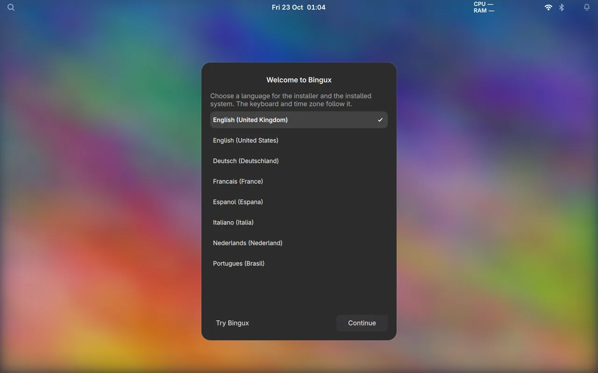

**Try Bingux** leaves the disks alone and opens the live desktop. Use it to
look around before installing.

### Keyboard

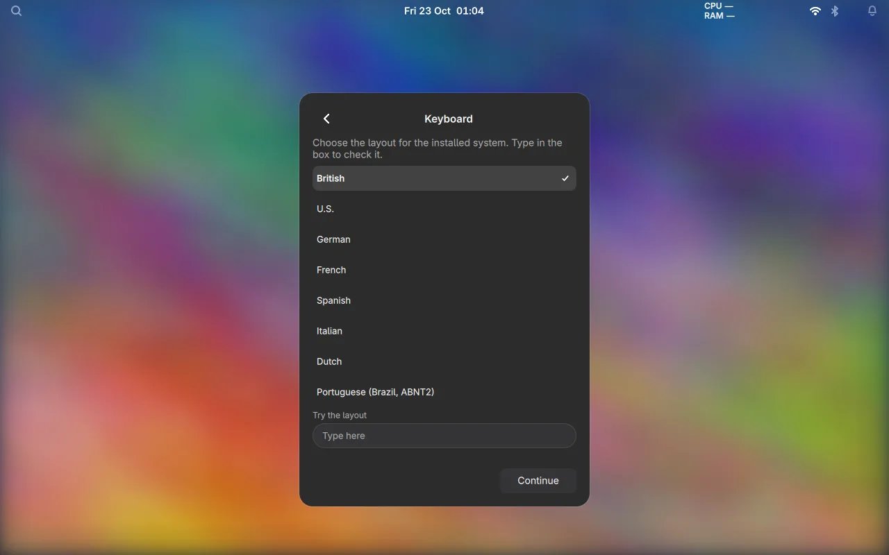

The layout is used by the installer and written to the installed system.

### Network

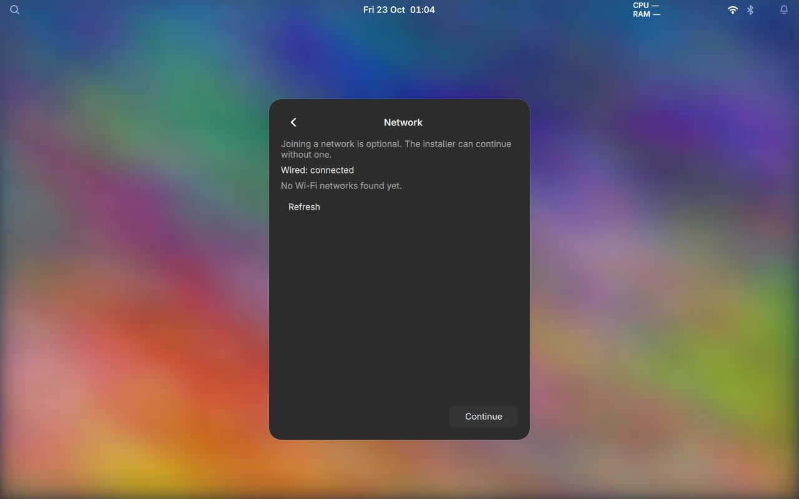

Shows the connection state. Connecting enables time sync, and the installed
system can fetch updates from the Bingux OS repository.

### Timezone

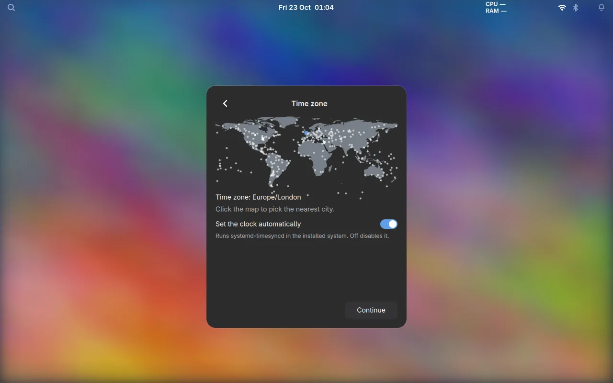

The timezone sets the local clock. Time sync (`systemd-timesyncd`) is on by
default.

### Disk

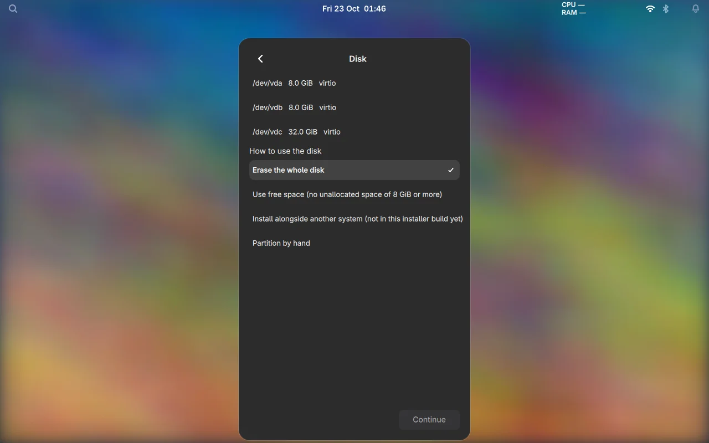

The disks found on the computer, with their size and model. The disk the ISO
runs from is not offered.

Under **How to use the disk** there are three choices:

- **Erase the whole disk** wipes the disk and creates the Bingux layout. This
  is the only choice that works in this build. The page warns that everything on
  the disk will be erased.
- **Use free space** and **Install alongside another system** keep the existing
  partitions. The page marks both as *not in this installer build yet*, so they
  cannot be selected. See [dual boot](#dual-boot).
- **Partition by hand** is greyed out, with the note *no partition editor in this
  installer yet*.

### Storage

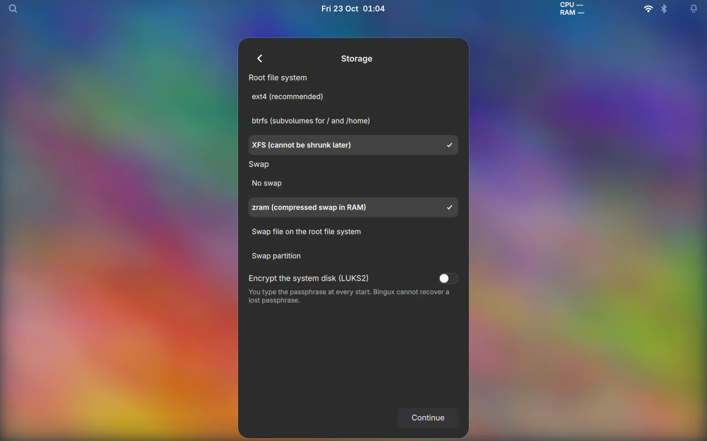

**Root file system.** `ext4` is the default. `btrfs` adds subvolumes (`@` for
`/`, `@home` for `/home`) and snapshots. `xfs` suits large files and big disks.

**Swap.** One of these choices:

| Choice | Effect |
| --- | --- |
| No swap | No swap space. |
| zram | Compressed swap in RAM, with no disk writes. |
| Swap file | A file `/swapfile` on the root file system. |
| Swap partition | A separate partition. With encryption it uses a random key on each boot. |

**Encrypt the system disk (LUKS2).** When it is offered for your firmware, the
toggle asks for a passphrase and its confirmation. The passphrase is typed at
every start, and a lost passphrase cannot be recovered. On BIOS only the root
is encrypted; `/boot` stays unencrypted `ext4`. If the build does not offer
encryption for your firmware, the toggle says so and stays off.

### Account

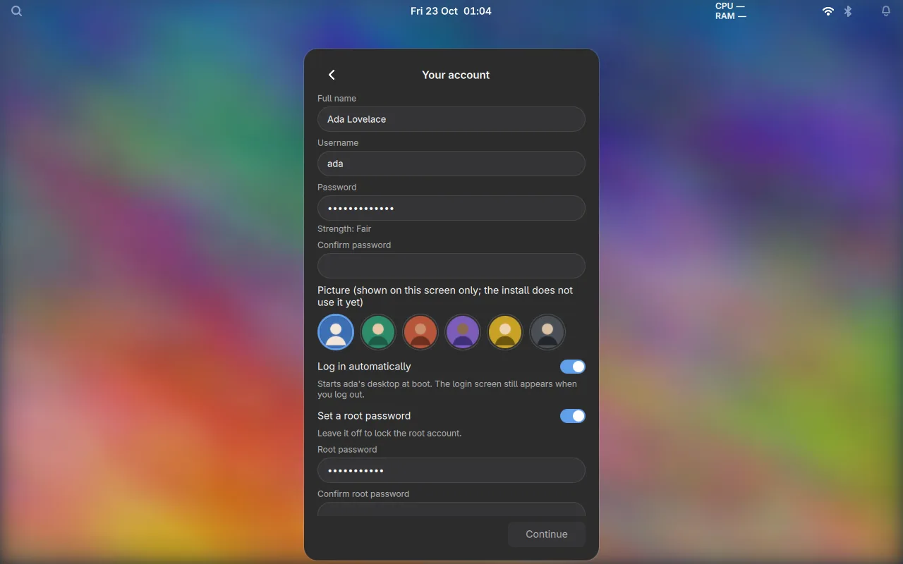

- **Name, password and confirmation** for the user. The user is an administrator
  (`sudo`) on the installed system.
- **Root password** is optional. Leave it off to lock the root account.
- **Log in automatically** starts this user's Gnoblin session at boot. The
  greeter stays the default session, so signing out shows the login screen
  again.

### Hostname

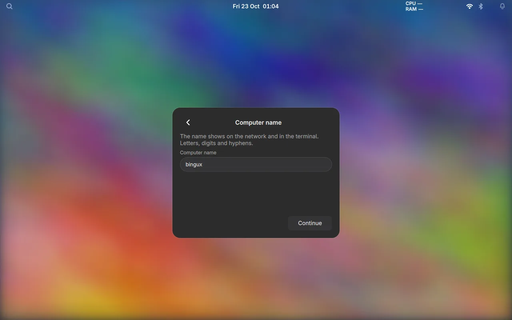

Letters, digits and hyphens, one label of at most 63 characters. The name shows
on the network and in the terminal.

### Summary

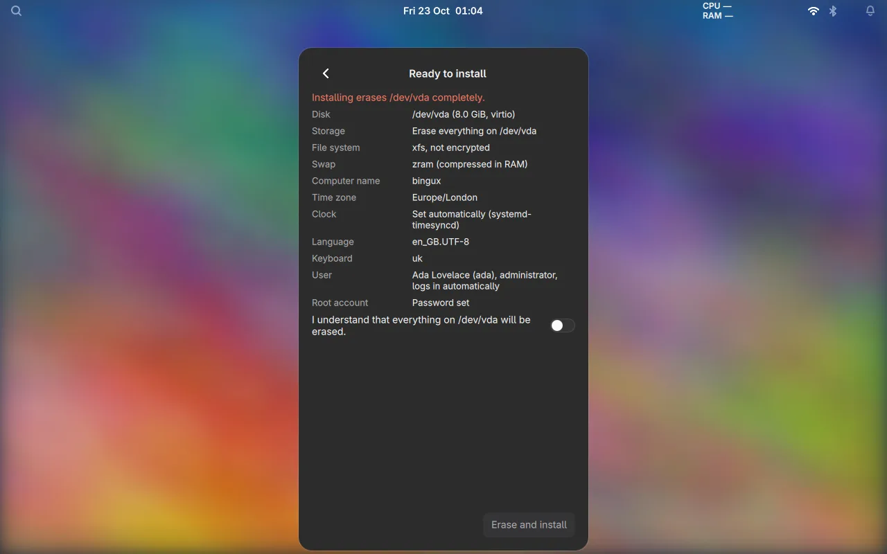

The summary lists the disk, layout, file system, swap, encryption, account and
hostname. The erase is confirmed with the toggle on this page; the install does
not start until it is on.

### Progress

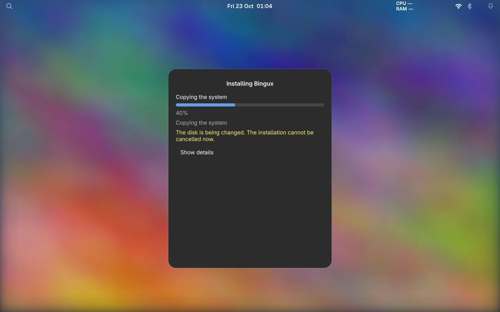

The installer runs these phases in order: validate, preflight, partition, mount,
copy, strip, configure, bootloader, finish. **Cancel** works only before the
partition phase. From that point the page shows that the disk is being changed
and cannot be cancelled.

### Error

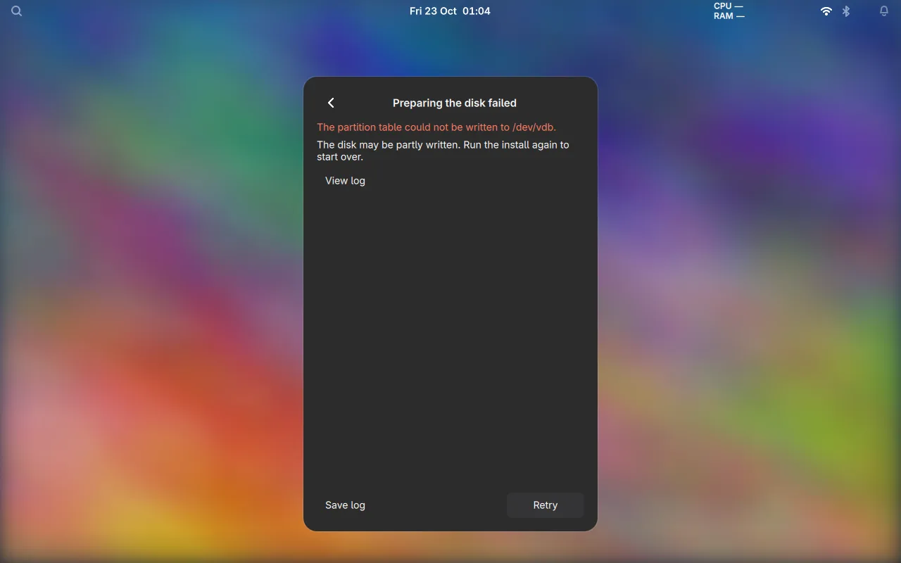

A failed phase stops the install and shows a message that says what was left on
disk. Failures before the partition phase change nothing. Failures after it
unmount the target and close the encryption mapping before the error appears.

- **View log** shows the installer log, one line per event.
- **Save log** writes the log to `/tmp/bingux-installer-<timestamp>.log` and shows
  the path on the page. Attach it to a bug report. Passwords and the passphrase
  are not written to it.
- **Retry** runs the install again from the summary.

### Finished

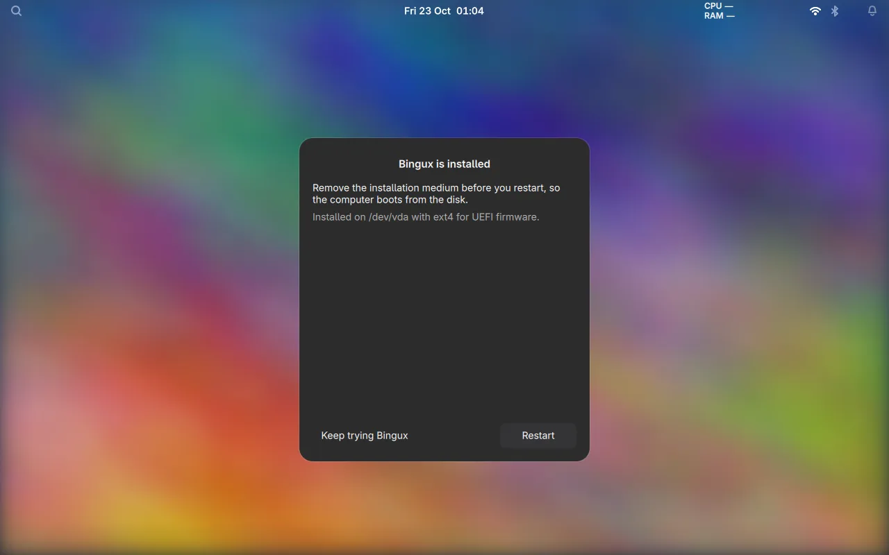

The disk is ready. **Restart** reboots; remove the install medium first.
**Keep trying Bingux** returns to the live desktop without rebooting.

## Dual boot

Dual boot is not available in the installer interface yet. The backend already
accepts the two keep-existing-partitions modes (`free_space` and `alongside`)
in a plan file, but the Disk page marks both unavailable in this build, and the
TODO tracks the remaining work. Resizing a real disk has not been tested. To
share a disk today, shrink the other system with its own tools first, then
install with a plan file that uses `manual` partitioning and reuses the existing
EFI system partition. Test that on a disk you can afford to lose.

## Firmware

| Firmware | Erase | Encryption | Notes |
| --- | --- | --- | --- |
| UEFI | yes | yes (LUKS2) | systemd-boot. The recommended path. |
| BIOS | yes | yes (LUKS2) | GRUB, with an unencrypted `ext4` `/boot`. Tested in QEMU only. |

Secure Boot and TPM-based unlocking are not tested, so this page makes no claim
about them.

## Plan file

The installer pages build a plan. The same plan can be written by hand and run
from a terminal, which is how the automated tests drive the installer:

```json
{
  "version": 2,
  "disk": "/dev/vda",
  "confirm_erase": "/dev/vda",
  "storage": {"mode": "erase"},
  "firmware": "auto",
  "filesystem": "btrfs",
  "encryption": {"enabled": true, "passphrase": "correct horse battery"},
  "swap": "zram",
  "other_os": "refuse",
  "hostname": "bingux-box",
  "timezone": "Europe/London",
  "locale": "en_GB.UTF-8",
  "keymap": "uk",
  "ntp": true,
  "root_password": null,
  "autologin": null,
  "users": [
    {"name": "kieran", "password": "correct horse", "admin": true, "full_name": "Kieran"}
  ]
}
```

What the keys do:

- `confirm_erase` must equal `disk`. It is the typed confirmation for the erase.
- `filesystem` is `ext4`, `btrfs` or `xfs`.
- `encryption.enabled` turns on LUKS2 for the root; the passphrase is 8 or more
  characters.
- `swap` is `none`, `zram`, `file` or `partition`. `file` and `partition` also take
  `swap_bytes` (1 to 64 GiB).
- `other_os` is `refuse` (default) or `allow`. It only matters for the erase
  mode.
- `ntp: false` disables time sync.
- `root_password: null` locks root; a string sets it.
- `autologin` is `null` or the name of a user in `users`.

Run a plan with:

```sh
bingux-installer probe
sudo bingux-installer install --plan plan.json
```

`distro/installer/README.md` has the full schema, the manual partition list and
every error code.

## Logs and troubleshooting

- The log shown by **View log** and saved by **Save log** is the installer's
  own record of the run.
- The daemon is `bingux-installer.service`, socket-activated on
  `/run/bingux-installer.sock`. `journalctl -u bingux-installer.service` shows
  its messages on a live system.
- If the installer does not come up, switch to another console and run
  `bingux-live-switch installer`.
- To use the live desktop again at any time before the install starts, choose
  **Try Bingux** on the welcome page.

## Testing

```sh
tests/installer-shots.py       # renders every page to build/installer-shots
tests/installer-ui.py          # drives the pages against a fake daemon
tests/live-session.test.py     # the installer and live-desktop switch
tests/distro-install.py        # installs onto a virtual disk and boots it
```

The screenshots on this page are the `installer-shots.py` output, converted to
WebP.
