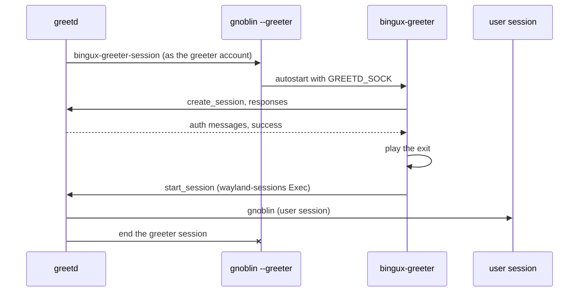

# Login screen

Bingux ships its own login screen, `bingux-greeter`. It is a greetd greeter:
greetd owns the PAM conversation and the privileged session start, Gnoblin in
greeter mode (`gnoblin --greeter`) is the compositor it runs on, and the greeter
is a Quickshell client built on the same `SessionScreen` as the lock screen.



## Install

The installer places these files (paths for the default prefix):

| File                                             | Purpose                                                       |
| ------------------------------------------------ | ------------------------------------------------------------- |
| `bin/bingux-greeter`                             | Quickshell wrapper for `GreeterShell.qml`                     |
| `bin/bingux-greeter-session`                     | greetd command: exports the session type and runs Gnoblin     |
| `share/bingux/greeter/gnoblin.lua`               | Gnoblin greeter configuration: autostarts statusd and greeter |
| `share/bingux/greeter/greetd.toml`               | greetd configuration example                                  |
| `share/polkit-1/rules.d/50-bingux-greeter.rules` | lets the greeter account restart and shut down                |
| `lib/tmpfiles.d/bingux-greeter.conf`             | creates `/var/lib/bingux/greeter` for wallpaper snapshots     |

Point greetd at the session command in `/etc/greetd/config.toml`:

```toml
[terminal]
vt = 1

[default_session]
command = "bingux-greeter-session"
user = "greeter"
```

`user` is the account the greetd package created (`greeter` on Arch, `greetd`
on Fedora). Then enable `greetd.service` and disable any other display
manager. The greeter session runs `bingux-statusd` for keyboard layouts and
`bingux-greeter`; nothing else starts before someone signs in.

## What the screen shows

- The remembered account, front and centre: picture or monogram, display
  name, a hint line and the password field. The hint says when a fingerprint
  reader or face recognition is enrolled for that account.
- Other accounts as a small avatar stack in the bottom-left corner. Clicking
  it opens the account list, with "Other..." for a name that is not listed.
  With one account there is no corner control.
- The session choice as a gear in the bottom-right corner, only when more
  than one `wayland-sessions` entry is installed. The list ticks the current
  one; Gnoblin is preferred on first use.
- The session bar at the top: keyboard layout and a status menu with
  network, battery, Restart and Shut Down. Nothing on the greeter launches an
  application or reaches a user's settings; see
  [Secure session locking](locking.md#session-bar) for the rules.
- The date and clock, over the selected account's wallpaper.

Accounts come from `bingux-session users`: passwd entries in the login UID
range, with the GECOS full name and the AccountsService icon. Sessions come
from `bingux-session sessions`, which reads `wayland-sessions/*.desktop` from
the XDG data directories.

### Wallpapers

The greeter account cannot read home directories, so each user's wallpaper is
published for it. `bingux-greeter-export.service` (part of `bingux.target`)
runs `bingux-session export` when the user's Bingux configuration changes; it
copies the resolved wallpaper to `/var/lib/bingux/greeter/<user>/`, a directory
only that user can write. The greeter only trusts a snapshot whose directory is
owned by the account it names. Accounts without a snapshot, and the "Other"
prompt, keep the last shown wallpaper or a deep tint of the accent colour.

### Remembered choice

After a successful login, `bingux-session remember USER SESSION` stores the
choice in `$XDG_STATE_HOME/bingux/greeter.json` of the greeter account; the
next start preselects it.

## Failure handling

- A wrong password keeps the field open, shakes it and shows greetd's
  message. The next response opens a new greetd conversation, so the user
  only types the password again.
- If greetd is not reachable (`GREETD_SOCK` unset or the socket gone) the
  status line says so and the field stays disabled.
- A session entry without an `Exec` line is reported as "No session is
  available to start".
- Power actions go through `systemctl`; a refusal (missing polkit rule) is
  shown in the status menu.

## Hand-over to the session

Once greetd accepts the credentials the screen plays its exit over
`Theme.sessionExitMotion` (360 ms): the controls fade, the identity shrinks,
the dim overlay lifts and the wallpaper pushes in. Only then does the greeter
call `Greetd.launch`, after `bingux-session remember` has returned. greetd
ends the greeter session and starts Gnoblin for the user; Gnoblin's user
session autostarts `bingux-wallpaper` first so the same picture is the first
thing drawn. The gap between the two compositors is Gnoblin's modeset; keeping
it short is tracked on the Gnoblin side.

## Testing

`make check-session` runs both screens in headless Sway:

- `tests/greeter-ui.py` speaks greetd's IPC from a fake server, rejects one
  password, accepts the next and checks the `start_session` command and
  environment. `BINGUX_GREETER_SHOT=/path.png` captures the failure state;
  `BINGUX_GREETER_WALLPAPER=/path.jpg` uses a real wallpaper;
  `BINGUX_SOFTWARE_RENDERING=0` renders blur and shadows.
- `tests/lock-ui.py` does the same for the lock screen through
  `ext-session-lock-v1`.

`tests/session-context.test.py` keeps the widget contexts and the capability
gate explicit.
