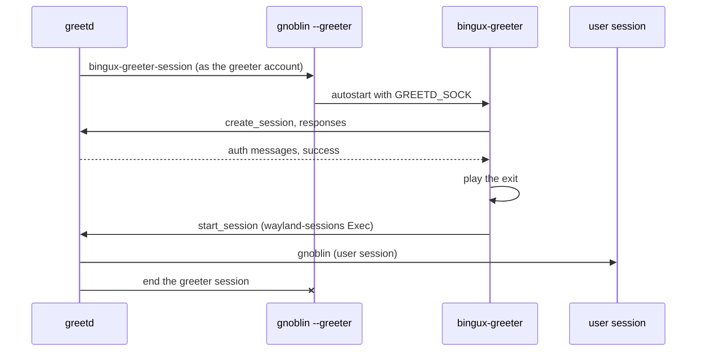
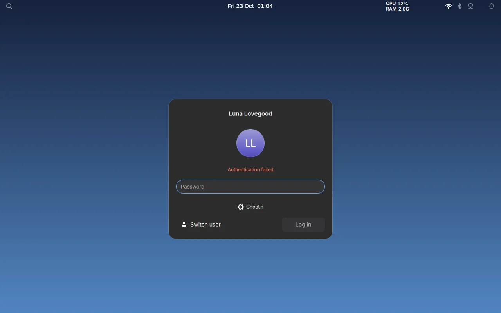
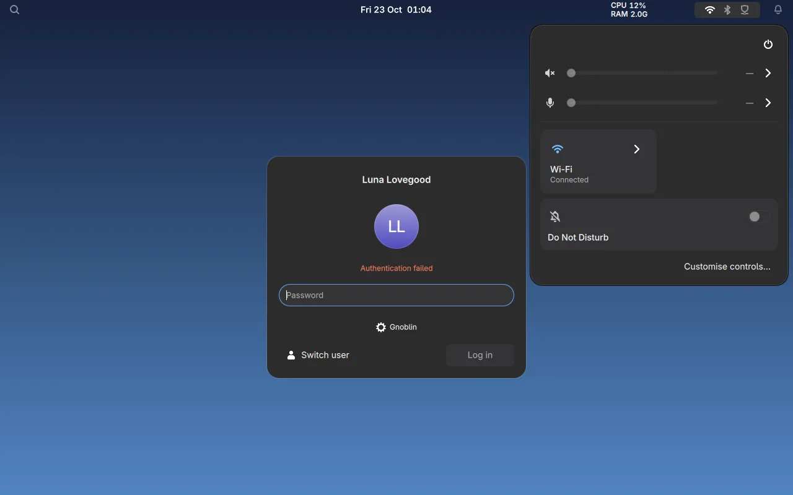

# Login screen

Bingux ships its own login screen, `bingux-greeter`. It is a greetd greeter:
greetd owns the PAM conversation and the privileged session start, Gnoblin in
greeter mode (`gnoblin --greeter`) is the compositor it runs on, and the greeter
is a Quickshell client built on the same `SessionScreen` as the lock screen.



## Install

The installer places these files (paths for the default prefix):

| File                                             | Purpose                                                                                                                  |
| ------------------------------------------------ | ------------------------------------------------------------------------------------------------------------------------ |
| `bin/bingux-greeter`                             | Quickshell wrapper for `GreeterShell.qml`                                                                                |
| `bin/bingux-greeter-session`                     | greetd command: exports the session type, gives the greeter account a writable `HOME` and runs Gnoblin                   |
| `share/bingux/greeter/gnoblin.lua`               | Gnoblin greeter configuration: autostarts statusd and greeter                                                            |
| `share/bingux/greeter/greetd.toml`               | greetd configuration example                                                                                             |
| `share/polkit-1/rules.d/50-bingux-greeter.rules` | lets the greeter account restart and shut down                                                                           |
| `lib/tmpfiles.d/bingux-greeter.conf`             | creates `/var/lib/bingux/greeter` for wallpaper snapshots and `/var/lib/bingux/greeter-home`, the greeter account's home |

Point greetd at the session command in `/etc/greetd/config.toml`:

```toml
[terminal]
vt = 1

[default_session]
command = "bingux-greeter-session"
user = "greeter"
```

`user` is the account the greetd package created (`greeter` on Arch, `greetd`
on Fedora). Then enable `greetd.service` and disable any other display
manager. The greeter session runs `bingux-statusd` for keyboard layouts and
`bingux-greeter`; nothing else starts before someone signs in.

## Screenshots


A wrong password keeps the field open with greetd's message:



The control centre opens from the top bar's status pill, the same panel the
desktop uses:



Shots come from `tests/greeter-ui.py`, which writes them to
`build/kiosk-shots/` (set `BINGUX_GREETER_SHOTS` to change the folder). Set
`BINGUX_GREETER_WALLPAPER` to a real image to use it instead of the test
backdrop.

## What the screen shows

- The remembered account, front and centre: picture or monogram, display
  name, a hint line and the password field. The hint says when a fingerprint
  reader or face recognition is enrolled for that account.
- Other accounts as a small avatar stack in the bottom-left corner. Clicking
  it opens the account list, with "Other..." for a name that is not listed.
  With one account there is no corner control.
- The session choice as a gear in the bottom-right corner, only when more
  than one `wayland-sessions` entry is installed. The list ticks the current
  one; Gnoblin is preferred on first use.
- The session bar at the top: keyboard layout and a status menu with
  network, battery, Restart and Shut Down. Nothing on the greeter launches an
  application or reaches a user's settings; see
  [Secure session locking](locking.md#session-bar) for the rules.
- The date and clock, over the selected account's wallpaper.

Accounts come from `bingux-session users`: passwd entries in the login UID
range, with the GECOS full name and the AccountsService icon. Sessions come
from `bingux-session sessions`, which reads `wayland-sessions/*.desktop` from
the XDG data directories.

### Wallpapers

The greeter account cannot read home directories, so each user's wallpaper is
published for it. `bingux-greeter-export.service` (part of `bingux.target`)
runs `bingux-session export` when the user's Bingux configuration changes; it
copies the resolved wallpaper to `/var/lib/bingux/greeter/<user>/`, a directory
only that user can write. The greeter only trusts a snapshot whose directory is
owned by the account it names. Accounts without a snapshot, and the "Other"
prompt, keep the last shown wallpaper or a deep tint of the accent colour.

The installer runs `bingux-session export` as each new account inside the target
(`configure.seed_greeter_snapshots`), so the first login screen already shows that
account's wallpaper and blurred twin, the same wallpaper the first session paints.
Without it, the first greeter shows the accent gradient until the first login.

### Wallpaper blur

Alongside the snapshot wallpaper, `bingux-session export` writes a blurred,
dimmed copy named `wallpaper-blur` (`/var/lib/bingux/greeter/<user>/wallpaper-blur`).
It is the path to use for the blurred backdrop. The blur is a Gaussian with a
sigma of 32 px and the brightness is 0.65; both values are the constants
`WALLPAPER_BLUR_RADIUS` and `WALLPAPER_DIM` in `packages/bingux-session/src/snapshot.rs`.
If blurring fails, the plain wallpaper is kept and any stale `wallpaper-blur`
is removed. The packaged default wallpaper gets the same treatment at build
time: `bingux-session blur-wallpaper` writes `default-blur.jpg` beside
`default.jpg`, and firstboot installs it for the live account as `wallpaper-blur`.

A new account's first session has no snapshot yet. Its compositor paints the
packaged `default-blur.jpg` from the skel drop-in (`bingux-background.lua`),
which `useradd -m` copies into the account at creation, instead of Gnoblin's
grey. The export replaces that drop-in during the session, and the change
applies from the next login.

### Remembered choice

After a successful login, `bingux-session remember USER SESSION` stores the
choice in `$XDG_STATE_HOME/bingux/greeter.json` of the greeter account; the
next start preselects it.

## Failure handling

- A wrong password keeps the field open, shakes it and shows greetd's
  message. The next response opens a new greetd conversation, so the user
  only types the password again.
- If greetd is not reachable (`GREETD_SOCK` unset or the socket gone) the
  status line says so and the field stays disabled.
- A session entry without an `Exec` line is reported as "No session is
  available to start".
- Power actions go through `systemctl`; a refusal (missing polkit rule) is
  shown in the status menu.

## Hand-over to the session

Once greetd accepts the credentials the screen plays its exit over
`Theme.sessionExitMotion` (360 ms): the controls fade, the identity shrinks,
the dim overlay lifts and the wallpaper pushes in. Only then does the greeter
call `Greetd.launch`, after `bingux-session remember` has returned. greetd
ends the greeter session and starts Gnoblin for the user.

Neither compositor shows black in between:

- The greeter's compositor paints the remembered account's wallpaper as its
  `compositor.background`. `bingux-greeter-session` asks
  `bingux-session greeter-background` for that Lua, writes it after a
  `gnoblin.load` of the packaged greeter configuration into the greeter
  account's runtime directory, and passes the file to `gnoblin --greeter`.
- The user's compositor paints the greeter's blurred copy from
  `~/.config/gnoblin/conf.d/bingux-background.lua`. `bingux-session export`
  writes that drop-in during the session (`bingux-greeter-export.service`, a
  user unit started by `bingux.target`). It names the blurred twin beside the
  account's snapshot, so the next login's compositor paints the picture the
  greeter showed. The installer's `init.lua` loads `conf.d/**/*.lua`.
- The desktop wallpaper then fades in sharp over that frame once it is ready.
  The frame never goes black and the picture does not move.

What remains is the modeset between the two compositors, which is the
kernel's and the display's, not the shell's.

The greeter exports `BINGUX_CONTINUING=1` to the session it launches. When the
desktop shell sees it (`SessionContext.continuing`), the wallpaper and top bar
are already where the greeter left them: the wallpaper's first show skips the
zoom and the bar skips its slide-in, so nothing enters again. The sharp wallpaper
fades in over the blurred copy the compositor paints. Lock and kiosk shells
ignore the flag. A desktop started without the variable (a cold start from
another login path) keeps the zoom and slide-in.

## Start-up cost

Gnoblin runs `systemctl --user start gnoblin-session.target` before it starts the
process that sends the compositor its configuration, and the compositor gives up
after 10 s without it. `bingux.target` sets `DefaultDependencies=no`, so that start
does not wait for the helper units it wants (the wallpaper export takes about 4 s of
CPU), and the wallpaper export runs in idle time. With the default the wait was 6.5 s
on four busy CPUs and 14 to 22 s in the E2E boots; without it, 0.4 s.

The greeter account has its own user manager, so the packaged `bingux.target`
would start the user desktop helpers for it. The search, status, portal and
wallpaper-export units carry `ConditionUser=!greeter` and `ConditionUser=!greetd`
so they start only for real users. The greeter's Gnoblin autostart already runs
the status service. The greeter's shell does not start the gsettings readers in
`Theme.qml`: they run only in the desktop and lock shells. `bingux-os` ships
`greetd.service.d/plymouth.conf`, which orders greetd after
`plymouth-quit-wait.service`, so the greeter takes the display once the splash
releases it. The GRUB menu waits 5 seconds (`distro/profile/grub`).

## Testing

`make check-session` runs both screens in headless Sway:

- `tests/greeter-ui.py` speaks greetd's IPC from a fake server, rejects one
  password, accepts the next and checks the `start_session` command and
  environment. Each screenshot is taken once the harness has written
  `GREETER_UI_ACK`, so the frame is settled; the top-bar pill's control
  centre is captured too. `BINGUX_GREETER_SHOT=/path.png` captures the
  failure state;
  `BINGUX_GREETER_WALLPAPER=/path.jpg` uses a real wallpaper;
  `BINGUX_SOFTWARE_RENDERING=0` renders blur and shadows.
- `tests/lock-ui.py` does the same for the lock screen through
  `ext-session-lock-v1`.

`tests/session-context.test.py` keeps the widget contexts and the capability
gate explicit.
