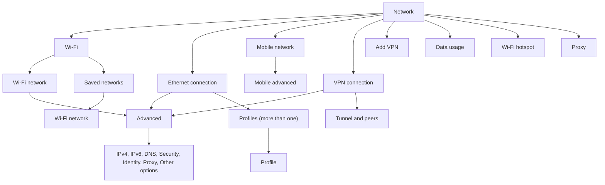

# Bingux Settings

`bingux-settings` is the Settings application for the Bingux desktop. It is a
native Wayland window (Rust, Freya) with the shell's look: a page list on the
left and, on the right, a rounded panel inset in the window. Each page starts
with a large title and one sentence that says what the page is for, then
boxed groups of rows. Below 740 px of
width the window is laid out as a phone. The page list is a screen of its own.
Choosing a page opens it, and the Back button in the header returns to the
list. A subpage's Back button returns to its page. Rows, controls and buttons
are bigger for a finger. The window buttons stay while you use a mouse, so a
narrow desktop window can still be closed; they are hidden once a finger
touches the window. Opening
Settings with no page name starts on the list; opening it
with a page name starts on that page.

## Open it

- Search for "Settings" or open it from the dock and the Control Centre.
- Right-click the wallpaper for Change Background… or Display Settings.
- From a terminal: `bingux-settings [ADDRESS]` or `binguxctl settings [ADDRESS]`.
- From a link or `xdg-open`: `xdg-open bingux-settings://network/wifi/saved`. The desktop entry registers the `bingux-settings` scheme.

Panels: `network`, `bluetooth`, `background` (Appearance), `desktop`,
`search`, `display`, `sound`, `power`, `keyboard`, `mouse`, `datetime`,
`users`, `applications`, `accessibility`, `privacy`, `about`. An unknown or omitted panel opens the
first page. An address names a page or a subpage. The old Network addresses
still work: `wifi`, `wifi/saved`, `wifi/network/<ssid>`, `wired`, `wired/<device>`
and `wired/vpn/<name>` open the matching page below `network/`, and the shell's
`network`, `ethernet` and `vpn` open the Network page. Addresses that moved when
the Network flow was tidied still open the page that took their place: a
connection's `ipv4`, `ipv6`, `dns`, `security`, `identity` and `proxy` are
below its `advanced` page, `network/wifi/hotspot` is `network/hotspot`,
`network/mobile/network`, `network/mobile/apn` and `network/mobile/apn-add` are
below `network/mobile/advanced`, `network/details/<connection>` opens the
connection's Advanced page, and a wired profile that is the one in use opens
the device's page. The scheme and the
`bingux-settings://` prefix may be left off on the command line:

| Address                       | Opens                                                                |
| ----------------------------- | -------------------------------------------------------------------- |
| `network`                     | The Network page (Wi-Fi, Ethernet, mobile, VPN)                      |
| `network/wifi`                | Wi-Fi networks                                                       |
| `network/wifi/saved`          | Saved networks                                                       |
| `network/wifi/saved/<name>`   | A saved network's page, with Back returning to Saved networks        |
| `network/wifi/network/<ssid>` | A Wi-Fi network's page                                               |
| `network/hotspot`             | Wi-Fi hotspot                                                        |
| `network/ethernet/<device>`   | A wired device: the page of the profile it uses                      |
| `network/ethernet/<device>/profile` | The profiles of a wired device                                 |
| `network/ethernet/<device>/profile/<name>` | A wired profile that is not in use                      |
| `network/vpn/<name>`          | A VPN's page                                                         |
| `network/add-vpn`             | Add a VPN (`/wireguard`, `/openvpn`, `/import`, or a plugin's name)  |
| `network/mobile`              | Mobile network (also `mobile`, `wwan`, `cellular`)                   |
| `network/mobile/advanced`     | Mobile carrier, access points (`/apn`, `/apn/<name>`, `/apn-add`), SIM and modem |
| `network/mobile/usage`        | The mobile network's data usage                                      |
| `network/proxy`               | System proxy                                                         |
| `network/usage`               | Data usage (`/interface/<name>`, `/connection/<name>`)              |
| `<connection page>/advanced`  | A connection's Advanced page: its editors and technical details. For example `network/ethernet/enp42s0/advanced` |
| `<connection page>/advanced/<editor>` | One editor: `ipv4`, `ipv6`, `dns`, `security`, `identity`, `proxy` or `options`, for example `network/wifi/network/Home/advanced/ipv4` |
| `<connection page>/usage`     | That connection's data usage                                         |
| `<vpn page>/tunnel`           | A VPN's tunnel, and `tunnel/peer/<n>` for one WireGuard peer        |
| `network/details/<connection>` | Opens that connection's Advanced page (old address)                 |
| `bluetooth/<mac>`             | A Bluetooth device's details                                         |
| `applications/default`        | Default applications                                                 |
| `applications/default/<kind>` | One default application kind, such as `applications/default/browser` |
| `applications/<desktop-id>`   | An application, for example `applications/org.gnome.Nautilus`        |
| `display/<index>`             | A display's details                                                  |
| `keyboard/shortcuts`          | Shortcuts                                                            |
| `keyboard/input/<kind>/<id>`  | An input source's subpage                                            |
| `datetime/timezone`           | Time zone                                                            |
| `background/font`             | Font                                                                 |
| `users/<path>`                | A user account                                                       |

Only one Settings window runs at a time. A second `bingux-settings` with an
address sends that address to the running window over
`$XDG_RUNTIME_DIR/bingux-settings.sock`; the window navigates there, raises
itself, and the second process exits. A socket left by a crashed instance
is replaced.

Set `BINGUX_REDUCED_MOTION=1` to disable animations.

While Settings is open, right-click its dock icon to open Network,
Bluetooth, Displays, Sound, Appearance or Power. These are the desktop
entry's actions; each one runs `bingux-settings` with that panel, and the
dock shows an application's actions only while it has a window.

## Navigation

Where Settings is, is a URI (`bingux-settings://network/wifi/network/Home`), and
the window's Back list is a list of those. The header's Back button, the page
title, the window title and the history menu all read that one list. The route
table is `packages/bingux-settings/src/routes.rs`; a page does not write its own
Back. See [Navigation](bingux-ui.md#navigation) for the system.

- **Back** goes to the page you came from, which is not always the page's parent:
  opening a Wi-Fi network from the Network page and pressing Back returns to
  Network. Alt+Left, the mouse Back button and the Back button do the same.
- **Escape and Back close a menu or dialog first.** A menu or dialog that is open
  never changes what the header shows, so the Back button does not appear or
  disappear when you open one.
- **The history menu.** Right-click the Back button, or hold it for about half a
  second with a finger or the primary button. A menu opens under it listing the
  pages Back would reach, nearest first. Choosing one goes there in a single
  slide. A page with one page below it shows one row.
- **Swipe back.** On a phone-sized window (and with a finger on any window), drag
  from the left edge. The page you are on shrinks and follows your finger over
  the page below, which grows into place. Let go past about a third of the width,
  or flick right, and it goes back. Let go sooner, flick left or drag back to the
  edge and it springs back. A swipe while a menu is open closes the menu.
- **Opening a URI** (`xdg-open bingux-settings://network/wifi/network/Home`, a
  search result, a second `bingux-settings` launch) builds the Back list from the
  page's parents, so Back from `network/wifi/network/Home` goes to Wi-Fi, then
  Network. A URI that names no page shows a Not found page with Up and Settings.
- **A `#fragment` is a row in the page.** Search results use it to scroll to the
  setting and highlight it.
- **On a phone-sized window** a row in the page list shows a pressed state the
  moment a finger lands on it. Scrolling the list clears it, and a scroll that
  ends over a row does not open that row. The page ends with a bottom margin that
  clears the window edge.

## App identity

The dock, the window switcher, search results and notifications find the
application icon from the desktop entry. `bingux-settings.desktop` sets
`Icon=bingux-settings` and `StartupWMClass=bingux-settings`, and the window's
app id is `bingux-settings`, so a running window groups under its dock icon.
The icon is `packages/bingux-settings/bingux-settings.svg`, a full-colour
128 x 128 icon in the Adwaita app-icon style the dock shows for other
applications. `scripts/install-shell.py` and the RPM install it as
`share/icons/hicolor/scalable/apps/bingux-settings.svg`; GTK finds it through
`XDG_DATA_DIRS`, which the shell's launcher sets to include the install
prefix. The window itself sets no icon, because Wayland takes it from the
desktop entry.

## Applications and subpages

Applications lists every installed application with its full-colour icon and, under its name, its first category in plain words (for example Media or Office).
Search, opened from the search button in the Installed header, filters the list by name. A Sort menu orders it by name or by size. Pressing a row opens that application's
page, with its icon and name, an Open button, a volume slider for each of its
audio streams while it plays or records, and a row for each kind of file it
can open, showing Default when it is the current choice. Pressing that row
opens the list for the kind. Every application row has a right-click menu
with Open, Show details and Uninstall.
Default applications, at the top of the page, is one row that shows the
default web browser. It opens the list of nine kinds: web links, mail,
calendar, files, text, documents, photos, music and video. Each kind shows
its current default, and has a search box. Pressing a kind opens the
applications that can open it, one radio button each; the selected one is the default. Choosing one makes it the
default for every type in that kind. The choice shows at once and is written
with `gio mime` in the background, so GTK applications and `xdg-open` see it.
If the write fails, the previous default comes back and a message says why.
Each kind's list shows each application once, even when the system lists it under several desktop files.
Default applications also has an Other file types section for the content types that no kind covers. They are grouped under Images, Audio, Video, Documents, Archives, Fonts, Code and Other. A row has the type's icon, its name from the shared-mime-info database (such as Bzip2 archive), its extensions (or the MIME type, when two types share a name, or when it has no extension) and a dropdown of the applications that can open it. Every dropdown is the same width and shows each application's icon. The section header has the search toggle and a Filter and sort menu, as the Installed list does: filter by category and by whether a default is set; sort by name or by application. The names are read in the background when the page loads. Rows load as the list is scrolled; there is no Show more button. The Installed list loads the same way.

### Start at login

An application's page has a Startup group with one switch, Start at login. It
reads the user's autostart entry in `~/.config/autostart`. Turning it on copies
the application's desktop file there, and turning it off writes `X-GNOME-Autostart-enabled=false`
into that copy, so the application stops starting at login without being
uninstalled. Only the user's autostart directory is read, so an entry shipped
system-wide is not shown as on. The change is written in the background and
reverts with a message if the write fails.

An application's page also has a File types group, read-only, listing the MIME types its desktop file declares in `MimeType=`. Change the default for a type in Open by default.

An application's page also has a Notifications group, with the application's GNOME notification switches: Show notifications, Show on the lock screen and Play notification sounds. The group appears only for applications the shell keeps settings for. Each switch changes at once and writes the setting in the background, and reverts with a message if the write fails.

The Sound page starts with the output device, a dropdown of the devices that can play sound with each one's full name (such as "Headphones - Fosi Audio K5 Pro"), and a Volume slider with its percentage and a mute button. Balance sits under the volume. The "Output" heading carries a short level meter and a "Test..." button that plays a tone through each speaker. Allow volume above 100% lets the slider boost quiet audio past 100%, which can distort. The input device follows the same layout, with its meter on the "Input" heading, then Applications lists one row for each application that plays or records sound, with its icon, name and percentage, a Playing or Recording state, the device it uses, a full-width volume slider and a mute button. Each application's icon comes from the icon the stream names when the icon theme has it, otherwise from the application's desktop entry.

Bluetooth uses subpages too. The list has two groups: My devices (paired or
remembered) and Nearby devices, which fill in while a scan runs. A scan runs in
25-second rounds while the page is open and Bluetooth is on. It stops when the
page closes or Bluetooth is turned off.
Each row shows an icon for the device type, its status and battery level when
known. Pressing a row opens Device details: the icon, name and status, then a
strip of actions (Pair or Connect, or Disconnect, and Forget once the device is
paired), the type, address, whether it is paired and connects automatically,
and its battery level. Forget asks first and returns to the list when the
device is gone. A device with no name shows as Unnamed device.
Name is an editable row in Device details. Saving a new name sets the device's alias through BlueZ; an empty name makes the device show its own name again.

Users lists the accounts that AccountsService knows, with the signed-in person first. Each account is a row with its avatar, its full name, and its user name and type underneath (the type alone when the account has no full name). Pressing a row opens that account's page, titled with the account's name. The list and the account page show the data loaded last time at once, and a skeleton on first open.
The account page opens with a large initials tile, the full name and the account type. Account is one group: Full name, User name, Account type, Automatic login, Language and Account locked. Language shows the account's locale, such as en_GB.UTF-8, or Not set when it has none, and is read only. Full name is one row with the name on the right. Pressing it opens a popup titled Change full name, with a Full name row and a Change button. A new name shows at once and is written in the background. If the write fails, the old name comes back and a toast says why.

Password appears only on the signed-in account. It is one row, Your password, with a Change password button. The button opens a popup titled Change password, with a caption, Current, New and Retype rows and a Change button. While the change runs the popup stays open with a "Changing your password..." line, and a second press is ignored. If the new passwords differ a caption says so as you type. A failed change keeps the fields and shows the reason in the popup; success closes the popup and a toast confirms it.
Each account row has a right-click menu with Open, and Change password for the signed-in account. If the list cannot load, the page shows the error with a Try again action.

Date and Time opens the time zone as a searchable list of cities. The
zone list shows each UTC offset only for
the selected zone. Set date and time opens a popup with Date (day, month and
year) and Time (hour and minute) rows and a Set button.
The switches on the Date and time page and the clock format row also have a
right-click menu with the same change.

A subpage slides in from the right over the page, which stays still beneath it,
and a Back button slides it back out the way it came, in the same 320 ms on the same
ease-in-out curve (an open and a close are one motion: neither starts slowly nor snaps off; see "The slide curve" in `docs/bingux-ui.md`). On a desktop window the window's own buttons stay at the top right while the sheet moves, and the header's own Back appears once the slide
settles, so only one chevron shows at a time. The header shows a Back button and the subpage
title is the large title at the top of the page. As the page scrolls, the title
fades into the centre of the header bar. On a phone the large title also fades
out as the page scrolls, and the header title rises into its place. Back, Alt+Left and the mouse
Back button return to the page below; choosing another page in the sidebar
closes the subpage.

## Copy

A subtitle or a group description states a state or a value: a device name, a connection state, a count, a setting's current value. It never gives an instruction, explains what a setting does, or says again what its title says. A row with nothing to state has no subtitle and is the compact height. Rows and fields that only appear while another setting is on or has a certain value slide in under the row that controls them (`Row::nested`, or `reveal_block` for a whole group) and never move what is above them.

## Where each setting lives

Settings has no store of its own. Every page reads and writes the system
that owns the setting, so changes made elsewhere show up here and the other
way round.

| Page            | Backend                                                                                                                                                                                   | Notes                                                                                                                                                                                                                                                                                                                                                                                                                                                                                                                                                    |
| --------------- | ----------------------------------------------------------------------------------------------------------------------------------------------------------------------------------------- | -------------------------------------------------------------------------------------------------------------------------------------------------------------------------------------------------------------------------------------------------------------------------------------------------------------------------------------------------------------------------------------------------------------------------------------------------------------------------------------------------------------------------------------------------------- |
| Appearance      | `bingux-config desktop.wallpaper`, `appearance.font_family`, GSettings `org.gnome.desktop.interface`                                                                                      | The font is picked from the installed families on a subpage. Accent colour and colour scheme are the keys GTK apps and the portal read, and are hidden without gsettings.                                                                                                                                                                                                                                                                                                                                                                                |
| Accessibility   | `org.gnome.desktop.a11y.*`, `org.gnome.desktop.interface` (GSettings)                                                                                                                     | Screen reader, large text, high contrast, reduced animations, cursor size, overlay scrollbars and the keyboard and pointer aids. See [Accessibility](#accessibility).                                                                                                                                                                                                                                                                                                                                                                                    |
| Desktop, Search | `bingux-config` (`~/.config/bingux/bingux.toml`)                                                                                                                                          | Same validation as `bingux-config set`. See [configuration](configuration.md).                                                                                                                                                                                                                                                                                                                                                                                                                                                                           |
| Displays        | `org.gnome.Mutter.DisplayConfig` over D-Bus, GSettings night light                                                                                                                        | Drag a display to place it; right-click it for Make main, Rotate, Disable or Settings. Apply appears under the arrangement, and on a display's own page, only once the layout has changed. It tries the layout for 15 seconds and reverts unless kept; Keep writes a persistent layout (`~/.config/monitors.xml`). Each display is a row that opens its own page. With several displays, Identify sits on the Displays header and numbers each one. Night light can follow a schedule.                                                                   |
| Sound           | `wpctl` (WirePlumber)                                                                                                                                                                     | Default devices (inline list, or a subpage with three or more), device kind icons from device properties, volumes, mute, and a row for each application.                                                                                                                                                                                                                                                                                                                                                                                                 |
| Network         | `nmcli` (NetworkManager), `mmcli` (ModemManager), GSettings `org.gnome.system.proxy`, `bingux-data-usage` | See [Network](#network). |
| Bluetooth       | `bluetoothctl` (BlueZ)                                                                                                                                                                    | Power, visibility, scan, pair, connect, auto-connect, forget. Each device is a row that opens its Device details subpage.                                                                                                                                                                                                                                                                                                                                                                                                                                |
| Power           | `powerprofilesctl`, `upower`, GSettings session and screensaver                                                                                                                           | Blank screen and lock delays. The power mode cards apply at once and go back if the change is refused.                                                                                                                                                                                                                                                                                                                                                                                                                                                   |
| Keyboard, Mouse | GSettings `org.gnome.desktop.peripherals.*`, `gnoblinctl input`                                                                                                                           | See the note below.                                                                                                                                                                                                                                                                                                                                                                                                                                                                                                                                      |
| Date and Time   | `timedatectl`, GSettings clock format, `bingux-config desktop.clock_seconds`                                                                                                              | Time zone and manual time may ask for authorisation.                                                                                                                                                                                                                                                                                                                                                                                                                                                                                                     |
| Users           | AccountsService over D-Bus                                                                                                                                                                | Full name changes may ask for authorisation.                                                                                                                                                                                                                                                                                                                                                                                                                                                                                                             |
| Applications    | Desktop entries in `XDG_DATA_DIRS`, `gio mime`, `wpctl`                                                                                                                                   | Installed applications with their icons, a page for each, and the default application for each kind of file.                                                                                                                                                                                                                                                                                                                                                                                                                                             |
| Privacy         | `~/.config/bingux/portal-permissions.toml` (`bingux-portal` store) | Rules that allow, ask or deny portal requests. Read and written atomically. See [Privacy](#privacy). |
| About           | `/etc/os-release`, DMI (`/sys/devices/virtual/dmi/id`), `/proc/cpuinfo`, `/proc/meminfo`, `lspci`, `/sys/class/drm`, `/proc/uptime`, `df`, `uname`, `gnoblinctl --version`, `hostnamectl` | Facts load in the background. The device card holds the name, system and model; System details lists the operating system, version, kernel, processor, memory, graphics, display, uptime, desktop and settings version as one-line rows, and Storage shows the space used on the root file system with its capacity. The rows keep their height and show blank values until each one arrives. The device card renames the device through `hostnamectl`, which may ask for authorisation, and copies a summary of every fact. Values copy on right-click. |

On Search, the Search subfolders row under File search is Nautilus's GSettings key `org.gnome.nautilus.preferences recursive-search` (Always, Local folders only, Never). It is hidden when that key cannot be read. Each change applies at once and returns to the old value with a toast if the write fails.

A page can replace the sentence under its title with its current state when
that helps (the connection on Network, the battery level on Power).
A failed change shows a toast instead of an inline message, and a page whose
tool is missing shows a readable error with a Try again action where that
makes sense.

On Network, Bluetooth and Displays, each item (a Wi-Fi network, a wired connection, a VPN, a Bluetooth device or a display) is a row that opens its own detail subpage, titled with the item's name. Right-clicking a network, device or display opens the same actions as its subpage.

## Network

One Network page covers Wi-Fi, wired Ethernet, mobile broadband, VPNs, the
proxy and data usage. The first page holds what matters most, each connection
has one page, and the editors are one level further down, below Advanced. Nothing is
edited in a popup. Popups stay only for short prompts: a Wi-Fi password, a
hidden network's name, the Wi-Fi share code, a new wired profile's name, a SIM PIN, and
Forget or Delete confirmations.

The rules of the flow:

- At most three levels below Network: the connection, its Advanced page, one editor.
- Back always goes to the page that holds the row you pressed, which is the
  parent in the address. A page's title says where you are, and the line under
  the title of an Advanced page or an editor says which connection it belongs to.
- A fact appears on one page. Every page has one way in, apart from search
  results and the old addresses.
- Inside a page: state and the main action, then everyday facts, then everyday
  settings, then one Advanced row.



### The first page

- **Status.** The title's sentence says what you are online through: "Online
  through Wi-Fi (Home)", "Online through Ethernet", "Offline", "Sign-in
  required" or "Offline (airplane mode)". There is no table of addresses here.
- **The active connection.** The first group has one row for it ("Connected ·
  192.168.0.72", with "Limited" or "No internet" when the check says so), which opens its page,
  and a Data usage row with today's totals, which opens the Data usage page.
  When NetworkManager reports a captive portal, a Sign-in required row opens
  the sign-in page in the browser.
- **Connections.** One row per Wi-Fi radio, per wired device and, when a modem
  exists, for mobile broadband. Each row shows its state (for example
  "Connected to Home · 5 GHz", "Connected · 1 Gbit/s · 192.168.0.72", "Cable
  unplugged", "Carrier · 5G"), has a switch where the connection has one, and
  opens its page. A wired device is named by its profile, or "Ethernet (enp42s0)"
  when nothing runs on it, and by the interface too when two devices run
  profiles of one name. Unplugged adapters with no profile fold into one muted
  row, "2 other wired adapters", that expands to them. A computer with no Wi-Fi
  hardware or no modem has no row for it.
- **VPN.** One row per VPN with a switch (a failed connect shows "Failed:" and
  the reason until the next try) and an Add VPN row.
- **More.** Airplane mode, Wi-Fi hotspot and Proxy. Airplane mode blocks every
  radio (`rfkill`); while it is on, the Wi-Fi and Mobile rows say "Off in airplane
  mode" and their switches are disabled.

If NetworkManager cannot be asked, the page shows the error with Try again.

### Wi-Fi

`network/wifi` has the header switch for the Wi-Fi radio, the connected network
(one row that opens its page), the networks in range (sorted by name, so rows do
not move while you read), and below them Saved networks and Connect to hidden
network. There is no action bar and no gear on the rows. Pressing a network that
is not saved joins it: a secured one asks for its password in a small popup that
stays open while it connects and shows a wrong password there; an open one
connects at once. A saved network says "Saved" and opens its page, where Connect
is. The hotspot is only under Network, More.

### A connection's page

A Wi-Fi network, a wired device, a VPN and the mobile network use one template:

1. The icon, the name and the state ("Connected · 1 Gbit/s").
2. Actions: Connect or Disconnect, Share (Wi-Fi), Forget (Wi-Fi) or Delete (a VPN, an
   extra wired profile).
3. The everyday facts: the IP address, the signal or the speed, and Data usage
   with this connection's totals for today, which opens that connection's usage.
   A network that is not saved has no Advanced page, so its security, band and
   access point are listed here.
4. The everyday settings, applied at once: Connect automatically, Metered
   connection, a Wi-Fi network's password (Show and Copy), a VPN's Tunnel row.
5. One Advanced row. Its line says what is not at its default, for example
   "Manual IPv4, Custom DNS".

Share shows a QR code (`WIFI:T:WPA;S:name;P:password;;`), the name, and the
password with Show and Copy. Changing a Wi-Fi password is in Advanced, Security.

A wired device's page is the page of the profile the device uses: the one it
runs, else the first. When the device has more than one profile, a Profile
dropdown below the actions chooses which runs, and Manage profiles opens the list
(`network/ethernet/<device>/profile`). The list marks the profile in use and opens
each other one as the same kind of page, with Use this profile and Delete. Add
profile is in Advanced, and in the list.

### Advanced

A connection's Advanced page holds, in order:

| Group      | Holds                                                                                   |
| ---------- | --------------------------------------------------------------------------------------- |
| Addressing | IPv4, IPv6 and DNS, each a row with its value that opens its editor                     |
| (untitled) | Security (Wi-Fi key type, 802.1X), Identity (MAC, MTU, Wake on LAN) and Proxy           |
| Behaviour  | Priority, Available to other users, and Other options                                  |
| Wired only | Add profile                                                                             |
| Technical details | Read-only and selectable: device, type, UUID, MAC address, MTU, Wi-Fi band, channel, access point and security, then the gateway, DNS servers, search domains and routes of IPv4 and IPv6, with the saved configuration when the connection is not active. Read again every few seconds |

The editors:

| Editor   | Holds                                                                                   |
| -------- | --------------------------------------------------------------------------------------- |
| IPv4     | Automatic (DHCP) first; Manual shows addresses, gateway and routes; Link-local, Shared, Disabled |
| IPv6     | The same, plus Ignore and privacy extensions                                            |
| DNS      | Automatic DNS switch, a list of servers, search domains (the DNS override)              |
| Security | Wi-Fi key type and password; 802.1X (EAP method, identity, certificates) for wired and Wi-Fi Enterprise |
| Identity | Name, MAC address (preserve, random, stable, custom), MTU, Wake on LAN                  |
| Proxy    | The connection's own proxy: none or a PAC URL                                           |
| Other options | DHCP hostname and client ID, route metric, may-fail, mDNS and LLMNR, retries       |

Switches and dropdowns write with `nmcli connection modify` as you change
them and go back with a toast if that fails. Fields that must apply together
(manual addresses and gateway, 802.1X, passwords) show an
Unsaved changes bar with Revert and Apply, only while something differs; Apply is
disabled while any field is invalid, and invalid text is never written. After a
change to a running connection, Settings runs `nmcli device reapply`; if
NetworkManager refuses, a toast offers Reconnect.

### VPN

A VPN's page has Connect or Disconnect and Delete (with a confirmation), where
it connects to, its tunnel address, its Data usage, Connect automatically,
Metered connection, a Tunnel row and the Advanced row. Types are found at run time: WireGuard is built in, and
every NetworkManager VPN plugin whose `.name` file is in
`/usr/lib/NetworkManager/VPN` or `/etc/NetworkManager/VPN` (OpenVPN, OpenConnect,
VPNC, SSH...) is offered; a plugin that is not installed is not listed.

- **Add VPN** (`network/add-vpn`) lists the types and Import from file. Import takes
  a WireGuard `.conf`, an OpenVPN `.ovpn` or a plugin's own format through the file
  chooser. The manual WireGuard form takes a name, private key, addresses, DNS and a
  first peer; it is written as a mode-0600 wg-quick file, imported, and removed.
  A failed creation shows `nmcli`'s message in the form.
- **Tunnel.** WireGuard: interface (private key, listen port, addresses, DNS, MTU,
  fwmark) and Peers, each a subpage (public key, preshared key, endpoint, allowed
  IPs with a Route all traffic switch, keepalive). Peers are read and written through
  NetworkManager's D-Bus API, because `nmcli` 1.54 cannot. A change to a running
  WireGuard tunnel applies after turning it off and on. Plugin VPNs show their
  friendly fields (gateway, user name, authentication, password handling) and
  an Advanced list of every `vpn.data` key.

### Mobile network

`network/mobile` (also `mobile`, `wwan`, `cellular`) uses ModemManager (`mmcli`)
and NetworkManager. It shows carrier, technology (2G to 5G) and signal, then Mobile
data and Data roaming, the Data usage row, and the Advanced row. Advanced
(`network/mobile/advanced`) holds Registration and Roaming, Network (Automatic, or choose a
carrier from a scan), Preferred network type (from the modem's supported modes),
Access point names (a list; each APN is a subpage with name, APN, user name,
password, authentication and IP type), SIM (Lock SIM with PIN, Change PIN, Unlock
with PIN or PUK, attempts left), and the modem's manufacturer, model,
firmware, IMEI and number. Without a modem the address shows "No mobile broadband
device." and the page has no Mobile row. A locked SIM shows only the unlock entry.

### Proxy

`network/proxy` edits `org.gnome.system.proxy`, the keys GNOME Settings uses:
Method (None, Manual, Automatic), then host and port for HTTP, HTTPS, FTP and
SOCKS (or one proxy for every protocol), Ignore hosts, or the Configuration URL.
The method applies at once; the fields apply together with the Unsaved changes bar.

### Data usage

`network/usage` (also `usage`, `data-usage`; `/interface/<name>` and
`/connection/<name>` narrow it) shows received and sent totals for Today, This week,
This month, the billing cycle and a custom range, a chart (hourly for Today, daily
otherwise), the same totals By interface and By connection (with a Metered badge),
and Since boot from the kernel counters. The Limit group sets the billing cycle's
start day, a monthly limit with a unit, and the percentage to warn at; a warning or
error line shows on the page and as a badge on the Network page's Data usage row.
A connection page can override the limit. Usage per application is not available:
this system has no per-process network accounting, and the page says so.
A connection's Data usage row opens `<connection page>/usage`, so Back returns to
the connection.

History comes from a recorder inside `bingux-statusd`, which samples
`/sys/class/net/<interface>/statistics/{rx,tx}_bytes` every 60 seconds for
Ethernet, Wi-Fi, mobile and VPN interfaces. When `vnstat` is installed and has
data, Settings reads that instead. The recorder's database is
`$XDG_DATA_HOME/bingux/data-usage.sqlite3` (`~/.local/share/bingux/` by default), SQLite in WAL
mode with a versioned schema; minute samples are kept 7 days, hourly totals 90 days
and daily totals forever. The totals for All leave out VPN interfaces, so tunnelled
traffic is not counted twice. See `packages/bingux-data-usage/README.md` for the
schema and the reader API. If no sample is recent, the page says "The data usage
recorder is not running."

Check the pages with `BINGUX_SETTINGS_FAKE_NETWORK=<online|wifi-off|wifi-only|airplane|no-wifi|offline|portal|modem>`
and `BINGUX_SETTINGS_FAKE_MODEM=<ok|no-sim|locked|roaming|none|puk|pin-lock>` on a
`--features snapshot` build; they replace what `nmcli` and `mmcli` report. The fake
network also has its own profiles for the Wi-Fi networks (`Home`, `Office`), the
wired profile `Wired connection 1` and the VPNs, so their pages open, and a change to
one is kept in memory for the run. A fake network runs no command that connects,
disconnects, adds, changes or deletes. `BINGUX_SETTINGS_FAKE_WIRED=many` gives
`enp42s0` a second profile and adds two unplugged adapters with no profile.

## Search

The search field in the sidebar (Ctrl+F) finds pages, settings and installed
applications as you type. Results are one list, grouped under the page they
belong to, best match first. Each row shows its name with the matched letters
marked and, below it, where it lives (`Network › Wi-Fi`). Spelling mistakes
are forgiven: `blutooth`, `prxoy` and `kayboard` find Bluetooth, Proxy and
Keyboard. A word matches the start of a longer one while you type (`bluet`),
`wifi`, `wi-fi` and `wi fi` are the same, and accents and capital letters do
not matter. Up and Down move through the results, Enter opens the best one,
and Esc clears the search.

Choosing a result opens its page or subpage, scrolls to the row and flashes
it, and clears the search. The sidebar lists the pages that have results while
you search.

Spotlight finds the same pages and settings (not the installed applications)
whether or not Settings is open: choosing one starts Settings on that page. The
index holds only fixed page and setting names; nothing about you or this
machine. To keep Spotlight from listing Settings, run
`bingux-config set search.disabled_providers '["bingux-settings"]'` (see
[Search presentation](search-presentation.md)).

`bingux-settings --search-provider` serves the search without a window, for
testing: `socat - UNIX-CONNECT:$XDG_RUNTIME_DIR/bingux/search/bingux-settings.sock`
and send `{"v":1,"type":"search","id":"1","index":"settings","body":{"q":"proxy"}}`.

The searchable settings are listed in `src/settings_index.rs`: add a row there
when a page gains a setting, with plain words a person might type in the
keywords column, and the subpage it lives on if it is not on the page itself.
The row's address ends in `#` and the row's title in lower case words joined
by `-`; the row of that title flashes when it is opened. See "Search" in
[Bingux UI](bingux-ui.md#search).

## Related pages

Each top-level page ends with a Related group of two other pages that usually
go with it. The pairs come from `PageId::related()` in `src/pages/mod.rs`.
Choosing one opens that page at its top level. Subpages do not show the group.

## Keyboard

Ctrl+Q and Ctrl+W close the window. Ctrl+F focuses the search, and Esc clears
it. The sidebar shows the signed-in person at the top (the full name from the
passwd entry); pressing it opens Users. The pages sit under group names
(Connections, Devices, Desktop, System). Search results appear under a
Settings name, and the person is hidden while a search is typed.

The Keyboard page has five groups. Key repeat holds Repeat keys, with Delay before repeat and Repeat speed nested under it and shown only while it is on, and a Try it box to test them. Typing holds Cursor blinking, with Blink speed nested under it and shown only while it is on, and Remember Num Lock state; Num Lock on at sign-in is nested under that switch and shown only while remembering is off. Special character entry holds Compose key and Alternate characters key. Input sources lists each layout or input method with its kind. Pressing a source opens its subpage, and Add an input source opens a popup of the layouts and methods not yet in the list. Separate input per window sits under the list. Shortcuts has a summary row that shows how many shortcuts Gnoblin lists once it has answered, and opens a read-only list of every shortcut, grouped by what it acts on. Shortcuts are set in the Gnoblin Lua file, and the Configuration group opens it with Open file when its path is known. Each change shows at once and is written in the background. If the write fails, the control goes back to its old value and a toast says why. Until the first read lands, the page shows the usual GNOME values in the same rows, dimmed, and no control can write during that time.

## Mouse

The Mouse page has a Mouse group with Natural scrolling, Pointer speed, Left-handed buttons, Pointer acceleration, Double-click speed and Middle click paste. Double-click speed is a slider shown in milliseconds. Middle click paste sets whether a middle click pastes the primary selection. A Touchpad group appears only when a touchpad is found. It has Use touchpad, Tap to click, Natural scrolling, Secondary click, Scrolling, Primary button, Pointer speed, Pointer acceleration and Disable while typing. With Use touchpad off, the other touchpad rows are hidden. Secondary click and Scrolling are drawn cards: pick one and it applies at once. Test your settings has a box to check the double-click speed and a list to check scrolling. A setting that Gnoblin's Lua file sets shows its value and the subtitle Managed by your desktop configuration, and cannot be changed on the page. Each change shows at once and is written in the background. If the write fails, the control goes back to its old value and a toast says why; the page no longer shows an error line of its own. Until the first read lands, the page shows its usual values in the same rows, dimmed, and no control can write during that time.

## Sound

Sound lists the output and input devices as two dropdowns. Each device has a
headphone, headset or speaker icon before its name, so a device is easy to
find among similar names. Choosing a device makes it the default at once; if
the change is refused, the dropdown goes back and a toast says why. Once the change is written, the page reloads the device list, so the dropdown shows what the system reports.

Under the output's device, a slider sets its volume. A short level meter on the
"Output" heading shows what the output plays, and one on the "Input" heading
shows what the input records, as in GNOME Settings. The meters run in the
background and only while this page is open.

Until the first reading of the sound system arrives, the page shows its groups
dimmed with blank values, so nothing moves when the real values land.

When the output has left and right channels, Balance appears under the
volume. Its track has a centre mark. When it has front and rear channels, Fade appears too,
and a Subwoofer slider appears when it has a low-frequency channel. Setting a
slider back to its centre snaps it onto the mark.

If "Allow volume above 100%" is on, the volume slider runs to 150% with a
tick at 100%, the point where the sound starts to clip.

"Test..." on the "Output" heading opens a speaker room: a large circle with one
round button per speaker of the output, each placed where that speaker sits (front
left and right at the top, centre at the top middle, sides level with the middle,
rear speakers at the bottom, subwoofer near the bottom). Pressing a button plays that
channel's freedesktop voice sample ("Front left", "Rear right" and so on) through that
channel only, and rings the button while it plays. The centre label names the channel
while it plays. The output device's right-click menu offers the same test.

Under the devices, three rows open or switch more:

- **Application volumes** (value such as "2 playing, 1 recording") opens the
  Application volumes subpage, `bingux-settings://sound/applications`. Each
  application that plays or records sound is a row with its icon, volume
  slider, mute button and a level meter. Right-clicking the row offers Mute,
  Reset to 100% and, with two or more devices, "Play to" or "Record from" a
  device. Rows keep their place while the page is open: a new application is
  added at the end, and one that stops stays dimmed as "Stopped" for about 15
  seconds, so nothing above a changing row moves.
- **Effects** opens `bingux-settings://sound/effects`; see
  [Sound effects](audio-effects.md). Its value is the preset in use, or Off.
- **Output effects** switches the output effects on or off. While the effects
  are on they are the default device, and the Output device list shows and
  changes the real device behind them.

The meters on the Sound page and the Application volumes subpage read the
PipeWire graph with `pw-record`, only while their rows are on screen in a
focused window: leaving the page or losing focus ends every capture. While
there is sound a meter updates on the window's frame clock, at most 30 times
a second; when everything is silent it asks for no frames. The Sound page
itself reads one `wpctl status` every five seconds, and the per-stream
volumes and icons only while the Application volumes subpage or an
application page is open.

Volume and mute changes apply at once. The backend applies them in the
background, and a failure puts the slider back and shows a toast.

## Window frame

Bingux Settings draws its own header bar with the minimise, maximise and
close buttons, because the sidebar and the page panel form one
layout. It does not ask for server decorations, so Gnoblin's `auto` frame mode
adds no titlebar. Gnoblin still clips the window and draws the corners,
border and shadow, so the app window itself is square and opaque. See
[window frames](window-frames.md).

## Scrolling

A wheel notch scrolls 64 px. The motion follows Firefox's smooth scrolling: it
starts quickly, glides softly while the wheel keeps turning and settles fast
once it stops. Turning the wheel the other way, or stopping, takes effect at
once. Touchpad movement follows the fingers 1 to 1. Dragging the page
does not scroll it. To tune the feel without a rebuild, set `BINGUX_WHEEL_STEP`
(pixels per notch), `BINGUX_TOUCHPAD_FACTOR` (touchpad speed, 1 is direct) or
`BINGUX_SCROLL_SPEED` (1 is the default, 2 is twice as quick, 0.5 twice as
soft; 0.25 to 8) before starting Settings.
These come from a small patch to Freya kept in `packages/vendor`.

## Desktop and dock

The Desktop and dock page starts with a preview of the desktop: the top bar, the dock and the sidebar as they are set below. Right-click the dock or the sidebar in the preview for a menu that shows or hides it, then aligns the dock or chooses the sidebar's edge. Each choice shows at once and is written in the background, the same as the matching row.

Every setting is inline. No setting opens a subpage, because each one is a switch, a slider or a short fixed list.

- Dock: a switch. When it is on, Icon size (a slider from 32 to 80 px, written when the pointer is released) and Alignment (Left, Centre or Right) show beneath it.
- Sidebar: a switch. When it is on, Side of the screen (Automatic, Left, Right or Top) shows beneath it.
- Dock mouse actions: Click, Middle click, Scroll and Scroll direction.
- Top bar: Show system usage and Show seconds in the clock.
- Control Centre: one switch for each tile (VPN, Do not disturb, Night light, Power mode, Keep awake). All five are saved together.
- Privacy: Show my public IP address. It looks the address up with an online service.

A write that fails puts the previous value back and a toast says why.

## Appearance

The Appearance page starts with a preview of the wallpaper on the desktop. Right-click the preview for Choose picture and Use system wallpaper.

The preview is its final size and shape from the first frame. Its backdrop is the accent-soft stand-in, and the wallpaper is decoded on a worker (to at most 2048 px on its longest side, shared with the colour scheme cards) and fades in over the stand-in when it lands (`ImageViewer::fade_in`, off with reduced motion). The picture's top bar, window, sidebar and dock sit on a layer above the backdrop (`Layer::Relative(1)`): Freya paints the nodes of one layer in no fixed order, so a wallpaper that lands as a new node would otherwise be painted over the bar and the bar's edge would move.

Wallpaper is a picker, a titled group with a search field and a source menu (All, Yours or System). The first tile is Add picture, which opens the Bingux file chooser on your Pictures folder as a grid of thumbnails, limited to PNG, JPEG, WebP, JPEG XL and AVIF files (see [bingux-ui](bingux-ui.md#files-and-the-file-chooser)). The Search page's "Add a folder" opens the same chooser to select a folder. The second tile is System background, which goes back to the picture that came with the system. The other tiles are the pictures, shown as thumbnails in four columns (two on a touch screen). The chosen picture has a check mark. Search filters by file name, and a source with no matches says so. Thumbnails are decoded in the background, and the choice is written to `desktop.wallpaper` in `bingux-config`.

Font is one summary row that shows the current font on the right. Pressing it opens the Font subpage, which has the full list and search (see Font below). The font is not also shown inline.

Accent colour is a row of swatches. Colour scheme is three cards: Default, Light and Dark. Applications follow it; the desktop shell stays dark. Both use GSettings and are left out when it cannot be read, and a line then says they are not available on this system.

Accent colour and colour scheme show at once and are written with GSettings in the background. If the write fails, the previous choice comes back. The page shows the data it loaded last time at once, and a skeleton on first open.

The Themes group chooses the icon theme and the cursor theme, and each list shows only the themes installed on this system. Text size, in the Font group, scales the text in applications that follow the system. Accessibility is a page of its own, described below. Each control shows its new value at once and writes GSettings in the background; if the write fails the old value comes back with a message.

## Accessibility

The Accessibility page has three groups. Seeing holds Screen reader, Large text, High contrast, Reduce animations, Cursor size and Overlay scrollbars. Typing holds On-screen keyboard, Sticky keys, Slow keys and Bounce keys. Pointing holds Mouse keys and Locate pointer. Each switch shows its new value at once and writes its GNOME key in the background; a failed write puts the old value back and shows the error as a toast. Large text sets the text scaling factor to 1.25, and off sets it back to 1.00. Reduce animations turns off `enable-animations`. Cursor size is a choice of 24, 32, 48, 64 and 96 px; a size the system already uses stays in the choice even when it is not one of those. A row whose key cannot be read is hidden, and a group with no rows is hidden too.

Open it with `bingux-settings accessibility`, or from the sidebar.

## Font

Bingux Settings and the shell use `appearance.font_family` from `bingux.toml`.
When it is empty they use Adwaita Sans, or the system sans-serif when Adwaita
Sans is not installed. GNOME's font setting is not read.

The Font page has one toolbar row and one group of rows. The search field fills
the width; the category dropdown at its right filters the list (All, Sans
serif, Serif, Monospace, Other). The group's description is the font count.
Each row shows the family name in its own face, with a muted sample ("The quick
brown fox jumps over the lazy dog") beneath it in the same face. Every row is
63 px tall, so the list scrolls at a steady pitch. Rows are built only when they
are near the view, but each keeps its height, so the scrollbar stays true. The
chosen font has a tick. Right-click a row to use it or copy its name.
Every match is listed, and `fc-list` runs
in the background, so the page never blocks while it loads. Choosing a font
applies it at once; if the write fails the page reverts and a toast says so.

The shell follows the change at once; Bingux Settings reads it at start. Set it
from the command line with `bingux-config set appearance.font_family Cantarell`.
"System default" clears it.

## Where a setting is stored

A setting that GNOME already defines stays in GSettings, because GTK
applications, the portal and Gnoblin read that key: accent colour, colour
scheme, night light, key repeat, pointer options, power timeouts and the clock
format. Bingux Settings writes the key and does not copy it anywhere else. A
setting that GNOME does not define goes in `bingux.toml`, written through
`bingux-config`: the wallpaper, dock, sidebar, search and the font. A new
setting follows the same rule. Without gsettings the pages that need it say so
and the rest keep working.

Desktop has an Introduction group with a **Show introduction** action. It asks the
running shell to reopen the first-login guide (`binguxctl ipc introduction show`),
so it needs a running Bingux shell and reports an error otherwise.

The Displays page has an Identify group with an **Identify** action. It asks the running shell to label each display with its number and connector, using `binguxctl identify show`. Each display group shows the same number in its Number row. Like Show introduction, it needs a running Bingux shell and reports an error otherwise.

## Privacy

The Privacy page edits the portal permission rules in
`$XDG_CONFIG_HOME/bingux/portal-permissions.toml` (default
`~/.config/bingux/portal-permissions.toml`). The `bingux-portal` crate reads
and writes the file, so the page and the portal backend share one schema.

- **Default** sets the level for requests that no rule decides: Ask or Deny.
  Allow is not offered as a default.
- **Rules** lists each rule with its selectors, capabilities and level. Add,
  edit, delete, and move rules up or down. Order matters.
- A matching deny always wins. Otherwise the last matching rule wins.
- Capabilities are Screen cast, Remote desktop, Input capture, Screenshot and
  Access. Monitors apply only to Screen cast and Remote desktop. Devices and
  Clipboard apply only to Remote desktop.
- Each rule needs a name, at least one capability, and an app ID, a program
  path (absolute) or a pattern. Errors show inline and nothing is saved.
- A missing file means the default applies. Saving the first rule creates it.
- A file that cannot be read is shown as an error with a Try again action. The
  page does not overwrite it, and portal requests stay denied until it is
  fixed.

Saves write a temporary file and rename it over the old one, so a crash does
not leave a half-written file. The file is private to the user.

## Gnoblin and GSettings

Gnoblin's Lua configuration can set pointer, touchpad and keyboard options.
When a field is set there to anything other than `"inherit"`, Gnoblin ignores
the matching GSettings key. The Keyboard and Mouse pages read the committed
snapshot (`gnoblinctl --json config show`) and show such rows read-only with
the subtitle "Managed by your desktop configuration". Keyboard layouts and input
methods come only from Gnoblin's `input_sources` table in the Lua file. The
Keyboard page lists them under Input sources with their names from the XKB
database (`evdev.xml`) and IBus. Its Add popup chooses one from those lists;
pressing a source opens its subpage, where Move up, Move down and Remove act
on it; the same three are in its right-click menu. Each change rewrites only
that table, keeps the file's comments, and asks Gnoblin to reload it; the file
is restored if Gnoblin refuses it. A table in a form the
page cannot rewrite is left alone and the page says so. Keyboard shortcuts are
set in the same Lua file. When the file path is known, the Keyboard page's "Open
file" button opens it with `xdg-open`. When Gnoblin is not running, the page
says so in one line.

GSettings needs a persistent backend (`dconf`) for values to survive logout.
The Bingux package requires it.

## Cached data

Pages save the values they last read, one JSON file per page under the
app's cache directory. When a page opens it shows those saved values at once,
then reads the system again in the background and saves the new result, so
values do not fill in while the page loads. A page with no saved file yet
shows its loading state until the first read finishes. A failed read saves
nothing, so the last good values stay on disk.

A page opened within 15 seconds of its last read starts no new read, so
flipping between pages does not run every page's commands again. Polling
pages (Network, Wi-Fi, Bluetooth, Sound, data usage, the clock) skip their
ticks while the window has no focus.

A slider that writes a setting (pointer speed, double-click speed, key repeat
delay and speed, blink speed) shows every step at once but runs one write at a
time with only the newest value waiting, and reads the page back once after the
last write (`runtime::optimistic_latest`).

## Loading contract

A page draws its final layout on the first frame: real groups and rows from a
placeholder model behind a veil (`pages/loading.rs`), with the same row count
and row heights as the loaded page, so only values change when data lands. A
slider row reserves its value text and its mark label from the first frame.

What a placeholder needs from the machine (a battery, a touchpad, the power
profiles service) is a hint read once on its own thread at start-up
(`loading::warm_hints`, one cell per hint so a slow command does not hold back
a file read); `render` only looks the answer up. A page whose shape follows
what the machine reports (paired Bluetooth devices, a sound card's speakers)
cannot place its rows before the read lands, so it is wrapped in
`loading::revealed`: hidden and taking presses while it loads, then faded in
at its final layout. The head of a page (its subtitle line included) comes from
the placeholder model too, so nothing below it moves. Anything with a focus
stop or another hook is a `Component` of its own, because the placeholder and
the loaded page often differ in how many of them they draw.

`scripts/layout-stability.py` holds the pages to this. It opens each page and a
few subpages at desktop and 390x800 size with no saved values and every
background result held back 1.5 seconds (`BINGUX_UI_RESULT_DELAY_MS`, testing
builds), records every frame and fails when a row separator or card border
moves by 4 px or more between frames, or when a page shows its error card
because of a hook mismatch. Data that comes from the machine is replaced by
fakes (`BINGUX_SETTINGS_FAKE_NETWORK`, `_MODEM`, `_DISPLAYS`, `_BLUETOOTH`,
`_INPUT`; snapshot builds only), so a run says the same on every computer.
Build with `--features snapshot` first.

## Profiling

`BINGUX_PERF_LOG=FILE` appends the unix time and duration in milliseconds of
every frame. `BINGUX_PERF_FOLDED=FILE` samples the UI thread's stack; touch
`FILE.dump` and the next frame writes folded stacks to `FILE`. Both work with
no inspector window, so they suit a headless session.

## Development

```sh
cargo build --manifest-path packages/bingux-settings/Cargo.toml
BINGUX_SETTINGS_BIN=target/debug/bingux-settings binguxctl settings sound
```

Pages find `bingux-config` through `BINGUX_CONFIG_BIN` when that is set,
else on `PATH`, else beside the `bingux-settings` binary, which is where
`make` and the package put it.

`make` builds the release binary with the other packages and
`scripts/install-shell.py` installs it with its desktop entry. The window is
built from [bingux-ui](bingux-ui.md), the design system crate that holds the
theme, icons, rows, controls and overlays; the app itself contains only the
pages and their backends.

To check every page without a compositor, build with the `snapshot` feature
and render the pages to PNG files. Each page reads the real system, so the
images show what the machine running the command reports:

```sh
cargo run --manifest-path packages/bingux-settings/Cargo.toml --features snapshot -- \
    --snapshot /tmp/bingux-settings-snapshots            # every page
cargo run --manifest-path packages/bingux-settings/Cargo.toml --features snapshot -- \
    --snapshot /tmp/bingux-settings-snapshots sound,about # some pages
```

Set `BINGUX_SETTINGS_SNAPSHOT_CLICK="x,y[;x,y]"` to click those window
points after the page loads and before the capture. Each click waits
`BINGUX_SETTINGS_SNAPSHOT_CLICK_SETTLE_MS` (default 1000) before the next
step, so a popup's open animation can be caught mid-frame at 60, 120 or 220 ms
by setting a short settle. This drives a real
write; for example clicking the Repeat keys switch on the Keyboard page
changes `org.gnome.desktop.peripherals.keyboard repeat`, which `gsettings
get` then shows. Set `BINGUX_SETTINGS_SNAPSHOT_SIZE="WxH"` to capture at
another window size, for example `390x780` for the phone layout (set
`BINGUX_SETTINGS_SNAPSHOT_LIST=1` to start on the list of pages) or
`1000x1500` to see a whole long page.

To find layout shifts, record every frame of a run instead of only the last
capture. `BINGUX_SETTINGS_SNAPSHOT_FRAMES=DIR` writes each frame of the
16 ms animation clock to `DIR/<page>/NNNNNN.png` with a `frames.jsonl`
manifest, from the first load on. `BINGUX_SETTINGS_SNAPSHOT_SCRIPT` then runs
a walk of `;`-separated commands: `click x,y`, `right_click x,y`,
`hover x,y`, `scroll x,y,dy`, `drag x1,y1,x2,y2`, `down x,y`, `move x,y` and `up x,y` (a held drag, so a frame can be saved between steps), `touch x,y` (a finger tap), `long_press x,y` (a finger held past the long-press threshold), `touch_down x,y`, `touch_move x,y` and `touch_up x,y` (a held finger, for dragging a text selection handle), `type TEXT` (keys into the focused field), `key escape|return|tab`,
`click-text LABEL`, `click-name NAME` (a control by its accessible name, for one that draws only an icon), `address PAGE[/SUBPAGE]`, `wait MS`, `mark TEXT` (a
marker in the manifest) and `save NAME`. Pass `@path` instead to read the
commands from a file. `scripts/frame-walk.py` drives the whole sidebar this
way: each page's first subpage and back, one popup, and a scroll down and
back. It then compares consecutive idle frames with PIL and numpy and writes
`/tmp/FrameWalk/report.md`, with a before and after crop for each shift:

```sh
python3 scripts/frame-walk.py                  # every page
python3 scripts/frame-walk.py --pages network,sound --timeout 300
python3 scripts/frame-walk.py --skip-run       # re-analyse frames already kept
```

`scripts/mobile-walk.py` does the same for the phone layout and its transitions: page push and pop, the list of pages, search, a toast, a dropdown sheet opened, closed by Escape or the scrim, pulled by its grabber with a mouse and with a finger (released short, past the threshold, flung, lifted above rest) and its list dragged by a finger. It runs at 390x800, 360x640 and 800x390, saves a frame strip per scenario under `--out` (default `/tmp/MobileWalk`) and checks the frames by pixel analysis: no blank frame, no A B A flash, the sheet's grabber and title keep their distance from its top edge (it moves as one piece), the sheet reaches the bottom edge, the scrim follows the drag, a released sheet rests or is gone, nothing touches the bottom edge of a resting sheet, and the page margins stay clear. It runs gsettings on a throw-away backend, so nothing on the desktop changes. Exit status 1 when a check fails.

```sh
python3 scripts/mobile-walk.py                                   # all scenarios, three sizes
python3 scripts/mobile-walk.py --sizes 390x800 --only sheet-fling-touch
python3 scripts/mobile-walk.py --skip-run                        # re-analyse kept frames
```

A page column is at most `Dim::Page` (720 px) wide beside the sidebar and `Dim::PagePhone` (520 px) on a narrow window, centred, with the compact page margin at the sides; between a phone and a tablet the cards grow with the window up to the cap and stop. Pages end `S8` plus `Dim::SafeBottom` above the bottom edge.

Frames before the walk's first `idle start` marker are the load phase and are
reported as load shifts. Live clocks and spinners can also show up, so check
the crop before filing one.
