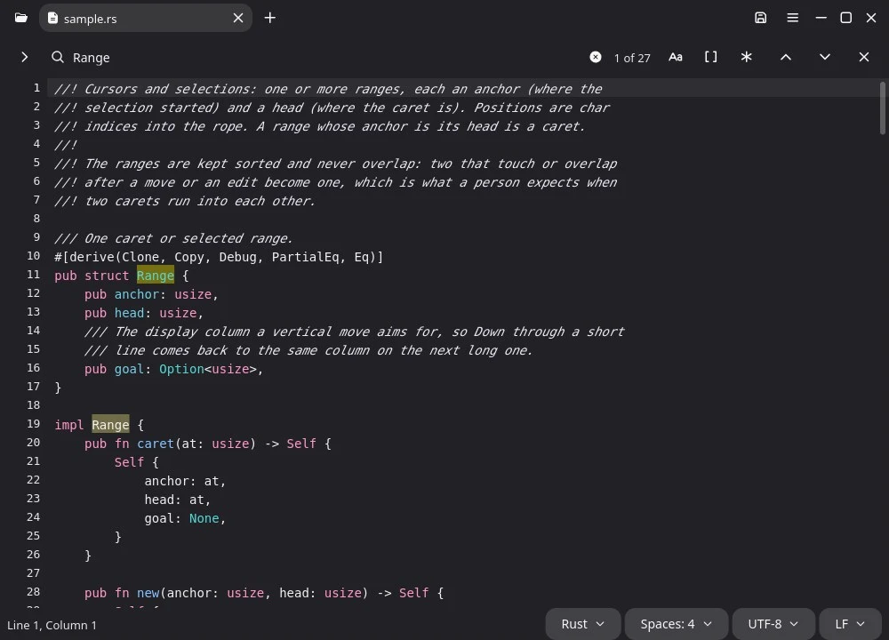

# Text Editor

Text Editor (`bingux-text-editor`) edits plain text and code. It opens with a
blank document ready to type in, or with the documents you had open last
time, including any changes you had not saved.



## Open and save

| To                           | Do                                                                                  |
| ---------------------------- | ----------------------------------------------------------------------------------- |
| Start a new document         | Ctrl+N or Ctrl+T, the + beside the tabs, or just type in an empty window            |
| Open a file                  | Ctrl+O, the folder button, drag files into the window, or `bingux-text-editor FILE` |
| Open a recent file           | Main menu ▸ Open recent                                                             |
| Save                         | Ctrl+S, or the disk button                                                          |
| Save under another name      | Ctrl+Shift+S                                                                        |
| Close a document             | Ctrl+W or the tab's ×; a document with changes asks Save, Discard or Cancel         |
| Bring back a closed document | Ctrl+Shift+T                                                                        |

- **Nothing typed is lost.** Two seconds after a change, the text is written
  as a draft in `~/.local/state/bingux/text-editor/drafts/`. If the window
  closes, the computer restarts or the program stops, the next start opens the
  same documents with their changes. A draft is deleted when its document is
  saved, or closed with Discard.
- **Each file opens where you left it.** The caret and scroll position of the
  last 500 files are remembered.
- **A file that changes on disk** while it is open is read again by itself
  when the document has no unsaved changes, with an Undo in the notice. With
  unsaved changes, a notice offers Read again or Keep mine. A file moved or
  deleted says so and offers Save.
- **A file you cannot write** opens normally with a notice; Save asks for a new
  place.
- **A file that is not text** (a program, a picture) shows "This file is not
  text" with Open anyway, so it is not damaged by accident.
- Saving writes to a temporary file in the same folder and renames it over the
  old one, so a full disk or a crash never leaves half a file. The file keeps
  its permissions, and a link stays a link.
- A file name that does not exist yet (`bingux-text-editor notes/new.md`) opens
  as an empty document that is saved there.

## Encodings and line endings

The status bar shows the language, the indentation, the encoding and the line
endings of the document; each is a menu.

| Situation                                                       | What happens                                                                                                |
| --------------------------------------------------------------- | ----------------------------------------------------------------------------------------------------------- |
| UTF-8, with or without a byte order mark                        | Read and written back the same way                                                                          |
| UTF-16 (with or without a byte order mark)                      | Detected and written back as UTF-16                                                                         |
| A legacy encoding (Windows-1252, Shift_JIS, GBK, KOI8-R, …)     | Detected from the bytes; saving writes the same encoding                                                    |
| UTF-8 with some Latin-1 lines in it (a file two programs wrote) | Both parts read correctly; a notice says saving writes it all as UTF-8                                      |
| Bytes that do not fit the detected encoding                     | A notice says they show as � and that saving replaces them; the encoding menu ▸ Read again as tries another |
| A character the file's encoding cannot hold, on save            | Save stops and offers Save in UTF-8                                                                         |
| CRLF, LF or CR line endings                                     | Kept; Line endings changes them; a file that mixes them is written with the most common one                 |

The editor reads `.editorconfig` files from the file's folder upwards:
`indent_style`, `indent_size`, `tab_width`, `end_of_line`,
`trim_trailing_whitespace` and `insert_final_newline` override the
preferences for that file.

## Editing

Languages are recognised from the file name, the extension, a `#!` line, or a
Vim or Emacs modeline (`vim: set ft=python:`, `-*- mode: ruby -*-`), and
coloured with the grammars of about 200 languages. The status bar's language
menu changes it. Indentation is detected from the file (tabs, or 2, 4 or 8
spaces); the indentation menu changes it.

| Keys                                        | Do                                                                    |
| ------------------------------------------- | --------------------------------------------------------------------- |
| Ctrl+D                                      | Duplicate the line, or the selection                                  |
| Alt+Up, Alt+Down                            | Move the line up or down                                              |
| Ctrl+Shift+K                                | Delete the line                                                       |
| Ctrl+J                                      | Join the next line                                                    |
| Ctrl+/                                      | Comment or uncomment the lines                                        |
| Home                                        | The first character after the indentation, then the start of the line |
| Ctrl+Backspace, Ctrl+Delete                 | Delete a word                                                         |
| Ctrl+Enter, Ctrl+Shift+Enter                | A new line below or above, wherever the caret is                      |
| Tab, Shift+Tab                              | Indent or outdent the selected lines                                  |
| Ctrl+L                                      | Select the line (again for the next)                                  |
| Ctrl+M                                      | Go to the matching bracket                                            |
| Alt+click, Ctrl+Alt+Up, Ctrl+Alt+Down       | Add a caret                                                           |
| Ctrl+Shift+D                                | Add the next occurrence of the selection as a selection               |
| Ctrl+Shift+L                                | Select every occurrence                                               |
| Escape                                      | Back to one caret                                                     |
| Ctrl+Z, Ctrl+Shift+Z                        | Undo and redo, a burst of typing at a time                            |
| Ctrl+=, Ctrl+-, Ctrl+0, Ctrl with the wheel | Zoom                                                                  |
| Alt+Z                                       | Wrap lines                                                            |

Typing a bracket or a quote adds its closer, typing the closer steps over it,
and a selection typed over with a bracket is wrapped instead. Enter keeps the
indentation and indents after an opening bracket. Copy and Cut with nothing
selected take the whole line, and pasting it puts it above the caret's line.
Main menu ▸ Text has sort lines, change case and remove trailing spaces.

## Find and replace

| Keys                                     | Do                                                       |
| ---------------------------------------- | -------------------------------------------------------- |
| Ctrl+F                                   | Find, with the selected text as the query                |
| Ctrl+H                                   | Find and replace                                         |
| Enter, Shift+Enter, F3, Shift+F3, Ctrl+G | Next and previous result                                 |
| Alt+Enter                                | Select every result (a caret on each)                    |
| Alt+C, Alt+W, Alt+R                      | Match case, whole words, regular expression              |
| Ctrl+I                                   | Go to a line, or `line:column`, or `+10` lines from here |

A plain query ignores case until it has a capital letter. Replace all is one
undo step. With a regular expression, `$1` in the replacement is the first
group, and `\n` and `\t` are a new line and a tab.

## Markdown preview

A Markdown file shows its preview beside the text (Ctrl+Shift+V turns it on
and off; on a phone the status bar's menu switches between them). The preview
follows the part of the text on screen, and a link opens in the browser.

## Large files

Only the lines on screen are laid out and drawn, so a large log opens and
scrolls quickly; a line longer than 10,000 characters is drawn a part at a
time. Files over 8 MB are not coloured, and drafts are not written for
documents over 64 MB (the file itself is the copy).

## Preferences

Main menu ▸ View and ▸ Editing hold the preferences, kept in
`~/.config/bingux/text-editor.json`:

| Preference                | Default |
| ------------------------- | ------- |
| Line numbers              | On      |
| Wrap lines                | On      |
| Show spaces and tabs      | Off     |
| Highlight current line    | On      |
| Markdown preview          | On      |
| Close brackets and quotes | On      |
| Trim spaces on save       | Off     |
| End with a new line       | On      |

## Make it the default text editor

```sh
xdg-mime default bingux-text-editor.desktop text/plain
```

The desktop entry lists the common text and source types, so a file manager
offers Text Editor for them.

## For developers

The window is `apps/text-editor`. The editing surface, find bar, go-to-line
bar and Markdown view are `bingux_ui::text_editor` (`docs/bingux-ui.md`,
"Text editor"), and the text engine (rope, undo, encodings, languages,
highlighting) is the `bingux-text` crate in `crates/text`.

`bingux-text-editor --snapshot DIR [FILE]` (built with `--features snapshot`)
renders the window to PNG without a compositor, and `--bench-typing FILE`
reports how long reading a file and each key press take.
