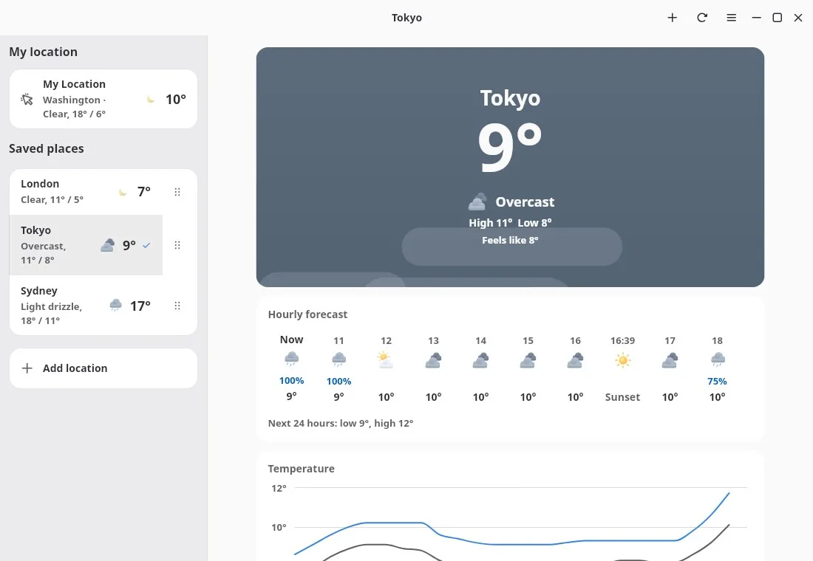
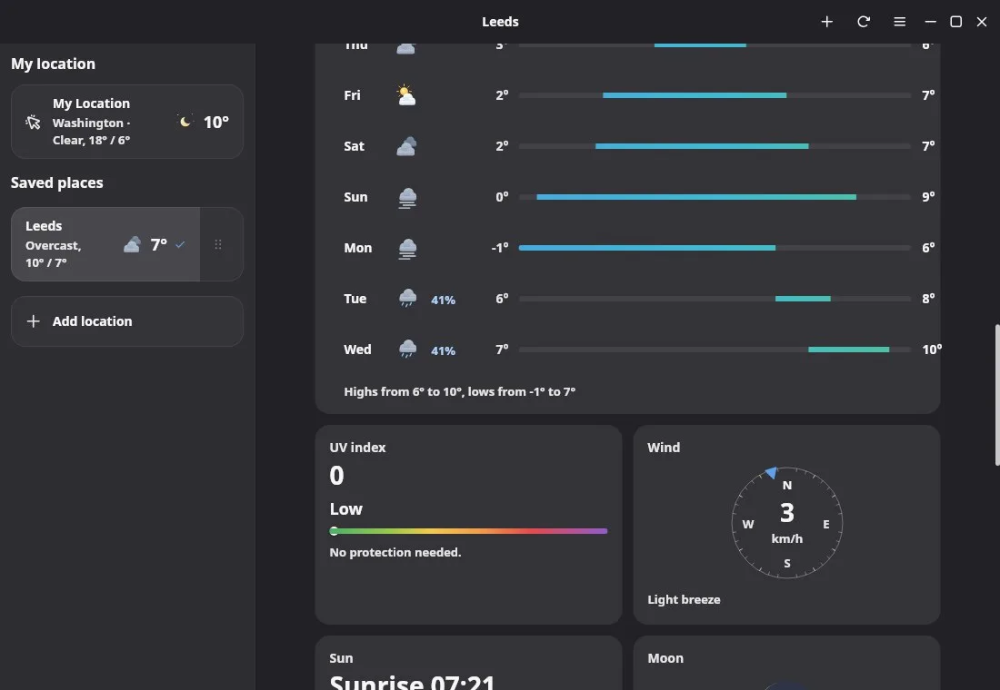
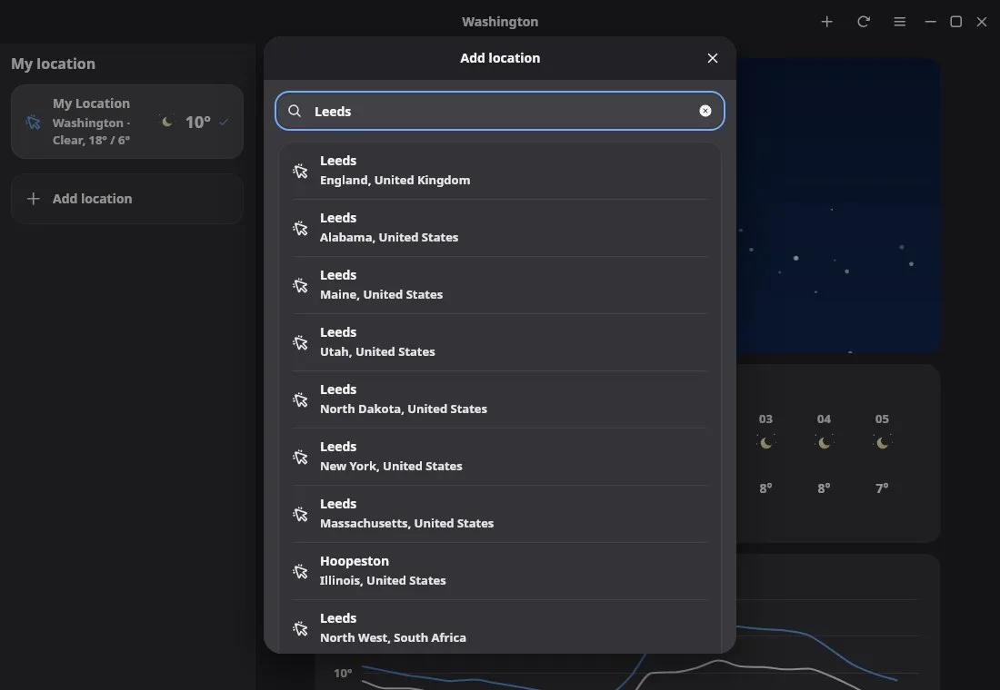
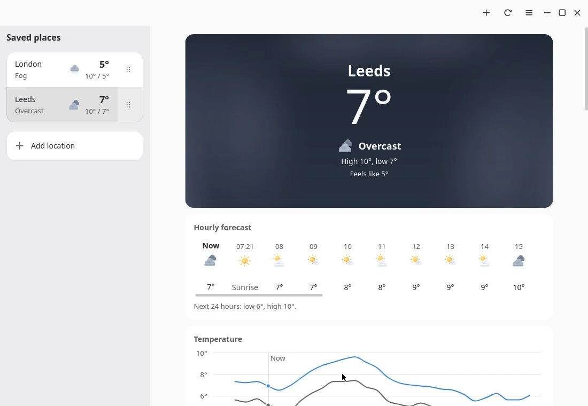
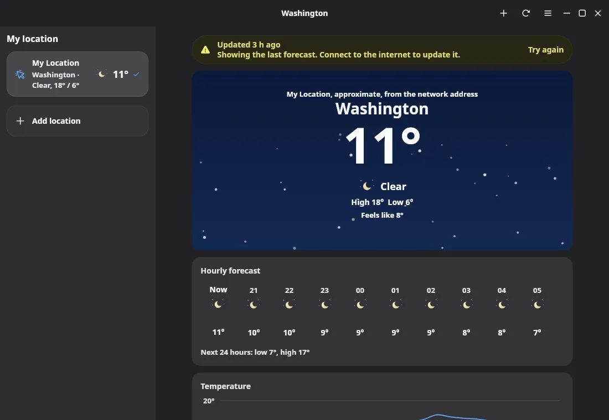

# Bingux Weather

Weather shows the conditions now, the next 24 hours and the next ten days for
the place the computer is in and for the cities you add. It needs no account,
no key and no setup: the first launch finds where the computer is and shows its
forecast.

## Open it

- Search for "Weather", or open it from the launcher or the dock.
- From a terminal: `bingux-weather`.

Only one Weather window runs. A second launch raises it.

## What it shows

| Part                 | What it says                                                                                                   |
| -------------------- | -------------------------------------------------------------------------------------------------------------- |
| Hero                 | The place, the temperature, the conditions, the day's high and low, how it feels and when rain starts or stops |
| Notices              | Conditions worth a warning in the next day and a half (see below)                                              |
| Hourly forecast      | An hour to a tile, with sunrise and sunset where they fall                                                     |
| Temperature          | A chart of the next 24 hours, with how it feels                                                                |
| Precipitation        | A chart of rain or snow in the next 24 hours                                                                   |
| 10-day forecast      | A day to a line, with the day's low and high as a bar on the range of the whole period                         |
| UV index             | The index, its band and what it asks of you                                                                    |
| Wind                 | A compass with the direction the wind comes from, the speed, and gusts                                         |
| Sun                  | Sunrise and sunset on an arc, with the sun where it is, and the length of the day                              |
| Moon                 | The phase, how much is lit and the next full or new moon                                                       |
| Feels like           | The apparent temperature and what makes it differ                                                              |
| Humidity             | The humidity and the dew point                                                                                 |
| Visibility, pressure | How far you can see, and the pressure with its trend and a small chart                                         |
| Air quality          | The US air quality index on its bands, and each pollutant                                                      |

The hero's sky follows the conditions and the light: a clear day is blue, a
clear night is dark with stars, rain is grey with streaks, and the hour round
sunrise and sunset is warm. The sky stands still, so it makes no motion for
someone who asked for reduced motion.

### Notices

Open-Meteo does not carry the warnings that national weather services issue, so
Weather shows none of those. The notices are read from the forecast itself:
thunderstorms, heavy rain, freezing rain, heavy snow, strong gusts, extreme heat
or cold, a very high UV index and unhealthy air. They are labelled as what they
are: what the forecast says, not an official alert. Check your national service
for warnings that matter for your safety.

## Where you are

"My Location" is found, in this order, with:

1. **The desktop's location service** (the Location portal, GeoClue behind it),
   when there is one. The desktop asks you once. If you say no, Weather does not
   go round it: it asks for a city instead.
2. **The network address**, when there is no location service. A keyless lookup
   (ipwho.is, then geojs.io, then ipapi.co) gives a position as good as the city,
   about 25 km. The lookup service sees the computer's address.
3. **A city you choose**, when neither works.

The list says which one was used, under "My Location" ("From the location
service", or "Approximate, from the network address"), and so does the hero.
Turn **Use my location** off in the menu to use only the cities you add. A town
name for a position is looked up from OpenStreetMap's Nominatim.

Nothing about the position is kept except the last place found, so the next
launch shows it before the new lookup has finished.

## Cities

Choose **Add location** (Ctrl+N), type a city or town, and choose a match.
Open-Meteo's search finds it. Drag a row by its grip, or press Alt+Up and
Alt+Down on it, to reorder the list. Delete, or **Remove** in the row's menu,
takes a city off.

On a phone-sized window the page fills the window, and the Back button in the
header shows the list.

## Units

Units follow your locale (`LC_ALL`, then `LC_MEASUREMENT`, then `LANG`) until you
choose: Fahrenheit, miles per hour, inches and a 12-hour clock for the United
States; miles per hour with Celsius and millimetres for the United Kingdom;
metric elsewhere. **Units** in the menu sets the temperature (Celsius or
Fahrenheit), the wind speed (kilometres per hour, miles per hour or metres per
second) and the precipitation (millimetres or inches), or goes back to
**Automatic**. Pressure is in inches of mercury where precipitation is in
inches, and hectopascals otherwise; visibility is in miles where wind is in
miles per hour, and kilometres otherwise.

## Offline

Each place's last forecast is kept. With no network, Weather shows it, with a
banner that says how old it is and a **Try again** button.

A forecast younger than ten minutes is not fetched again. The window looks for
a newer one every ten minutes while it is open, and Ctrl+R fetches again unless
the forecast is less than half a minute old.

## Keys

| Key                          | Does                                     |
| ---------------------------- | ---------------------------------------- |
| Ctrl+R, F5                   | Refresh                                  |
| Ctrl+N                       | Add a location                           |
| Ctrl+Shift+C                 | Copy the conditions as a line of text    |
| Ctrl+Page Down, Ctrl+Page Up | The next and previous place              |
| Left, Right                  | Look at each hour on the hourly forecast |
| Up, Down                     | Look at each day on the 10-day forecast  |
| Home, End                    | The first and last hour or day           |
| Alt+Up, Alt+Down             | Move the focused place in the list       |
| Delete                       | Remove the focused place from the list   |
| Ctrl+Shift+?                 | About Weather                            |

Pointing at an hour or a day, or touching it, chooses it too. Pointing at a
point of the temperature chart, or a bar of the precipitation chart, shows its
value; on a touch screen, press and hold.

## Data and licence

The forecast, the air quality and the city search are
[Open-Meteo](https://open-meteo.com)'s. Open-Meteo needs no key; its data is
licensed [CC BY 4.0](https://creativecommons.org/licenses/by/4.0/) and its free
service is for non-commercial use. The window says "Weather data by
Open-Meteo.com" at the bottom of the page, with a link.

Open-Meteo answers in metric units and in the place's own time zone. The model
keeps both as they come and converts only when it writes a number.

## Files

| Path                                             | Holds                                             |
| ------------------------------------------------ | ------------------------------------------------- |
| `$XDG_CONFIG_HOME/bingux/weather/settings.json`  | The saved places, the units and the place on show |
| `$XDG_CONFIG_HOME/bingux/weather/here.json`      | Where the computer was last found                 |
| `$XDG_CACHE_HOME/bingux/weather/forecast-*.json` | The last forecast of each place                   |

`BINGUX_WEATHER_DIR` puts both under one folder (`config/` and `cache/`), for a
test or a screenshot that must leave your own alone. `HTTPS_PROXY` is honoured.

## Troubleshooting

- **"No connection"**: Weather could not reach the internet. Check the
  connection and choose **Try again**. If a forecast was saved it stays on
  screen meanwhile.
- **"My Location" says the location is turned off for this app**: the desktop
  refused the position. Add a city instead, or allow it in the desktop's
  privacy settings and choose **Try again**.
- **The wrong city**: a position from the network address is approximate and can
  name a neighbouring city, or the city of the network's provider. Add the city
  you want, or turn **Use my location** off.

## For developers

- `crates/weather` (`bingux-weather`) has no UI: the Open-Meteo client, the
  forecast model (metric, every time as wall-clock seconds at the place), WMO
  weather codes, units, the moon, the notices, and the settings and cache.
  `cargo test --manifest-path crates/weather/Cargo.toml` runs its tests.
- `bingux_ui::location` finds the position (see
  [Location](bingux-ui.md#location)); it needs the `location` feature.
- The compass, the day arc and the range bar are bingux-ui charts (see
  [Charts](bingux-ui.md#charts)), and the temperature and precipitation charts
  are its line and bar charts.
- `apps/weather` holds the pages. `bingux-weather --snapshot DIR` (a build with
  `--features snapshot`) writes `weather.png`, `weather-details.png` and
  `weather-bottom.png`; `BINGUX_WEATHER_SNAPSHOT_SIZE=390x800` renders a phone.
